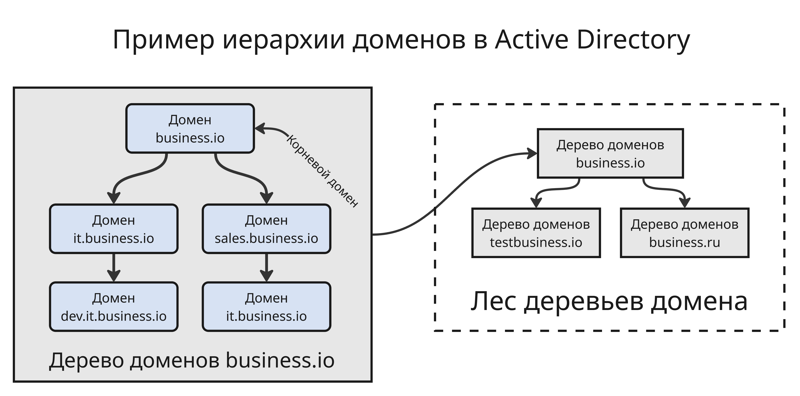

## Лекция 4. Active Directory

Одной из частых задач, которую выполняет Windows Server, - это централизованное управление пользователями и доступом в инфраструктуре рабочих станций (чаще всего в офисах). Одним из инструментов для этого является служба каталогов Active Directory, которая обеспечивает информационную безопасность

### Введение в информационную безопасность

Информационная безопасность - это процесс обеспечения конфиденциальности, целостности и доступности информации, где:

* Конфиденциальность - обеспечение доступа к информации только авторизованным пользователям
* Целостность - обеспечение достоверности и полноты информации и методов ее обработки
* Доступность - обеспечение доступа к информации и связанным с ней активам авторизованных пользователей по мере необходимости

Для обеспечения доступа существуют 3 процесса:

* Идентификация - процесс **распознавания** субъекта в компьютерной системе или на веб-ресурсе при помощи анализа его идентификатора (либо имени и пароля, либо любой другой информации о пользователе, которая воспринимается системой)
* Аутентификация (от англ. authentication) - процесс **проверки принадлежности** субъекту прав доступа к информационным ресурсам системы

    Субъекты (например, пользователь или устройство) идентифицируются по идентификатору безопасности (Security ID, SID), который уникален в пределах жизни системы. Имя субъекта и разрешения являются атрибутами структуры, привязанной к идентификатору безопасности

    Аутентификацию можно осуществлять по:

    * Знанию, которым владеет субъект
    * Свойству данных субъекта (такие методы называются биометрическими)
    * Предмету, который принадлежит субъекту (например, ключ-карта)
    * Информации, которая имеет непосредственное отношение к субъекту

    Также аутентификация бывает:

    * Односторонней, которая проверяет подлинность одной стороны (например, проверка подлинности сайта по HTTPS)
    * Двусторонней, где проверяется подлинность системы и субъекта

* Авторизация - процесс **проверки прав** пользователя на осуществление определенных действий в системе. Авторизация проходит в два последовательных этапа:

    1. Определение возможности доступа пользователя в компьютерную систему посредством идентификации и аутентификации
    2. Одобрение или отклонение запроса на доступ

    Главным образом авторизация необходима для сохранения конфиденциальности и целостности информации в системе

Всего есть два классических механизма для обеспечения безопасности:

* Дискреционное управление доступом (Discretionary Access Control, DAC), обычно в форме списка управления доступом (Access-Control List, ACL)

    Список управления доступом состоит из записей контроля доступа (Access-Control Entry, ACE) и определяет права субъектов на объект, к котором привязан список. Такой список может наследоваться и дополняться при наследовании

    Запись контроля доступа содержит идентификатор безопасности (SID), маску разрешений и маску запретов. Из вычитания множества запретов из множества разрешений образуются эффективные права, которые применяются в данный момент

    Запреты полезны в тех случаях, если нужно, чтобы пользователь имел меньше прав, чем предоставляется другим пользователям в его группе (маску запретов также называют фильтром наследования прав в операционной системе Novell NetWare и службе каталогов Novell eDirectory)

    Такая модель чаще всего используется в операционных системах (например, в Linux и других системах по стандартам POSIX), в базах данных (в том числе СУБД от Microsoft) и файловых системах (в том числе NTFS)

* Мандатное управление доступом (Mandatory Access Control, MAC), где пользователь не может полностью управлять доступом к ресурсам, которые он создает, а доступ определяет политика системы по меткам

---

Можно выделить 3 архитектуры безопасности:

1. Одноранговые (или автономные) - каждый узел имеет собственную локальную службу безопасности и локальную базу субъектов. В такой архитектуре у пользователя есть учетные записи на каждом компьютере
2. Централизованные - на каждом узле есть локальная служба безопасности, но она выступает клиентом централизованной службы. В такой архитектуре есть служба каталогов на централизованном узле, к которому обращаются другие компьютеры в сети для аутентификации и авторизации
3. Распределенные - каждый узел имеет локальную службу безопасности, которая является клиентом распределенной службы - то есть системы, где нет одного абсолютного центра доверия, а есть несколько доверенных участников

Служба каталогов - это сетевой сервис, предоставляющий централизованные средства управления ресурсами автоматизированной системы

Основные функции службы каталогов - это управление пользователями, управление ресурсами, разграничение прав доступа, поиск ресурсов, распространение сетевых политик и интеграция с другими сервисами

Примерами служб каталогов являются:

* Network Information Service (NIS, ранее назывался Yellow Pages, YP) - служба каталогов от Sun Microsystems
* OpenLDAP - открытая служба каталогов, реализующая протокол LDAP (Lightweight Directory Access Protocol)
* Apache Directory Server (ApacheDS) - служба каталогов от Apache Software Foundation, совместимая с LDAP
* И Active Directory - служба каталогов в Windows

### Служба каталогов Active Directory

По умолчанию в каждой операционной системе Windows (в том числе потребительской версии) для локальной аутентификации используется подсистема локальной безопасности (Local Security Authority, LSA) и диспетчер учетных записей безопасности (Security Account Manager, SAM)

Active Directory (AD) - это служба каталогов, появившаяся в Windows 2000 Server, которая обеспечивает централизованное управление учетными записями пользователей, компьютерами, правами доступа и политиками безопасности. В Windows Server 2008 служба Active Directory была переименована в Active Directory Domain Services (Службы домена Active Directory, AD DS) для различения от других продуктов семейства: Certificate Services (AD CS), Federation Services (AD FS), Lightweight Directory Services (AD LDS) и Rights Management Services (AD RMS)

Active Directory позволяет решить такие проблемы как множественная аутентификация, управление учетными записями, масштабирование систем аутентификации и авторизации

Особенности Active Directory:

* Централизованный репозиторий данных
* Распределенная архитектура
* Средство авторизации и аутентификации
* Средство управления субъектно-объектными отношениями. Важно подметить, что в Active Directory объекты могут быть субъектами
* Система хранения данных
* Логическая структура в виде дерева, хранящего два типа объектов (контейнеры и листья)
* Использование пространства имен DNS для именования доменов и поиска контроллеров

Active Directory хранит сведения идентификации пользователей, приложений и ресурсов в базе данных `ntds.dit`, которая основана на технологии Extensible Storage Engine (ESE, также известна как JET Blue - от Joint Engine Technology) и способна работать с несколькими хозяевами (multi-master). Все данные в этой базе данных могут изменяться на любом узле, кроме тех узлов, что установлены в режим для чтения

Для доступа к данным можно использовать открытые протоколы (LDAP) или стандартизованные интерфейсы ADSI (Active Directory Service Interfaces) с множеством интерфейсов COM (Component Object Model). Также Active Directory позволяет создавать и расширять собственные объекты и атрибуты

Для поиска объектов можно использовать стандартизированные запросы или стандартные интерфейсы доступа к объектам

Также `ntds.dit` может храниться в виде реплик на разных контроллерах домена (компьютеры, которые управляют AD DS), а данные могут изменяться на любом из них и реплицироваться на другие контроллеры. Репликация каталога `SYSVOL` с данными AD DS разделяется на два направления:

* Входящая репликация (Inbound Replication) - процесс, при котором контроллер домена инициирует сеанс связи, запрашивает и получает изменения от своих партнеров (реализация pull-модели)
* Исходящая репликация (Outbound Replication) - процесс, при котором контроллер домена формирует и отдает пакет своих изменений партнерам в ответ на их входящие запросы

В репликации участвует служба DFS-R (Distributed File System Replication) через протокол RPC (Remote Procedure Call). Ранее репликация производилась через службу FRS (File Replication Service), и была поддержка репликации через почтовый протокол SMTP (Simple Mail Transfer Protocol)

Active Directory обладает встроенными возможностями устойчивости к отказам. База данных со множеством хозяев и имеющиеся контроллеры домена позволяют пользователям продолжать аутентификацию и авторизацию из любого доступного контроллера домена в любой момент времени

Active Directory также обладает гибким механизмом назначения прав на основе списка управления доступом (ACL) и позволяет применять различные виды аутентификации, такие как парольные методы, сертификаты, аппаратные ключи и так далее. Для аутентификации применяются протоколы Kerberos 5 и NTLM (New Technology LAN Manager, протокол ныне устарел)

Также Active Directory поддерживает технологию единого входа SSO (Single Sign-On) - сторонние приложения и сервисы (в том числе за пределами экосистемы Windows) могут аутентифицироваться в AD DS, что обеспечивает простоту управления учетными данными и единые механизмы интеграции

Помимо этого Active Directory позволяет гибко настраивать среду через групповые политики и административные шаблоны, а также помогает проводить аудит - процесс независимой проверки и оценки конфигураций и результатов работы

### Логические компоненты

Основным компонентом в Active Directory является домен (Domain). Домены объединяются в деревья доменов (Domain Tree), а деревья - в леса. Внутри домена существуют организационные подразделения (OU, Organizational Unit), а они в свою очередь хранят объекты (так называемые листья) - пользователи, группы, компьютеры, принтеры, каталоги и прочее

Организационное подразделение является контейнерным объектом и соответствует административному подразделению организации (например, разные отделы - бухгалтерия, маркетинг и так далее), но может решать технические задачи (например, по региональной принадлежности). Организационное подразделение служит для группировки объектов, применения групповых политик и делегирования управления

Домен является минимальной областью безопасности в AD DS и основным контейнерным объектом, соответствует бизнес-организации и имеет свои собственные характеристики, границы и ресурсы. Также домен имеет свое доменное имя

Дерево доменов (Domain Tree) является коллекцией доменов (одного или нескольких), которая отражает организационную структуру

Домены в дереве ограничены связью предок-потомок. Самый первый домен в выбранном дереве домена именуется родительским доменом и также является корневым доменом. Все прочие домены в этом дереве называют доменами потомков или дочерними доменами. Внутри дерева доменов домены образуют непрерывное пространство имен DNS, таким образом, имя DNS домена-родителя является суффиксом имени DNS домена-ребенка

Лесом называют полностью самостоятельную организацию Active Directory, которая имеет определенный набор атрибутов и является периметром безопасности организации. В состав леса могут входить как одно, так и несколько доменных деревьев. Все объекты, создаваемые внутри леса, имеют общий набор атрибутов, который определяется схемой Active Directory

Для именования объектов используется несколько способов:

* LDAP URL, например, `LDAP://server.firma.local/CN=Fedor Sumkin,OU=My-Unit,DC=Firma,DC=local`
* Отличительное имя (Distinguished Name, DN) по стандарту X.500, например, `CN=Fedor Sumkin,OU=My-Unit,DC=Firma,DC=local`
* Относительное отличительное имя (Relative Distinguished Name, RDN), например, `CN=Fedor Sumkin`
* Каноническое имя, например, `Firma.local\My-Unit\Fedor Sumkin`
* UPN (User Principal Name) по стандарту RFC 822, используется при входе, например, `Fedor@firma.local`

Между доменами могут быть установлены доверительные отношения для обеспечения доступа к ресурсам одного домена пользователям другого:

* Между связанными доменами внутри дерева автоматически устанавливаются доверительные отношения (Родительско-дочернее доверие, Parent-Child Trust) - они будут двусторонними (то есть при установлении такого обе стороны имеют доступ к ресурсам друг друга) и транзитивными (если пары доменов A и B, B и C доверяют друг другу, то A и C доверяют друг другу)
* Между корневыми доменами деревьев одного леса автоматически устанавливаются двусторонние и транзитивные доверительные отношения (Доверие корня дерева, Tree-Root Trust)
* Между доменами из разных лесов можно установить доверительные отношения (Внешнее доверие, External Trust), двусторонние или односторонние
* Между доменами разных деревьев внутри одного леса можно вручную установить доверительные отношения (Перекрестное доверие, Shortcut Trust) - они являются транзитивными и могут быть односторонними или двусторонними. Такие отношения позволяют повысить эффективность взаимодействия между двумя доменами
* Между корневыми доменами разных лесов доверительные отношения  (Доверие лесов, Forest Trust) устанавливаются вручную и могут быть двусторонними или односторонними, транзитивными или нетранзитивными

Также доверительные отношения можно установить между доменом и сторонним сервисом, поддерживающим Kerberos (Доверие области, Realm Trust)

### Физические компоненты

Компьютер, который работает под управлением Windows Server и выполняет роль Службы домена Active Directory (AD DS), называют контроллером домена

Контроллер домена может быть и физическим, и виртуальным (то есть с установленной AD DS на виртуальную машину). Количество контроллеров внутри одного пространства имен практически не ограничено

Уровень функциональности контроллера домена определяет набор правил поведения службы каталогов на уровне схемы, протоколов, встроенных атрибутов и другое. Такой уровень определяется версией Windows Server, но для обратной совместимости современные версии поддерживают уровни из старых версий Windows (например, AD DS в Windows Server 2012 R2 может работать на уровне функциональности Windows Server 2008), что позволяет сделать миграцию на новые версии ОС плавнее. Выделяют уровень функциональности для домена и для леса

Контроллеры равнозначны, но могут выполнять уникальные роли FSMO (Flexible Single-Master Operation), которые гарантируют синхронизацию данных. Всего таких ролей 5:

* Уникальных для одного леса:

    1. Хозяин схемы (Schema Master) - отвечает за любые изменения в схеме Active Directory (структуре классов и атрибутов)
    2. Хозяин именования доменов (Domain Naming Master) - управляет добавлением или удалением доменов, а также разделов приложений в лесу Active Directory

* Уникальных для одного домена:

    3. Хозяин RID (RID Master) - выдает контроллерам домена блоки относительных идентификаторов (Relative ID, RID), которые используются для создания уникальных SID-номеров объектов (пользователей, групп, компьютеров). Без этой роли через некоторое время в домене станет невозможно создавать новые учетные записи
    4. Эмулятор PDC (PDC Emulator) - выполняет самые важные вспомогательные функции: обрабатывает старые пароли (Windows NT 4.0), выступает главным источником синхронизации времени для домена и координирует изменения групповых политик
    5. Хозяин инфраструктуры (Infrastructure Master) - отвечает за обновление ссылок на объекты из других доменов (сопоставляет GUID, SID и отличительные имена DN)

Также существует особый контроллер домена - "центральный справочник" (или сервер глобального каталога), который нужен для поиска объектов без рекурсивного обхода дерева и поиска по основным атрибутам

В файловой системе Windows служба каталогов Active Directory использует:

* Файл `ntds.dit`, хранящий базу данных
* Журнал транзакций `edb.log`
* Вспомогательные журналы
транзакций `edbxxxxx.log`
* Файл контрольной точки `edb.chk` для протоколирования транзакций для отметки времени внесения обновлений из файлов журналов в `ntds.dit`
* Временный файл `temp.edb`, в котором хранится информация о текущих транзакциях, а также страницы, извлеченные из базы данных `ntds.dit` во время сжатия

Ранее использовались файлы `res1.log` и `res2.log`, которые являлись резервными файлами журнала и использовались в случае переполнения системного раздела (сейчас эту роль выполняется монитор ресурсов)

<!-- · Площадки Active Directory - Site Active Directory
• определяются физической топологией сетевой среды.
• Конфигурируют взаимодействие в сетевой среде:
• Репликация - изменение интенсивности и протоколов репликации между
контроллерами и другими сервисами
· Локализация служб - определение ближайшего сервиса, например, Службы
сертификации, Службы обмена сообщениями Active Directory, сервером Microsoft
Exchange и дp.
• Аутентификация - аутентификация на ближайшем контроллере домена -->

