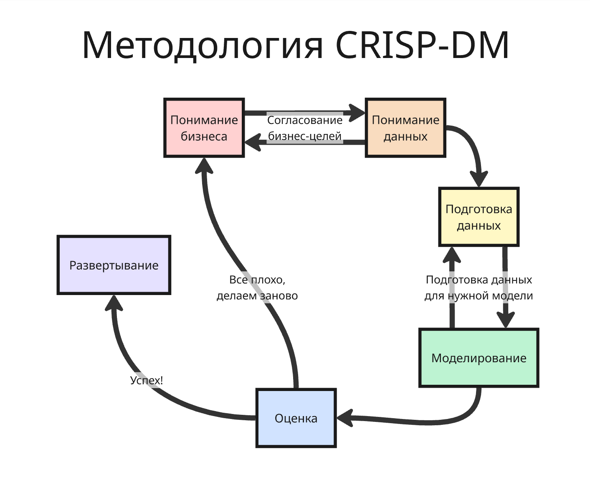
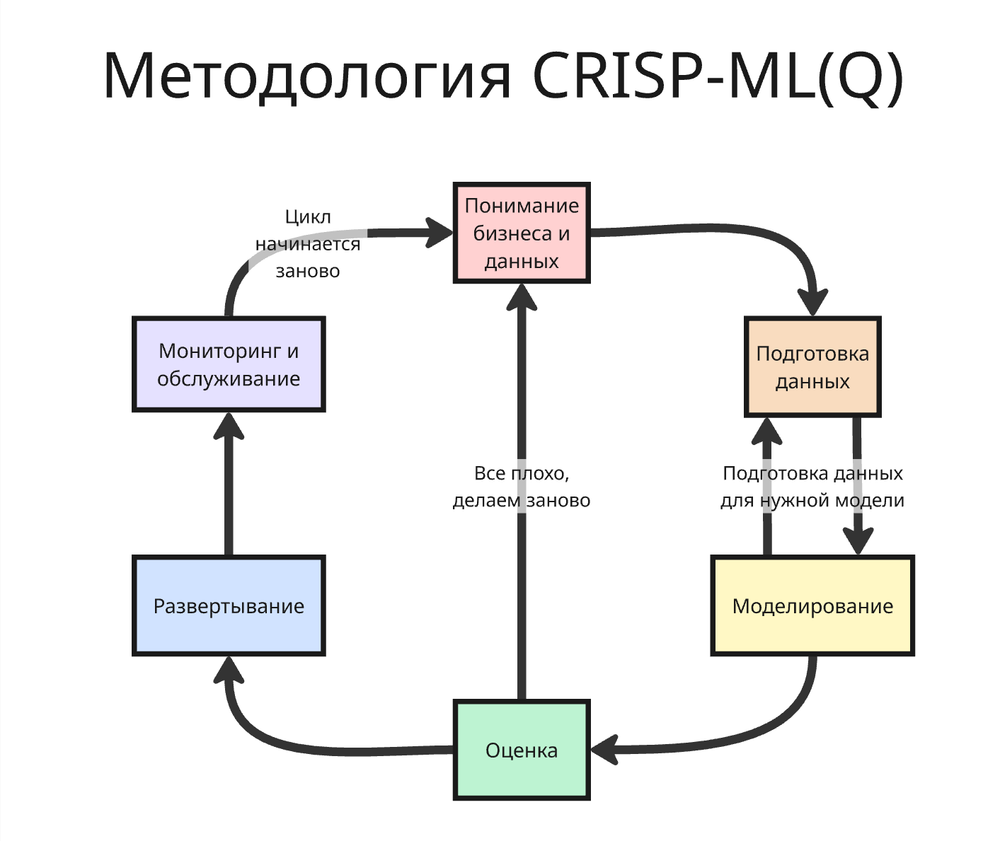

<script id="MathJax-script" async src="https://cdn.jsdelivr.net/npm/mathjax@4/tex-mml-chtml.js"></script>
<script>
window.MathJax = {
  tex: {
    inlineMath: {'[+]': [['$', '$']]}
  }
};
</script>

# Анализ данных и информационных поиск

Курс посвящен изучению анализа данных (в англ. Data Mining) и методов поиска данных

Анализ данных изучает такую задачу: есть запрос пользователя, на основе которого нужно проанализировать данные из базы и выдать подходящие отранжированные объекты

На курсе будут разбираться классические методы, рекомендательные системы, методы обучения ранжированию (Learning-to-Rank, LTR), семантический и генеративный поиск

## Лекция 1. Методология и структурный анализ данных

### Методология

При построении проекта, использующего анализ данных или поиск, нужно определиться с выбором методологии разработки и анализа, ведь проекты, включающие анализ данных, должны:

* быть надежными, то есть исполняться с предсказуемым результатом
* и быть повторяемыми, особенно людьми с малым опытом в анализе данных

Правильная методология предоставляет:

* Средства для сохранения опыта проектов, а накопленный опыт позволяет успешно повторять проекты
* Упрощение планирования и управления проектами
* Простоту включения в работу новых членов команды

---

Популярной методологией является CRISP-DM (CRoss Industry Standard Process for Data Mining), которая разбивает анализ данных на 6 этапов:

* Понимание бизнеса (Business Understanding) - определение целей проекта и требований со стороны бизнеса. Результатом данной фазы является постановка задачи в терминах анализа данных и предварительный план по ее решению

    Помимо бизнес-целей составляется список метрик, которые важны для бизнеса (например, прибыль, сокращение расходов), которые позволяют лучше сформулировать требования. Затем оцениваются ресурсы, ограничения, риски и другие факторы, которые важны для анализа данных

    Далее составляется план проекта, в котором описаны этапы, которые должны быть выполнены. Проект считается успешным, если выполнен установленный критерий, например, определенный уровень точности

* Понимание данных (Data Understanding) - сбор данных и первичное ознакомление

    Для этого необходимо выявить проблемы с качеством данных, такие как ошибки или пропуски, понять что за данные имеются в наличии, попробовать отыскать интересные наборы данных или сформировать гипотезы о наличии скрытых закономерностей в данных. Такой процесс называется разведочным анализом данных (Exploratory Data Analysis, EDA)

    Сначала данные собираются (самостоятельно или уже готовые наборы), далее данные описываются: их формат, количество данных, количество признаков и другие характеристики. Потом данные изучаются: визуализация, выяснение распределения признаков, их корреляция

    После этого проверяется качество данных - их полнота, корректность, пропущенные значения

* Подготовка данных (Data Preparation) - получение итогового набора данных, которые будут использоваться при моделировании

    Подготовка включает в себя отбор таблиц, записей и атрибутов, а также очистку и конвертацию данных для моделирования

    Отбор данных включает в себя алгоритмы, которые выбирают релевантные для проекта данные. Выбор данных включает как выбор признаков, так и выбор объектов. Далее данные очищаются, дополнительно из них создаются производные (например, с помощью порождения новых признаков)

    Далее данные при надобности агрегируют и приводят в нужный формат

* Моделирование (Modeling) - применение методик моделирования, построение моделей и настройка параметров

    Сначала выбирают конкретный метод моделирования (например, дерево решений или нейросеть), делаются тесты для валидации модели

    Затем эта модель обучается на подготовленных данных. Далее полученная модель оценивается 

* Оценка (Evaluation) - проверка достижения бизнес-целей перед внедрением модели

    На этом этапе проводится оценка результатов с точки зрения достижения бизнес-целей и выявление недостатков. Далее определяются следующие шаги: перевод в эксплуатацию, дополнительное исследование или начало проекта заново

* Развертывание (Deployment) - составление финального отчета или автоматизация процесса анализа данных

    Развертывание включает в себя подведение итогов и планирование поддержки и мониторинга проекта. Финальный отчет оценивает, что было сделано хорошо, а что плохо



---

По мере развития технологий выяснилось, что методология CRISP-DM, заточенная на статические данные, была недостаточной для машинного обучения, при котором данные имеют свойство меняться (такой процесс называется data drift), из-за чего модели устаревают и деградируют. Кроме этого часть проектов машинного обучения не оправдывают ожиданий из-за отсутствия системного контроля качества

Поэтому в 2021 году появилась методология CRISP-ML(Q) (Cross-Industry Standard Process for the development of Machine Learning applications with Quality assurance)

В CRISP-ML(Q) цикл разработки состоит из 6 фаз:

* Понимание бизнеса и данных - определение целей, бизнес-метрик и критериев успеха
* Подготовка данных - создание конвейера трансформации сырых данных: отбор признаков и борьба с размерностью, очистка, обработка выбросов и пропусков, балансировка классов
* Моделирование - построение модели с учётом ограничений целевой платформы
* Оценка модели - слайсовый анализ по разным подгруппам, проверка надежности к шуму
* Развертывание - настройка на целевом оборудовании
* Мониторинг и обслуживание - отслеживание деградации из-за изменения данных, поведения пользователей или оборудования



### Структурный анализ на основе графов

Граф $G(V, E)$ - структура, состоящая из множества $V$ вершин и множества $E$ соединяющих их ребер

Графы отлично могут представить большинство наборов связных данных, с которыми человек встречается в жизни, например, граф друзей или граф статей, где ребра - это упоминания одной статьи в другой

Граф можно представить:

* Как матрицу смежности $A$ (Adjacency Matrix), где ячейка матрицы $a_{i j}$ равна $0$, если связи между $i$-ой и $j$-ой вершинами нет, иначе есть

    Например:

    |   | A | B | C | D |
    | - | - | - | - | - |
    | A | 0 | 1 | 1 | 0 |
    | B | 0 | 0 | 1 | 0 |
    | C | 1 | 0 | 0 | 0 |
    | D | 0 | 0 | 1 | 0 |

    Если ячейки $a_{i j}$ и $a_{j i}$ не равны, то связь между вершинами односторонняя

    Дополнительно в ячейках может указываться вес ребра для взвешенных графов

    У матрицы есть недостаток - для разреженных графов (у которых число ребер намного меньше квадрата числа вершин) матрица занимает очень много места

* Список смежности (Adjacency List) - список, в котором для каждой вершины есть вложенный список связей к другим вершинам

    Например:

    | Вершина | Связи к вершинам |
    | - | - |
    | A | B, C |
    | B | C |
    | C | A |
    | D | C |

    Такой метод позволяет наиболее эффективно хранить разреженные графы

* Список ребер (Edge List), например:

    | Начало ребра | Конец ребра |
    | ------ | ------ |
    | A      | B      |
    | A      | C      |
    | B      | C      |
    | C      | A      |
    | D      | C      |

В Python для работы с графами можно использовать библиотеку `networkx`. Так, например, создается граф по списку ребер

```python
import pandas as pd
import networkx as nx

edges = pd.DataFrame({
    "source": ["A", "A", "B", "C", "D"],
    "target": ["B", "C", "C", "A", "C"]
})

G = nx.from_pandas_edgelist(
    edges,
    source="source",
    target="target",
    create_using=nx.DiGraph()
)
```

---

Рассмотрим два алгоритма для работы с графами:

1. Алгоритм PageRank ("ранжирование страниц" или "ранжирование Пейджа")

    В середине 1990-ых годов количество веб-страниц росло настолько быстро, что поисковые системы (такие как AltaVista, Lycos, Yahoo) перестали справляться с ранжированием результатов поиска, так как они оценивали HTML-документы в основном по количеству слов и их расположению

    Такой подход является уязвимым, так как можно увеличить частоту ключевых слов (тем самым увеличив позицию в выдаче) или увеличить число страниц-пустышек, ссылающихся на нужную страницу

    Поэтому в 1998 году Ларри Пейджем и Сергеем Брином был разработан алгоритм PageRank для поисковой системы BackRub (который был переименован в Google)

    Основная идея алгоритма PageRank состоит в том, что авторитет страницы определяется не количеством входящих ссылок, а авторитетностью страниц, которые на неё ссылаются. Для этого: 

    * Строится граф страниц, где ребра - это ссылка на другую страницу
    * Далее со случайной страницы запускается робот, который:

        * с шансом 85% переходит по случайной ссылке на текущей странице
        * или с шансом 15% закрывает текущую и открывает случайную новую

    Таким образом:

    * Граф превращается в цепь Маркова, где переходы заданы вероятностями
    * Страницы-пустышки не будут посещены часто, так как на них никто не ссылается и единственным образом туда попасть - это случайный открытие новой
    * Поэтому переходы из таких страниц будут учитываться меньше
    * А из-за случайного перехода на новую страницу граф не обязан быть связным

    Рейтинг страницы определяется рейтингом страниц, которые на неё ссылаются - $PR(A) = \frac{1-d}{N} + d \sum_{i=1}^{n} \frac{PR(T_i)}{C(T_i)}$, где $N$ - число страниц, $T_i$ - страница, ссылающаяся на $A$, $n$ - число таких страниц, $C(T_i)$ - количество исходящих ссылок, , $d$ - коэффициент затухания (та самая вероятность в 85%)

    Коэффициент затухания необходим, чтобы избегать тупики - ситуации, когда текущая страница не содержит ссылок, и ловушки - циклические переходы между страницами

    Наличие случайного перехода гарантирует существование единственного стационарного распределения вероятностей

    Интересно заметить, что с математической точки зрения алгоритм PageRank представляет собой вычисление собственного вектора матрицы переходных вероятностей марковской цепи

* Алгоритм HITS (Hyperlink Induced Topic Search)

    Алгоритм HITS был предложен в 1999 году Джоном Клейнбергом для нахождения веб-страниц

    HITS предполагает, что есть два вида страниц:

    * Авторитетные страницы, содержащие интересующие данные на заданный запрос
    * Хаб-страницы, которые содержат много ссылок на авторитетные страницы

    Затем HITS находит лучшие авторитетные и хаб-страницы

    Для этого алгоритм на каждой итерации:

    1. Обновляет ранг авторитетных страниц как сумму хаб-страниц, ссылающихся на нее: $a_i = \sum_{j \rightarrow i} h_j$
    2. Затем обновляет ранг хаб-страниц как сумму рангов авторитетных страниц, на которые хаб-страница ссылается: $h_i=\sum_{i\rightarrow j} a_j$
    3. Далее эти вектора нормируются: $\vec a = \frac{\vec a}{||\vec a||}$, $\vec h = \frac{\vec h}{||\vec h||}$

    Процесс повторяется до сходимости

    Алгоритм HITS используется значительно реже, чем алгоритм PageRank, так как:

    * Алгоритм зависит от запроса, для каждого поискового запроса необходимо сначала построить подграф релевантных страниц, а затем выполнить вычисления заново, что делает HITS более затратным
    * Если в подграф случайно попадает популярный, но слабо связанный с запросом узел, он может существенно исказить результаты ранжирования
    * Группы страниц, активно ссылающихся друг на друга, способны искусственно завышать значения $h_i$ и $a_i$

---

Как правило, граф не является входными данными для обучения, так как его нужно преобразовать в числовые признаки

Такие признаки извлекаются на трех уровнях:

* Весь граф, его топология

    Большинство реальных сетей являются безмасштабными и сетями "малово мира", то есть такими, где большинство вершин имеют мало связей, а меньшинство являются хабами, связывающие очень много вершин

    Такие сети устойчивы к случайному удалению вершин, но чувствительны к удалению хабов, а также имеют свойство, что между двумя случайными вершинами обычно существует короткий путь (например, на этом основана концепция "шести рукопожатий")

* Вершина графа и ее центральности. Различают несколько видов центральности:

    * Степенная центральность (Degree Centrality) - число связей вершины, для ориентированных графов различают входящую и исходящую степень
    * Центральность близости (Closeness Centrality) показывает, насколько близко вершина расположена ко всем остальным
    * Промежуточная центральность (Betweenness Centrality) показывает, сколько кратчайших путей проходит через вершину - такие вершины служат мостами между кластерами

* Локальное окружение вершины (кластеризация)

    Обнаружение кластеров (или сообществ) - это поиск групп вершин, связанных между собой плотнее, чем с остальным графом. Для этого применяют величину модулярности $Q = \frac{1}{2m} \sum_{ij} \left( A_{ij} - \frac{k_i k_j}{2m} \right) \delta(c_i, c_j)$, где $A_{ij}$ - матрица смежности, $k_i$ - степень вершины, $m$ - число ребер, $c_i$ - номер кластера вершины, $\delta(c_i, c_j)$ - предикат, равный 1, если вершины принадлежат одному кластеру

    Модулярность $Q$ сравнивает реальное число связей внутри кластера с ожидаемым случайным. Обычно $Q < 0.3$ означает отсутствие выраженной структуры, $0.3 < Q < 0.5$ значит, что кластеры различимы, а $Q > 0.5$ - граф хорошо разделяется

### Текстовый анализ

За историю человечества было написано множество текстов: книг, статей, рассказов, повестей и так далее. Исследователи, изучавшие такие тексты, сформулировали два эмпирических закона:

1. Закон Ципфа - частота слова $f(r)$ обратно пропорционально возведению в степень $s \approx 1$ ранга $r$ в списке: $f(r) \propto \frac{1}{r^s}$

    Пример: есть миллион статей, найдем частоту каждого слова

    |   Ранг | Слово     |   Частота |
    | -----: | --------- | --------: |
    |      1 | `и`       | 8 700 000 |
    |      2 | `в`        | 4 200 000 |
    |      3 | `не`       | 3 100 000 |
    |      4 | `на`        | 2 200 000 |
    |    ... | ...       |       ... |
    |   1000 | `иммерсивный` |       8200 |
    |  40000 | `эмерджентный` |         220 |
    |  70000 | `диегитический` |         100 |

    Слово `и` встретилось приблизительно в два раза чаще, чем `в`, приблизительно в три раза чаще, чем `не` и так далее

    Можно заметить, что часто употребимые слова содержатся в почти всех статьях, тогда как редкие слова могут служить ключевыми и быть связаны с темой документа

2. Закон Хипса - словарь увеличивается пропорционально возведению в степень $\beta \approx 0.5$ суммарного числа слов в статьях $n$: $V \propto n^\beta$

    Параметр $\beta$ характеризует скорость появления новых слов (обычно $0.4 \leq \beta \leq 0.6$)

    Например, при чтении более новые статьи будут использовать более новые термины, имена, сокращения и так далее, таким образом словарь языка никогда не является конечным

    По этой причине словарь нельзя составить заранее, вместо этого методы анализа используют другие подходы, например, разделение слов на части

Методы анализа не умеют работать с текстом как таковым, поэтому перед обучением текст представляют в другом виде, обычно разбивая на несколько частей. Подходы представления текста разделяют на уровне:

* На уровне символов можно сделать токенизацию - разбить текст на слова (токены), или разбиение текста на предложения
* На уровне слов можно разметить части речи и снять морфологическую неоднозначность (когда часть речи слова зависит от контекста)
* На уровне предложений можно выделить именные или глагольные группы, семантические роли или составить деревья составляющих и зависимостей
* На уровне смысла можно выделить синонимы, проанализировать аргументативные связи и разрешить кореферентность слов (например, для местоимений)

Обычно делают такую предобработку (количество этапов зависит от задачи):

* Токенизация - разделение текста на слова или другие части
* Нормализация - приведение к одному регистру, удаление пунктуации, исправление опечаток, удаление HTML-тегов, гиперссылок и другое
* Стемминг (от англ. stem - "стебель") - нахождение основы слова путем удаления окончания (обычно на основе эвристик)
* Лемматизация - точное приведение слов к словарной, начальной форм
* Удаление стоп-слов, которые не несут никакой смысловой нагрузки (например, предлоги, союзы)
* Морфологическая разметка (Part-of-Speech tagging) - разметка токенов частями речи (в том числе с зависимости от контекста)
