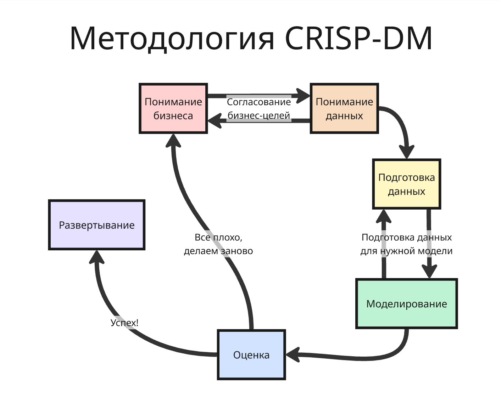
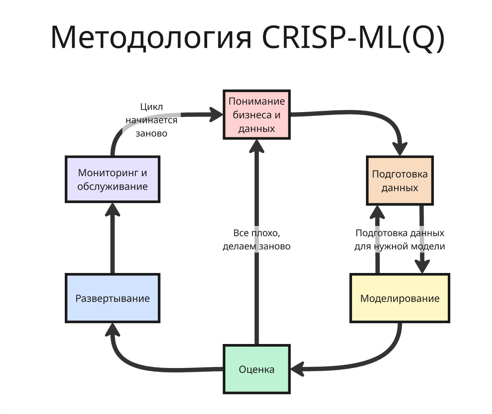

<!-- This file is generated by assets.build.markdown.superconspect_builder. All changes to it will be lost -->

<script id="MathJax-script" async src="https://cdn.jsdelivr.net/npm/mathjax@4/tex-mml-chtml.js"></script>
<script>
window.MathJax = {
  tex: {
    inlineMath: {'[+]': [['$', '$']]}
  }
};
</script>

# <a name="%D0%B0%D0%BD%D0%B0%D0%BB%D0%B8%D0%B7-%D0%B4%D0%B0%D0%BD%D0%BD%D1%8B%D1%85-%D0%B8-%D0%B8%D0%BD%D1%84%D0%BE%D1%80%D0%BC%D0%B0%D1%86%D0%B8%D0%BE%D0%BD%D0%BD%D1%8B%D1%85-%D0%BF%D0%BE%D0%B8%D1%81%D0%BA"></a> Анализ данных и информационных поиск

* [Анализ данных и информационных поиск](#%D0%B0%D0%BD%D0%B0%D0%BB%D0%B8%D0%B7-%D0%B4%D0%B0%D0%BD%D0%BD%D1%8B%D1%85-%D0%B8-%D0%B8%D0%BD%D1%84%D0%BE%D1%80%D0%BC%D0%B0%D1%86%D0%B8%D0%BE%D0%BD%D0%BD%D1%8B%D1%85-%D0%BF%D0%BE%D0%B8%D1%81%D0%BA)
  * [Лекция 1. Методология и структурный анализ данных](#%D0%BB%D0%B5%D0%BA%D1%86%D0%B8%D1%8F-1.-%D0%BC%D0%B5%D1%82%D0%BE%D0%B4%D0%BE%D0%BB%D0%BE%D0%B3%D0%B8%D1%8F-%D0%B8-%D1%81%D1%82%D1%80%D1%83%D0%BA%D1%82%D1%83%D1%80%D0%BD%D1%8B%D0%B9-%D0%B0%D0%BD%D0%B0%D0%BB%D0%B8%D0%B7-%D0%B4%D0%B0%D0%BD%D0%BD%D1%8B%D1%85)
    * [Методология](#%D0%BC%D0%B5%D1%82%D0%BE%D0%B4%D0%BE%D0%BB%D0%BE%D0%B3%D0%B8%D1%8F)
    * [Структурный анализ на основе графов](#%D1%81%D1%82%D1%80%D1%83%D0%BA%D1%82%D1%83%D1%80%D0%BD%D1%8B%D0%B9-%D0%B0%D0%BD%D0%B0%D0%BB%D0%B8%D0%B7-%D0%BD%D0%B0-%D0%BE%D1%81%D0%BD%D0%BE%D0%B2%D0%B5-%D0%B3%D1%80%D0%B0%D1%84%D0%BE%D0%B2)
    * [Текстовый анализ](#%D1%82%D0%B5%D0%BA%D1%81%D1%82%D0%BE%D0%B2%D1%8B%D0%B9-%D0%B0%D0%BD%D0%B0%D0%BB%D0%B8%D0%B7)
  * [Лекция 2. Классический поиск и вероятностное ранжирование](#%D0%BB%D0%B5%D0%BA%D1%86%D0%B8%D1%8F-2.-%D0%BA%D0%BB%D0%B0%D1%81%D1%81%D0%B8%D1%87%D0%B5%D1%81%D0%BA%D0%B8%D0%B9-%D0%BF%D0%BE%D0%B8%D1%81%D0%BA-%D0%B8-%D0%B2%D0%B5%D1%80%D0%BE%D1%8F%D1%82%D0%BD%D0%BE%D1%81%D1%82%D0%BD%D0%BE%D0%B5-%D1%80%D0%B0%D0%BD%D0%B6%D0%B8%D1%80%D0%BE%D0%B2%D0%B0%D0%BD%D0%B8%D0%B5)
    * [Основы поиска информации](#%D0%BE%D1%81%D0%BD%D0%BE%D0%B2%D1%8B-%D0%BF%D0%BE%D0%B8%D1%81%D0%BA%D0%B0-%D0%B8%D0%BD%D1%84%D0%BE%D1%80%D0%BC%D0%B0%D1%86%D0%B8%D0%B8)
    * [Модели TF-IDF и BM25](#%D0%BC%D0%BE%D0%B4%D0%B5%D0%BB%D0%B8-tf-idf-%D0%B8-bm25)
    * [Оценка качества](#%D0%BE%D1%86%D0%B5%D0%BD%D0%BA%D0%B0-%D0%BA%D0%B0%D1%87%D0%B5%D1%81%D1%82%D0%B2%D0%B0)
  * [X. Программа экзамена 2026/2027](#x.-%D0%BF%D1%80%D0%BE%D0%B3%D1%80%D0%B0%D0%BC%D0%BC%D0%B0-%D1%8D%D0%BA%D0%B7%D0%B0%D0%BC%D0%B5%D0%BD%D0%B0-2026%2F2027)

<!-- begin dataanalysis_2026_09_14.md -->
Курс посвящен изучению анализа данных (в англ. Data Mining) и методов поиска данных

Анализ данных изучает такую задачу: есть запрос пользователя, на основе которого нужно проанализировать данные из базы и выдать подходящие отранжированные объекты

На курсе будут разбираться классические методы, рекомендательные системы, методы обучения ранжированию (Learning-to-Rank, LTR), семантический и генеративный поиск

## <a name="%D0%BB%D0%B5%D0%BA%D1%86%D0%B8%D1%8F-1.-%D0%BC%D0%B5%D1%82%D0%BE%D0%B4%D0%BE%D0%BB%D0%BE%D0%B3%D0%B8%D1%8F-%D0%B8-%D1%81%D1%82%D1%80%D1%83%D0%BA%D1%82%D1%83%D1%80%D0%BD%D1%8B%D0%B9-%D0%B0%D0%BD%D0%B0%D0%BB%D0%B8%D0%B7-%D0%B4%D0%B0%D0%BD%D0%BD%D1%8B%D1%85"></a> Лекция 1. Методология и структурный анализ данных

### <a name="%D0%BC%D0%B5%D1%82%D0%BE%D0%B4%D0%BE%D0%BB%D0%BE%D0%B3%D0%B8%D1%8F"></a> Методология

При построении проекта, использующего анализ данных или поиск, нужно определиться с выбором методологии разработки и анализа, ведь проекты, включающие анализ данных, должны:

* быть надежными, то есть исполняться с предсказуемым результатом
* и быть повторяемыми, особенно людьми с малым опытом в анализе данных

Правильная методология предоставляет:

* Средства для сохранения опыта проектов, а накопленный опыт позволяет успешно повторять проекты
* Упрощение планирования и управления проектами
* Простоту включения в работу новых членов команды

---

Популярной методологией является CRISP-DM (CRoss Industry Standard Process for Data Mining), которая разбивает анализ данных на 6 этапов:

* Понимание бизнеса (Business Understanding) - определение целей проекта и требований со стороны бизнеса. Результатом данной фазы является постановка задачи в терминах анализа данных и предварительный план по ее решению

    Помимо бизнес-целей составляется список метрик, которые важны для бизнеса (например, прибыль, сокращение расходов), которые позволяют лучше сформулировать требования. Затем оцениваются ресурсы, ограничения, риски и другие факторы, которые важны для анализа данных

    Далее составляется план проекта, в котором описаны этапы, которые должны быть выполнены. Проект считается успешным, если выполнен установленный критерий, например, определенный уровень точности

* Понимание данных (Data Understanding) - сбор данных и первичное ознакомление

    Для этого необходимо выявить проблемы с качеством данных, такие как ошибки или пропуски, понять что за данные имеются в наличии, попробовать отыскать интересные наборы данных или сформировать гипотезы о наличии скрытых закономерностей в данных. Такой процесс называется разведочным анализом данных (Exploratory Data Analysis, EDA)

    Сначала данные собираются (самостоятельно или уже готовые наборы), далее данные описываются: их формат, количество данных, количество признаков и другие характеристики. Потом данные изучаются: визуализация, выяснение распределения признаков, их корреляция

    После этого проверяется качество данных - их полнота, корректность, пропущенные значения

* Подготовка данных (Data Preparation) - получение итогового набора данных, которые будут использоваться при моделировании

    Подготовка включает в себя отбор таблиц, записей и атрибутов, а также очистку и конвертацию данных для моделирования

    Отбор данных включает в себя алгоритмы, которые выбирают релевантные для проекта данные. Выбор данных включает как выбор признаков, так и выбор объектов. Далее данные очищаются, дополнительно из них создаются производные (например, с помощью порождения новых признаков)

    Далее данные при надобности агрегируют и приводят в нужный формат

* Моделирование (Modeling) - применение методик моделирования, построение моделей и настройка параметров

    Сначала выбирают конкретный метод моделирования (например, дерево решений или нейросеть), делаются тесты для валидации модели

    Затем эта модель обучается на подготовленных данных. Далее полученная модель оценивается 

* Оценка (Evaluation) - проверка достижения бизнес-целей перед внедрением модели

    На этом этапе проводится оценка результатов с точки зрения достижения бизнес-целей и выявление недостатков. Далее определяются следующие шаги: перевод в эксплуатацию, дополнительное исследование или начало проекта заново

* Развертывание (Deployment) - составление финального отчета или автоматизация процесса анализа данных

    Развертывание включает в себя подведение итогов и планирование поддержки и мониторинга проекта. Финальный отчет оценивает, что было сделано хорошо, а что плохо



---

По мере развития технологий выяснилось, что методология CRISP-DM, заточенная на статические данные, была недостаточной для машинного обучения, при котором данные имеют свойство меняться (такой процесс называется data drift), из-за чего модели устаревают и деградируют. Кроме этого часть проектов машинного обучения не оправдывают ожиданий из-за отсутствия системного контроля качества

Поэтому в 2021 году появилась методология CRISP-ML(Q) (Cross-Industry Standard Process for the development of Machine Learning applications with Quality assurance)

В CRISP-ML(Q) цикл разработки состоит из 6 фаз:

* Понимание бизнеса и данных - определение целей, бизнес-метрик и критериев успеха
* Подготовка данных - создание конвейера трансформации сырых данных: отбор признаков и борьба с размерностью, очистка, обработка выбросов и пропусков, балансировка классов
* Моделирование - построение модели с учётом ограничений целевой платформы
* Оценка модели - слайсовый анализ по разным подгруппам, проверка надежности к шуму
* Развертывание - настройка на целевом оборудовании
* Мониторинг и обслуживание - отслеживание деградации из-за изменения данных, поведения пользователей или оборудования



### <a name="%D1%81%D1%82%D1%80%D1%83%D0%BA%D1%82%D1%83%D1%80%D0%BD%D1%8B%D0%B9-%D0%B0%D0%BD%D0%B0%D0%BB%D0%B8%D0%B7-%D0%BD%D0%B0-%D0%BE%D1%81%D0%BD%D0%BE%D0%B2%D0%B5-%D0%B3%D1%80%D0%B0%D1%84%D0%BE%D0%B2"></a> Структурный анализ на основе графов

Граф $G(V, E)$ - структура, состоящая из множества $V$ вершин и множества $E$ соединяющих их ребер

Графы отлично могут представить большинство наборов связных данных, с которыми человек встречается в жизни, например, граф друзей или граф статей, где ребра - это упоминания одной статьи в другой

Граф можно представить:

* Как матрицу смежности $A$ (Adjacency Matrix), где ячейка матрицы $a_{i j}$ равна $0$, если связи между $i$-ой и $j$-ой вершинами нет, иначе есть

    Например:

    |   | A | B | C | D |
    | - | - | - | - | - |
    | A | 0 | 1 | 1 | 0 |
    | B | 0 | 0 | 1 | 0 |
    | C | 1 | 0 | 0 | 0 |
    | D | 0 | 0 | 1 | 0 |

    Если ячейки $a_{i j}$ и $a_{j i}$ не равны, то связь между вершинами односторонняя

    Дополнительно в ячейках может указываться вес ребра для взвешенных графов

    У матрицы есть недостаток - для разреженных графов (у которых число ребер намного меньше квадрата числа вершин) матрица занимает очень много места

* Список смежности (Adjacency List) - список, в котором для каждой вершины есть вложенный список связей к другим вершинам

    Например:

    | Вершина | Связи к вершинам |
    | - | - |
    | A | B, C |
    | B | C |
    | C | A |
    | D | C |

    Такой метод позволяет наиболее эффективно хранить разреженные графы

* Список ребер (Edge List), например:

    | Начало ребра | Конец ребра |
    | ------ | ------ |
    | A      | B      |
    | A      | C      |
    | B      | C      |
    | C      | A      |
    | D      | C      |

В Python для работы с графами можно использовать библиотеку `networkx`. Так, например, создается граф по списку ребер

```python
import pandas as pd
import networkx as nx

edges = pd.DataFrame({
    "source": ["A", "A", "B", "C", "D"],
    "target": ["B", "C", "C", "A", "C"]
})

G = nx.from_pandas_edgelist(
    edges,
    source="source",
    target="target",
    create_using=nx.DiGraph()
)
```

---

Рассмотрим два алгоритма для работы с графами:

1. Алгоритм PageRank ("ранжирование страниц" или "ранжирование Пейджа")

    В середине 1990-ых годов количество веб-страниц росло настолько быстро, что поисковые системы (такие как AltaVista, Lycos, Yahoo) перестали справляться с ранжированием результатов поиска, так как они оценивали HTML-документы в основном по количеству слов и их расположению

    Такой подход является уязвимым, так как можно увеличить частоту ключевых слов (тем самым увеличив позицию в выдаче) или увеличить число страниц-пустышек, ссылающихся на нужную страницу

    Поэтому в 1998 году Ларри Пейджем и Сергеем Брином был разработан алгоритм PageRank для поисковой системы BackRub (который был переименован в Google)

    Основная идея алгоритма PageRank состоит в том, что авторитет страницы определяется не количеством входящих ссылок, а авторитетностью страниц, которые на неё ссылаются. Для этого: 

    * Строится граф страниц, где ребра - это ссылка на другую страницу
    * Далее со случайной страницы запускается робот, который:

        * с шансом 85% переходит по случайной ссылке на текущей странице
        * или с шансом 15% закрывает текущую и открывает случайную новую

    Таким образом:

    * Граф превращается в цепь Маркова, где переходы заданы вероятностями
    * Страницы-пустышки не будут посещены часто, так как на них никто не ссылается и единственным образом туда попасть - это случайный открытие новой
    * Поэтому переходы из таких страниц будут учитываться меньше
    * А из-за случайного перехода на новую страницу граф не обязан быть связным

    Рейтинг страницы определяется рейтингом страниц, которые на неё ссылаются - $PR(A) = \frac{1-d}{N} + d \sum_{i=1}^{n} \frac{PR(T_i)}{C(T_i)}$, где $N$ - число страниц, $T_i$ - страница, ссылающаяся на $A$, $n$ - число таких страниц, $C(T_i)$ - количество исходящих ссылок, , $d$ - коэффициент затухания (та самая вероятность в 85%)

    Коэффициент затухания необходим, чтобы избегать тупики - ситуации, когда текущая страница не содержит ссылок, и ловушки - циклические переходы между страницами

    Наличие случайного перехода гарантирует существование единственного стационарного распределения вероятностей

    Интересно заметить, что с математической точки зрения алгоритм PageRank представляет собой вычисление собственного вектора матрицы переходных вероятностей марковской цепи

2. Алгоритм HITS (Hyperlink Induced Topic Search)

    Алгоритм HITS был предложен в 1999 году Джоном Клейнбергом для нахождения веб-страниц

    HITS предполагает, что есть два вида страниц:

    * Авторитетные страницы, содержащие интересующие данные на заданный запрос
    * Хаб-страницы, которые содержат много ссылок на авторитетные страницы

    Затем HITS находит лучшие авторитетные и хаб-страницы

    Для этого алгоритм на каждой итерации:

    1. Обновляет ранг авторитетных страниц как сумму хаб-страниц, ссылающихся на нее: $a_i = \sum_{j \rightarrow i} h_j$
    2. Затем обновляет ранг хаб-страниц как сумму рангов авторитетных страниц, на которые хаб-страница ссылается: $h_i=\sum_{i\rightarrow j} a_j$
    3. Далее эти вектора нормируются: $\vec a = \frac{\vec a}{\|\vec a\|}$, $\vec h = \frac{\vec h}{\|\vec h\|}$

    Процесс повторяется до сходимости

    Алгоритм HITS используется значительно реже, чем алгоритм PageRank, так как:

    * Алгоритм зависит от запроса, для каждого поискового запроса необходимо сначала построить подграф релевантных страниц, а затем выполнить вычисления заново, что делает HITS более затратным
    * Если в подграф случайно попадает популярный, но слабо связанный с запросом узел, он может существенно исказить результаты ранжирования
    * Группы страниц, активно ссылающихся друг на друга, способны искусственно завышать значения $h_i$ и $a_i$

---

Как правило, граф не является входными данными для обучения, так как его нужно преобразовать в числовые признаки

Такие признаки извлекаются на трех уровнях:

* Весь граф, его топология

    Большинство реальных сетей являются безмасштабными и сетями "малово мира", то есть такими, где большинство вершин имеют мало связей, а меньшинство являются хабами, связывающие очень много вершин

    Такие сети устойчивы к случайному удалению вершин, но чувствительны к удалению хабов, а также имеют свойство, что между двумя случайными вершинами обычно существует короткий путь (например, на этом основана концепция "шести рукопожатий")

* Вершина графа и ее центральности. Различают несколько видов центральности:

    * Степенная центральность (Degree Centrality) - число связей вершины, для ориентированных графов различают входящую и исходящую степень
    * Центральность близости (Closeness Centrality) показывает, насколько близко вершина расположена ко всем остальным
    * Промежуточная центральность (Betweenness Centrality) показывает, сколько кратчайших путей проходит через вершину - такие вершины служат мостами между кластерами

* Локальное окружение вершины (кластеризация)

    Обнаружение кластеров (или сообществ) - это поиск групп вершин, связанных между собой плотнее, чем с остальным графом. Для этого применяют величину модулярности $Q = \frac{1}{2m} \sum_{ij} \left( A_{ij} - \frac{k_i k_j}{2m} \right) \delta(c_i, c_j)$, где $A_{ij}$ - матрица смежности, $k_i$ - степень вершины, $m$ - число ребер, $c_i$ - номер кластера вершины, $\delta(c_i, c_j)$ - предикат, равный 1, если вершины принадлежат одному кластеру

    Модулярность $Q$ сравнивает реальное число связей внутри кластера с ожидаемым случайным. Обычно $Q < 0.3$ означает отсутствие выраженной структуры, $0.3 < Q < 0.5$ значит, что кластеры различимы, а $Q > 0.5$ - граф хорошо разделяется

### <a name="%D1%82%D0%B5%D0%BA%D1%81%D1%82%D0%BE%D0%B2%D1%8B%D0%B9-%D0%B0%D0%BD%D0%B0%D0%BB%D0%B8%D0%B7"></a> Текстовый анализ

За историю человечества было написано множество текстов: книг, статей, рассказов, повестей и так далее. Исследователи, изучавшие такие тексты, сформулировали два эмпирических закона:

1. Закон Ципфа - частота слова $f(r)$ обратно пропорционально возведению в степень $s \approx 1$ ранга $r$ в списке: $f(r) \propto \frac{1}{r^s}$

    Пример: есть миллион статей, найдем частоту каждого слова

    |   Ранг | Слово     |   Частота |
    | -----: | --------- | --------: |
    |      1 | `и`       | 8 700 000 |
    |      2 | `в`        | 4 200 000 |
    |      3 | `не`       | 3 100 000 |
    |      4 | `на`        | 2 200 000 |
    |    ... | ...       |       ... |
    |   1000 | `иммерсивный` |       8200 |
    |  40000 | `эмерджентный` |         220 |
    |  70000 | `диегитический` |         100 |

    Слово `и` встретилось приблизительно в два раза чаще, чем `в`, приблизительно в три раза чаще, чем `не` и так далее

    Можно заметить, что часто употребимые слова содержатся в почти всех статьях, тогда как редкие слова могут служить ключевыми и быть связаны с темой документа

2. Закон Хипса - словарь увеличивается пропорционально возведению в степень $\beta \approx 0.5$ суммарного числа слов в статьях $n$: $V \propto n^\beta$

    Параметр $\beta$ характеризует скорость появления новых слов (обычно $0.4 \leq \beta \leq 0.6$)

    Например, при чтении более новые статьи будут использовать более новые термины, имена, сокращения и так далее, таким образом словарь языка никогда не является конечным

    По этой причине словарь нельзя составить заранее, вместо этого методы анализа используют другие подходы, например, разделение слов на части

Методы анализа не умеют работать с текстом как таковым, поэтому перед обучением текст представляют в другом виде, обычно разбивая на несколько частей. Подходы представления текста разделяют на уровне:

* На уровне символов можно сделать токенизацию - разбить текст на слова (токены), или разбиение текста на предложения
* На уровне слов можно разметить части речи и снять морфологическую неоднозначность (когда часть речи слова зависит от контекста)
* На уровне предложений можно выделить именные или глагольные группы, семантические роли или составить деревья составляющих и зависимостей
* На уровне смысла можно выделить синонимы, проанализировать аргументативные связи и разрешить кореферентность слов (например, для местоимений)

Обычно делают такую предобработку (количество этапов зависит от задачи):

* Токенизация - разделение текста на слова или другие части
* Нормализация - приведение к одному регистру, удаление пунктуации, исправление опечаток, удаление HTML-тегов, гиперссылок и другое
* Стемминг (от англ. stem - "стебель") - нахождение основы слова путем удаления окончания (обычно на основе эвристик)
* Лемматизация - точное приведение слов к словарной, начальной форме
* Удаление стоп-слов, которые не несут никакой смысловой нагрузки (например, предлоги, союзы)
* Морфологическая разметка (Part-of-Speech tagging) - разметка токенов частями речи (в том числе с зависимости от контекста)
<!-- end dataanalysis_2026_09_14.md -->

<!-- begin dataanalysis_2026_09_28.md -->
## <a name="%D0%BB%D0%B5%D0%BA%D1%86%D0%B8%D1%8F-2.-%D0%BA%D0%BB%D0%B0%D1%81%D1%81%D0%B8%D1%87%D0%B5%D1%81%D0%BA%D0%B8%D0%B9-%D0%BF%D0%BE%D0%B8%D1%81%D0%BA-%D0%B8-%D0%B2%D0%B5%D1%80%D0%BE%D1%8F%D1%82%D0%BD%D0%BE%D1%81%D1%82%D0%BD%D0%BE%D0%B5-%D1%80%D0%B0%D0%BD%D0%B6%D0%B8%D1%80%D0%BE%D0%B2%D0%B0%D0%BD%D0%B8%D0%B5"></a> Лекция 2. Классический поиск и вероятностное ранжирование

### <a name="%D0%BE%D1%81%D0%BD%D0%BE%D0%B2%D1%8B-%D0%BF%D0%BE%D0%B8%D1%81%D0%BA%D0%B0-%D0%B8%D0%BD%D1%84%D0%BE%D1%80%D0%BC%D0%B0%D1%86%D0%B8%D0%B8"></a> Основы поиска информации

Поисковые системы начали свое развитие с каталогов. При появлении новой страницы она заносится в каталог, где перечислены страницы по алфавиту или сгруппированы по категориям

Когда число страниц в 1990 году стало настолько огромным, что вручную их нельзя было перечислить, появилась первая поисковая система - Archie. Ее создал студент Алан Эмтедж из университета Макгилла для поиска среди файлов, размещенных на FTP-серверах. Тогда появился подход предварительного построения поискового индекса для оптимизации времени поиска

Далее с развитием всемирной сети Интернет студент Массачусетского института технологий Мэттью Грей в 1993 году разработал программу World Wide Web Wanderer - веб-робота, который бродил по страницам и собирал информацию о них. Полученная база данных получила название Wandex

В 1994 году была представлена аналогичная поисковая система - ALIWEB (Archie Like Indexing for the WEB), но для работы которой владельцы сайтов должны были сами зарегистрировать свои страницы

Далее в середине 1990-ых появляются массовые поисковые системы: Yahoo! в 1994, Lycos в 1994, AltaVista в 1995. В России появились системы Рамблер и Апорт в 1996 году

Затем, несмотря на быстрый поиск, появилась другая проблема: какие страницы показывать пользователю первыми? 

Чтобы решить эту проблему Ларри Пейдж и Сергей Брин предложили учитывать структуру гиперссылок, которые ведут на другие документы, в алгоритме PageRank, описанном в 1998 году, для поисковой системы BackRub. Позднее BackRub будет переименован в Google

К середине 2000-ых годов основные задачи полнотекстового поиска были решены, поэтому развитие поисковых систем происходило в других направлениях:

* С ростом веб-страниц выросли и индексы для них. Чтобы ускорить работу, Google представил стандарт карты для сайта (sitemap), который позволяет задать владельцам сайтов публичные страницы, чтобы поисковые роботы брали информацию оттуда
* С ростом числа участников рынка (например, Bing от Microsoft или китайская система Baidu) усилилась конкуренция
* Сейчас же поиск перестал ограничиваться веб-страницами - с появлением других форм контента (книги, статью, программный код, изображения, видео, карты) используют нейросети для поиска релевантной пользователю информации

---

Поиск делится на два этапа:

* Предварительная подготовка данных

    1. Поисковой робот (или же краулер, crawler), специальная программа, заходит на сайт и обходит страницы, чтобы обновить базу данных страниц (добавить новые страницы, удалить уже несуществующие и так далее)
    2. Индексатор далее анализирует эту базу данных страниц: извлекает текст, проводит токенизацию, нормализацию и строит инвертированный индекс, где указано, в каких документах содержится то или иное слово

* Далее пользователь вводит свой поисковой запрос

    1. Запрос обрабатывается: проводится определение языка, токенизация, лемматизация и исправление опечаток
    2. Согласно токенам из запроса отбираются документы из индекса. В современных системах дополнительно могут использоваться фильтрация по метаданным, поиск приближенных соседей (Approximate Nearest Neighbors, ANN)
    3. Далее документы ранжируются по степени релевантности (то есть по тому, насколько сильно они подходят запросу). Алгоритм ранжирования может использоваться разный: PageRank, методы обучения ранжированию (Learning-to-Rank) и так далее
    4. В конце документы нужным образом представляются пользователю: берется заголовок веб-страницы, фрагмент текста, который подходит запросу и другое

Ключевую роль в оптимизации поиска играет индексация, в ходе которой данные подготавливаются в такую структуру, в которой запрос на поиск занимает наименьшее время

В более усовершенствованных системах поиск среди множества документов делится на несколько этапов:

1. Стадия отбора кандидатов (Candidate Retrieval), цель которой - это отобрать за 5-15 миллисекунд с помощью быстрых алгоритмов из миллионов документов тысячу потенциально подходящих. Для этого используют лексический поиск (например, поиск по инвертированному индексу или вероятностные формулы совпадения слов) и поиск приближенных соседей (ANN)
2. Стадия тяжелого переранжирования (Reranking), в которой нужно отсортировать по релевантности эту тысячу документов. Здесь применяются деревья решений с градиентным бустингом
3. Стадия постобработки и финального показа, где отбираются 10 или 20 лучших для пользователя результатов

---

Поиск данных (Data Retrieval) - это поиск объектов в структурированных данных по формально заданным условиям, например, `SELECT`-запрос в базах данных SQL

С математической точки зрения поиск данных сводится к вычислению предиката $$f(d) = \begin{cases} 1, & \text{если } d \in R, \\ 0, & \text{если } d \notin R, \end{cases}$$, где $d$ - это объект базы данных, а $R$ - множество объектов, удовлетворяющих запросу

Здесь все найденные записи равноправны, то есть предикат не определяет их порядок

Задача информационного поиска состоит иначе - вместо формализованного запроса, для которого легко построить алгоритм, есть текстовый запрос, который должен по смыслу соответствовать интересующим пользователя документами

Информационный поиск (Information Retrieval, IR) - это область информатики, которая изучает методы поиска документов, удовлетворяющих информационной потребности пользователя, из большой коллекции, при этом документы чаще всего не имеют единой четкой структуры

Запрос - это формализованный способ выражения информационной потребности с использованием средств естественного языка (то есть слов), при этом одна и та же потребность может быть сформулирована разными запросами

Объект поиска - это информационная сущность, которая хранится в базе автоматизированной поисковой системы. Чаще всего это текстовый документ, но может быть медиа. Процесс занесения объектов поиска в поисковую систему называется индексацией

Критерием поиска выступает степень соответствия запросу, по которому можно сделать ранжирование объектов поиска

---

Булева модель исторически является первой и математически строгой моделью информационного поиска:

* Документы и запрос представляются как множества терминов (то есть как мешок слов, bag of words) без учета порядка и грамматики
* Релевантность представляется бинарным образом - документ либо строго удовлетворяет логическому предикату с операторами `AND`, `OR`, `NOT`, либо отбрасывается 

Такая модель детерминирована (то есть результат воспроизводим), но в ней нет встроенного ранжирования, то есть документ, где термин встретился 50 раз, не отличается от документа с одним упоминанием. Кроме того, возникает "проблема ловушки выдачи": строгий `AND` часто возвращает ноль документов из-за переограничения, а широкий `OR` - миллионы из-за недоограничения

Наивный подход к булеву поиску - это полнотекстовое сканирование (наподобие утилиты `grep`). Сложность такого подхода составляет $O(N \cdot L)$, где $N$ - число документов, а $L$ - средняя длина документа, что очень много: на корпусе из $10^7$ документов запрос может выполняться десятки секунд или минуты, операция `NOT` требует чтения всего объёма данных без ранней остановки, а обработка регулярных выражений и связок операторов масштабируется линейно с ростом базы

Первая концептуальная структура для ускорения поиска - это терм-документная матрица инцидентности. Строки соответствуют уникальным словам словаря корпуса $V$, а столбцы - идентификаторам документов $D$. Если в ячейке $A_{t,d}$ матрицы значение 1, то термин $t$ присутствует в документе $d$. Логические операции транслируются в побитовые операции процессора, которые могут выполняться параллельно на уровне регистров

Проблема масштаба связана с разреженностью матрицы: если $N=1000000$ документов, $\|V\|=500 000$ уникальных слов, то объём матрицы составляет $\|V\| \cdot N = 5 \cdot 10^{11}$ ячеек, что занимает примерно 58.2 Гб при хранении одного бита на ячейку. При этом средний документ содержит от 200 до 1000 уникальных слов, поэтому доля единиц в столбце составляет 0.04-0.2%, а доля нулей - 99.8%

Инвертированный индекс получается путем удаления нулей и сохранения только номеров документов для слов. Инвертированный индекс состоит из списков документов и словаря, который хранит уникальные термины, документную частоту $df$ и указатель на список отсортированных документов, где содержится это слово

Словарь организуется как B-дерево, префиксное дерево или хеш-таблица (у которых асимптотическая сложность поиска $O(\text{длина слова})$ или $O(1)$). Сортировка документов критична для эффективного объединения и пересечения списков

Обработка булевых запросов над списками документов не требует сканирования всей базы, например:

* Операция `AND` реализуется методом двух указателей (со сложностью $O(L_1 + L_2)$, где $L_1$ и $L_2$ - длины списков документов)
* Операция `OR` аналогична слиянию без дубликатов (сложность - $O(L_1 + L_2)$)
* Операция `NOT` в запросе `A AND NOT B` выполняется проходом по списку A с проверкой, что элементов списка A нет в списке B (асимптотика - $O(L_A + L_B)$)

Для оптимизации булева поиска можно применять принцип наименьшей частотности (Shortest First) - пересечение лучше начинать со списков с наименьшей документной частотой, что сразу уменьшает выборку

Булев поиск возвращает несортированный список идентификаторов документов. Чтобы его отранжировать, используют частоту слова в документе или же подходы TF-IDF и BM25

---

Также поиск должен исправлять нечеткость. Различают нечеткость на уровне документа, когда документ не полностью соответствует запросу (такое решается ранжированием), и на уровне слова (например, опечатка в запросе, разное написание). Для решения этой проблемы поверх словаря инвертированного индекса строятся вспомогательные структуры

Например, с помощью расстояния Левенштейна (Levenshtein Distance), предложенного Владимиром Левенштейном в 1965 году, которое определяется как число удаления, вставки или замены символов, чтобы одно слово преобразить в другое. Расстояние Левенштейна можно вычислить с помощью динамического программирования за $O(n m)$, где $n$ - длина 1-ого слова, $m$ - длина 2-ого слова

---

Сравнивать запрос со всеми словами словаря слишком дорого: при $\|V\|=1000000$ сложность $O(\|V\| \cdot n \cdot m)$ оказывается слишком высокой. Поэтому используются специальные структуры:

* Символьные n-граммы (или k-граммный индекс слов), разбивают слово на последовательности из нескольких символов. Если пользователь введет слово почти правильно, то большинство триграмм останутся одинаковыми, поэтому поиск по n-граммам хорошо работает при пропущенных или переставленных символах (такой подход широко используется в Elasticsearch и Apache Lucene)
* BK-деревья (Burkhard–Keller Trees), предложенные Буркхардом и Келлером в 1973 году, организуют вершины по расстоянию Левенштейна и позволяют рассматривать лишь небольшую часть словаря

    BK-дерево существенно сокращает число вычислений по сравнению с полным перебором, при этом современные поисковые системы почти никогда не используют только расстояние Левенштейна - исправление запросов является задачей машинного обучения, где учитываются расстояние между словами, частота слов в языке, частота поисковых запросов, контекст, история поиска пользователя и языковые модели
    
Современные системы всё чаще используют большие языковые модели, которые учитывают семантику запроса и исправляют не только орфографические, но и смысловые ошибки

### <a name="%D0%BC%D0%BE%D0%B4%D0%B5%D0%BB%D0%B8-tf-idf-%D0%B8-bm25"></a> Модели TF-IDF и BM25

Булев поиск делит документы бинарно, но при совпадении тысяч страниц невозможно выдать неструктурированный список - отсюда возникает принцип вероятностного ранжирования (сформулирован Робертсоном в 1977 году):  поисковая система достигает максимальной полезности, если ранжирует документы $d$ по убыванию вероятности их релевантности запросу $q$, то есть $P(R=1 \mid d,q)$

Чтобы оценить эту вероятность, необходимо перейти от бинарных списков к взвешиванию терминов. Булева модель игнорирует два ключевых статистических фактора:

* Локальная значимость (Term Frequency, TF): слово, встретившееся в тексте 10 раз, характеризует документ сильнее, чем упомянутое 1 раз
* Глобальная специфичность (Inverse Document Frequency, IDF): слово, встречающееся в 90% документов корпуса (например, стоп-слова, общие термины), не несет различительной силы, тогда как редкое слово несет максимальную смысловую нагрузку

Исторически первым решением стала векторная модель (Vector Space Model), в которой документ и запрос отображаются в $\|V\|$-мерное пространство, где координата каждого слова - это произведение $\mathrm{TF} \times \mathrm{IDF}$, а мера близости - это косинус угла $\cos \theta$

Так появилась модель TF-IDF, основанная на мере TF-IDF - статистической мере важности слова в документе с учетом коллекции. Мера TF-IDF состоит из двух других мер:

* Частоты термина (Term Frequency, TF) - количество вхождений термина $t$ в документ $d$. Также применяют логарифмическое сглаживание: $\mathrm{TF} = 1 + \log tf$, если $tf > 0$, иначе $0$
* Обратная частота документа (Inverse Document Frequency) - $\mathrm{IDF}(t)=\log \frac{N}{df_t}$, где $N$ - общее число документов, $df_t$ - число документов, содержащих термин $t$

Получается формула $\mathrm{Score}(q,d) = \sum_{t \in q} \mathrm{TF}(t,d) \cdot \mathrm{IDF}(t)$

У классического TF-IDF есть два недостатка:

* Отсутствие насыщения частоты (Term saturation) - разница между 1 и 5 упоминаниями велика, но между 100 и 200 упоминаниями разница в релевантности почти исчезает
* Смещение из-за длины документа (Document length bias) - длинный документ может случайно упоминать слова запроса чаще, чем короткий точный документ. При этом длинный документ может быть длинным по двум причинам: документ покрывает много тем либо автор использует много слов для одной мысли

Другая модель, BM25 (Best Matching 25), учитывает это. Формула ранжирования документа $D$ по запросу $Q=(q_1,q_2,\ldots,q_n)$ становится следующей:

$$
\mathrm{Score} (D,Q) = \sum_{i=1}^{n} \mathrm{IDF}(q_i) \cdot \frac{\mathrm{TF}(q_i,D) \cdot (k_1+1)}
{\mathrm{TF}(q_i,D)+k_1\cdot \left(1-b+b\cdot \frac{\|D\|}{\mathrm{avgdl}}\right)},
$$

где $\|D\|$ - длина документа в словах, $\mathrm{avgdl}$ - средняя длина документа по корпусу, $k_1$ и $b$ - гиперпараметры

Параметр $k_1 \in [1.2,2.0]$ регулирует насыщение частоты термина TF:

* При $\mathrm{TF}(q_i,D) \to \infty$ дробь стремится к пределу $k_1 + 1$
* Если $k_1=0$, то частота термина полностью игнорируется, вместо этого бинарный учет наличия слова
* При больших $k_1$ кривая выпрямляется и приближается к линейной частоте термина
* Обычно берут значение $k_1 \approx 1.2$

Параметр $b \in [0,1]$ управляет нормализацией длины документа:

* Если $b=1$, включается полная нормализация: оценка документа масштабируется обратно пропорционально его относительной длине
* Если $b=0$, нормализация отключена, длина документа не влияет на оценку
* На практике берут $b=0.75$, то есть длинный документ немного штрафуется, но не отсекается полностью

---

На многословных запросах списки содержат миллионы документов. Полный подсчет BM25 для каждого документа перегружает процессор, хотя пользователю нужно только несколько лучших кандидатов

Алгоритм безопасного отсечения WAND (от Weak AND) решает эту проблему. Алгоритм гарантирует математически точную выборку $k$ лучших кандидатов, но пропускает вычисление точного оценка релевантности для большинства документов

Основные идеи алгоритма:

* Для каждого термина запроса заранее известна максимальна оценка релевантности (он же $\mathrm{Score}$), который он в принципе может дать документу. Такая оценка будет верхней границей $U_t$
* Порог отсечения $\theta$ равен минимальной оценки релевантности среди кандидатов в текущей куче лучших документов
* Далее алгоритм суммирует $U_t$ терминов. Если даже в идеальном случае сумма максимальных вкладов не дотягивает до $\theta$, документ гарантированно не попадет в выборку $k$ лучших. Указатель в индексе перепрыгивает этот документ и тысячи соседних без подсчета точного BM25

---

Индекс можно строить в базе данных, например в SQLite. Схема простого индекса состоит из четырех таблиц:

* `urllist` - список проиндексированных URL
* `wordlist` - список слов
* `wordlocation` - список мест вхождения слов в документы, где место вхождения - это номер слова в документе
* `link` - идентификаторы двух URL, связанных ссылкой

Дополнительно можно завести таблицу `linkwords` для текста ссылки

В каждой таблице SQLite по умолчанию есть поле `rowid`, поэтому явно задавать ключевые поля необязательно

Таблица `wordlocation` связывает слова с документами, поэтому можно легко найти страницы, содержащие данное слово. Но поисковая машина должна поддерживать запросы из нескольких слов, поэтому нужна функция, которая принимает строку запроса, разбивает ее на слова и строит SQL-запрос для поиска URL документов, в которые входят все указанные слова

В ответе сначала идет идентификатор документа, затем позиция первого слова из запроса, позиция второго слова и так далее для каждого вхождения. Отдельно возвращается список идентификаторов слов из запроса

Функция поиска сужает круг документов, но также нужно присвоить страницам ранг относительно запроса и возвращать их по убыванию ранга. Это можно делать следующим образом:

* По частоте слов (то есть количеству вхождений в документ)
* По расстоянию между словами в документе (если в запросе несколько слов, они должны встречаться в документе рядом)
* По расположению в документе (например, в заголовке)

Ранжирование по содержимому в веб-поиске не всегда дает хороший результат. Его можно улучшить, учитывая количество и качество ссылок на страницу

### <a name="%D0%BE%D1%86%D0%B5%D0%BD%D0%BA%D0%B0-%D0%BA%D0%B0%D1%87%D0%B5%D1%81%D1%82%D0%B2%D0%B0"></a> Оценка качества

После проектирования индекса или изменения весов BM25 возникает задача: как объективно понять, стала ли поисковая выдача лучше? В информационном поиске используется двухуровневая методология:

- Офлайн-оценка (Offline Evaluation) - лабораторная проверка алгоритмической точности модели на зафиксированных данных. Она позволяет воспроизводимо сравнивать модели и подбирать гиперпараметры
- Онлайн-оценка (Online Evaluation) - продуктовая проверка на реальном трафике. Она фиксирует фактическое удовлетворение информационных потребностей пользователей

Офлайн-тестирование опирается на парадигму Крэнфилда, предложенную в экспериментах Cranfield II в 1960-ые годы. Тестовая коллекция, или Gold Standard, формализуется тройкой $C = \langle D, Q, R \rangle$, где $D$ - коллекция документов, статичный массив текстов, по которому строится индекс ($\|D\|=N$), $Q$ - набор поисковых запросов, репрезентативная выборка реальных пользовательских запросов, а $R$ - матрица суждений о релевантности (или Qrels, она отображает пару "запрос-документ" в оценку полезности $rel(q,d)$)

Оценки в Qrels бывают:

* бинарными, то есть $rel \in \{0,1\}$, где 0 - нерелевантен, 1 - релевантен
* градуированными, например, от 0 до 3, где 0 - нерелевантно, а 3 - идеальный целевой документ

Если в корпусе $10^7$ документов, а в наборе $10^3$ запросов, то зачастую нет возможности физически разметить $10^{10}$ пар. Поэтому в проверках (вроде TREC) используется пулинг:

1. Берутся $M$ разных поисковых систем: BM25, плотный векторный поиск, бустинг и другие
2. Каждая система возвращает свою выборку $\mathrm{TopK}$ из $K$ элементов, например $K=100$
3. Результаты объединяются: $P_q = \bigcup_{i=1}^{M} \mathrm{TopK}_i$
4. Эксперты размечают только документы из объединения $P_q$. Остальные документы корпуса считаются нерелевантными (для них $rel=0$)

Экспертные оценки релевантности не являются абсолютной истиной: они субъективны и зависят от содержания, кругозора эксперта и контекста. Для аудита качества разметки используется коэффициент Каппа Коэна - $\kappa = \frac{P_o - P_e}{1 - P_e}$, где $P_o$ - наблюдаемая доля совпадений, $P_e$ - гипотетическая вероятность случайного совпадения при маргинальных распределениях оценок

Чем выше $\kappa$, тем выше согласие. В масштабных бенчмарках TREC и MS MARCO значение $\kappa$ обычно колеблется в диапазоне $0.45-0.65$

Важно учитывать, что часто релевантность (соответствие текста документа смысловому полю запроса) расходится с полезностью документа для решения проблемы пользователя

---

Онлайн-оценка базируется на журналировании взаимодействий реального пользователя с интерфейсом. Ключевые продуктовые метрики включают:

* CTR (Click-Through Rate) - процент людей, перешедших на страницу после его просмотра
* Abandonment Rate - доля запросов, оставшихся без кликов
* MRR@Clicks - обратное от позиции первого клика
* Dwell Time - время на странице после перехода до возврата в выдачу
* Session Success Rate (или Conversion Rate) - доля сессий, завершившихся решением задачи (например, покупкой)

Также применяют:

* A/B-тестирование: пользователи делятся на группы A и B, которым выдают разную поисковую выдачу для определения разницы метрик. Для статистически значимой фиксации сдвига метрик на 0.5-1% нужны миллионы запросов и недели сбора трафика
* Чередование списков (Interleaving): выдачи алгоритмов A и B перемешиваются в единый список для каждого запроса. Система сравнивает суммарное число кликов по документам, внесенным системой A, против системы B

Здесь важно учитывать, что первая позиция собирает максимум кликов просто по привычке читать сверху вниз (даже если релевантный документ находится на 3-4 месте) - такое называется позиционным смещением (Position Bias), а также влияет привлекательность сегмента текста, который презентует сайт в выдаче (Presentation Bias)

---

Для офлайн-оценки используют такие метрики:

* Precision@K показывает, какая доля документов среди первых $K$ результатов действительно релевантна: $\mathrm{Precision@K} = \frac{\text{число релевантных документов в Top-}K}{K}$

    Если среди первых 10 документов 7 релевантных, то $\mathrm{Precision@10} = \frac{7}{10} = 0.7$

    Precision оценивает только ту часть выдачи, которую пользователь реально просматривает, поэтому часто используют Precision@5 и Precision@10. Однако эта метрика не учитывает порядок внутри выборки

* Recall@K показывает, какую долю всех релевантных документов система смогла найти: $\mathrm{Recall@K} = \frac{\text{число найденных релевантных документов}}{\text{общее число релевантных документов}}$

    Если в коллекции 25 релевантных документов, а система нашла только 20 релевантных, то $\mathrm{Recall} = \frac{20}{25} = 0.8$

* Mean Reciprocal Rank (MRR) моделирует поиск "известного факта", когда пользователю нужен строго первый полезный документ

    Пусть для запроса $q$ первый релевантный документ найден на позиции $rank_q$ - тогда $\mathrm{RR}(q) = \frac{1}{rank_q}$, а $\mathrm{MRR} = \frac{1}{\|Q\|} \sum_{q \in Q} \frac{1}{rank_q}$

    MRR резко штрафует за смещение первого ответа вниз, применяется в навигационных запросах. Недостаток состоит в том, что MRR не учитывает документы после первого найденного

* Mean Average Precision (MAP) вычисляет точность в каждой точке выдачи, где появляется очередной релевантный документ, и усредняет эти значения

    Пусть $R_q$ - общее число релевантных документов для запроса $q$, $P@k(q)$ - точность на срезе первых $k$ документов, $rel_k \in \{0,1\}$ - индикатор релевантности документа на позиции $k$, тогда $\mathrm{AP}(q) = \frac{1}{R_q} \sum_{k=1}^{N} P@k(q) \cdot rel_k$

    Нормировка идет на общее число релевантных документов $R_q$, а не на число фактически найденных документов - $\mathrm{MAP} = \frac{1}{\|Q\|} \sum_{q \in Q} \mathrm{AP}(q)$

    MAP оценивает, насколько плотно релевантные документы сгруппированы у вершины списка. Недостаток состоит в том, что MAP требует бинарной релевантности и не различает глубокий обзор и поверхностную заметку

* Normalized Discounted Cumulative Gain (nDCG) учитывает градации качества и вычисляется так:

    2. Вычисляется дисконтированный совокупный выигрыш - $\mathrm{DCG@K} = \sum_{i=1}^{K} \frac{2^{rel_i} - 1}{\log_2(i+1)}$

        Числитель $2^{rel_i}-1$ экспоненциально поощряет документы высшего качества, а знаменатель $\log_2(i+1)$ отражает логарифмическое затухание внимания

    3. Далее нормализация - $\mathrm{nDCG@K} = \frac{\mathrm{DCG@K}}{\mathrm{IDCG@K}} \in [0,1]$, где $\mathrm{IDCG@K} = \sum_{i=1}^{K} \frac{2^{rel^*_i} - 1}{\log_2(i+1)}$, а $rel^*$ - истинные релевантности, отсортированные по убыванию

При изменении поиска изменение метрик может говорить о разном:

* Если Precision@5 и Recall@5 не изменились, то количество релевантных документов в первой пятёрке осталось прежним, сами документы при этом могли смениться
* Если MRR не изменился, то в среднем по запросам первый релевантный документ остался на тех же позициях. Для одного запроса это означает, что позиция первого релевантного документа не поменялась
* Если MAP не изменился, то средняя точность в моментах появления релевантных документов осталась прежней (это обычно означает, что позиции релевантных документов не поменялись)
* Если nDCG@5 упал, то одна из возможных причин - документ с высшей полезностью ($rel=3$) сместился на позицию с большим логарифмическим штрафом

Рост или падение метрики может быть шумом, поэтому используют статистические проверки гипотез
<!-- end dataanalysis_2026_09_28.md -->

<!-- begin dataanalysis_exam_list.md -->
## <a name="x.-%D0%BF%D1%80%D0%BE%D0%B3%D1%80%D0%B0%D0%BC%D0%BC%D0%B0-%D1%8D%D0%BA%D0%B7%D0%B0%D0%BC%D0%B5%D0%BD%D0%B0-2026%2F2027"></a> X. Программа экзамена 2026/2027

Данный список вопросов является предварительным

1. Методологии жизненного цикла ML-проекта (CRISP-DM и CRISP-ML). CRISP-DM vs CRISP-ML(MQ): Опишите 6 классических этапов CRISP-DM. Какие специфические требования машинного обучения заставили расширить классическую модель CRISP-DM? Объясните роль мониторинга (Monitoring) в поисковых системах. Объясните, почему в поиске и аналитике процесс всегда является итерационным.
2. Аналитические стратегии предобработки текста: Стемминг vs Лемматизация. Раскройте суть процедур стемминга и лемматизации. Проведите сравнительный анализ этих методов: как выбор конкретного метода влияет на полноту (Recall) и точность (Precision) поисковой системы? В каких задачах анализа данных стемминг может быть предпочтительнее лемматизации, и наоборот?
3. Статистический анализ корпусов: Законы Ципфа и Хипса. Сформулируйте законы Ципфа и Хипса. Объясните их практическое значение для специалиста по анализу данных: Как закон Ципфа помогает в обоснованном выборе списка «стоп-слов»? Как закон Хипса позволяет прогнозировать затраты на хранение инвертированного индекса при росте объема данных?  Почему размер словаря в поисковых системах продолжает расти даже при огромных объемах выборки? Как выбор между стеммингом и лемматизацией влияет на параметры закона Хипса?
4. Топология графов и меры центральности. Опишите ключевые меры центральности. Приведите примеры бизнес-задач, где центральность по посредничеству (Betweenness) является более важным показателем, чем простая популярность (Degree). Какую аналитическую информацию дает высокая степень посредничества узла в графе транзакций или в социальном графе? Как удаление таких узлов влияет на связность сети и коэффициент кластеризации?
5. Сравнительный анализ алгоритмов PageRank и HITS. Опишите фундаментальные различия в моделях ранжирования PageRank и HITS. В каких случаях целесообразно использовать HITS вместо PageRank? Объясните разницу между понятиями «Глобальная авторитетность» и «Локальная авторитетность» (query-dependent) в контексте этих алгоритмов.
6. Токенизация и очистка данных. Раскройте процесс превращения неструктурированного текста в набор токенов. Опишите сложные случаи токенизации (аббревиатуры, составные слова, даты, URL). Каковы риски агрессивной очистки данных (удаление пунктуации, приведение к нижнему регистру)? Приведите пример, когда сохранение регистра (Case Sensitivity) или использование N-грамм критически важно для корректного анализа данных.
7. Булева модель поиска: от формальной логики к практическим ограничениям. Опишите теоретическую базу булевой модели поиска. В чем заключается различие между «информационной потребностью» пользователя и его «запросом»? Объясните принцип оптимизации выполнения сложных запросов (Query Optimization) на основе статистики Document Frequency (df): в каком порядке следует пересекать списки термов в запросе A AND B AND C, если их частоты существенно различаются? Проанализируйте основные недостатки булевой модели. Почему этой модели недостаточно для современных систем поиска информации?
8. Метрики качества ранжирования: P, R, MAP, MRR, nDCG. Дайте определения метрикам Precision@K и Recall@K. В какой бизнес-задаче максимизация Recall важнее, чем Precision? Объясните принцип расчета MRR: почему эта метрика считается «жесткой» и ориентированной на навигационный поиск? В чем преимущество nDCG перед метрикой MAP? Разберите формулу DCG: почему используется логарифмическое затухание знаменателя? Зачем нужна процедура нормализации в этой метрике?
9. Сравните подходы User-based CF и Item-based CF. В чем заключается математическое различие между центрированным косинусом (Adjusted Cosine) для айтемов и коэффициентом корреляции Пирсона для пользователей? Назовите не менее трех фундаментальных инженерных причин, по которым индустрия перешла с User-based на Item-based подход при масштабировании на миллионные каталоги.
10. В чем заключается специфика неявного фидбека (Implicit Feedback), и почему оптимизация модели FunkSVD через SGD становится вычислительно непригодной для матрицы MN? Как алгоритм iALS решает эту проблему?
11. Линейные модели в рекомендациях: SLIM и EASE (Sparse Linear Methods). Сформулируйте математическую постановку задачи для моделей SLIM и EASE. Объясните их практическое и инженерное значение для специалиста по анализу данных
12. Сравните контентные (Content-Based) и коллаборативные (Collaborative Filtering) подходы в рекомендательных системах. В чем выражается компромисс между способностью решать проблему «холодного старта» для новых объектов и риском «сверхспециализации» (overspecialization)? Объясните математический принцип построения гибридной модели на примере архитектуры LightFM.
13. Оценка качества рекомендательных систем за пределами точности (Beyond Accuracy Metrics). Сформулируйте концепцию «парадокса точности» (Accuracy Paradox) в рекомендательных системах и объясните, почему оптимизация исключительно метрик совпадения с историей (Precision@K, HitRate@K, NDCG@K) приводит к деградации пользовательского опыта. Объясните практическое и продуктовое значение метрик качества выдачи
<!-- end dataanalysis_exam_list.md -->

