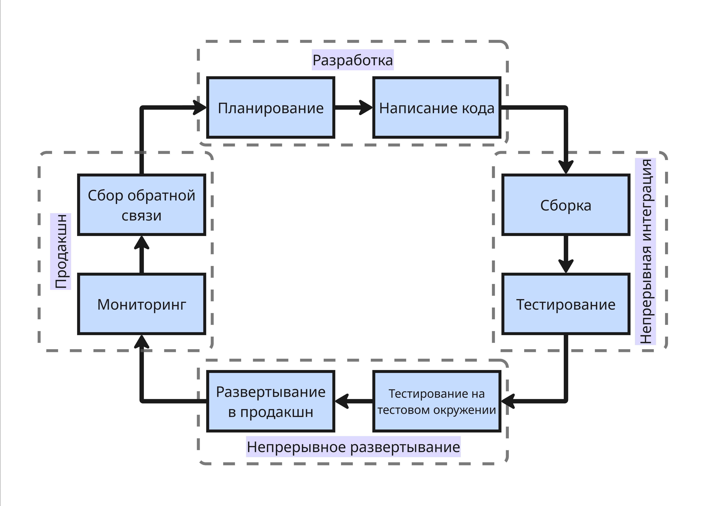
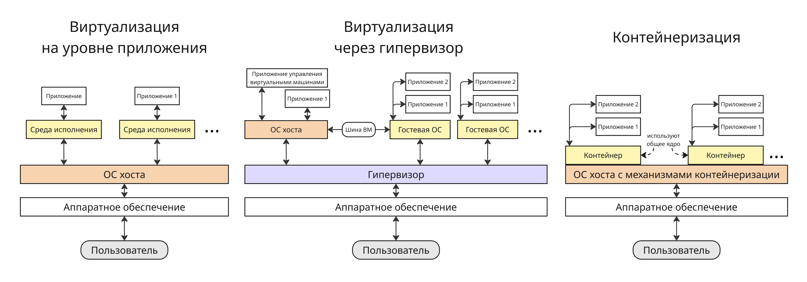
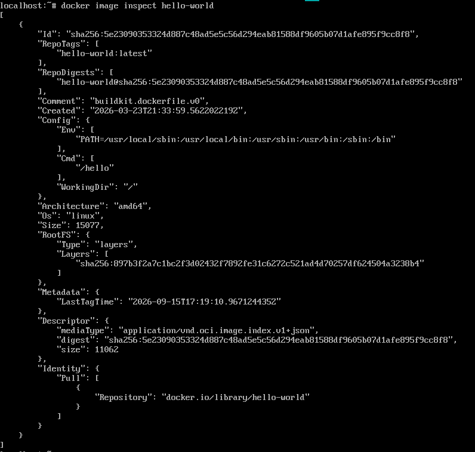

<!-- This file is generated by assets.build.markdown.superconspect_builder. All changes to it will be lost -->

<script type="application/json" id="subject-info">{"recommended": [{"title": "Операционные системы", "link": "opersys/opersys_superconspect.html"}, {"title": "Телекоммуникационные системы и технологии", "link": "telecomm/telecomm_superconspect.html"}]}</script>


# <a name="%D1%82%D0%B5%D1%85%D0%BD%D0%BE%D0%BB%D0%BE%D0%B3%D0%B8%D0%B8-%D1%81%D0%B1%D0%BE%D1%80%D0%BA%D0%B8-%D0%B8-%D1%80%D0%B0%D0%B7%D0%B2%D0%B5%D1%80%D1%82%D1%8B%D0%B2%D0%B0%D0%BD%D0%B8%D1%8F-%D0%BF%D1%80%D0%BE%D0%B3%D1%80%D0%B0%D0%BC%D0%BC%D0%BD%D0%BE%D0%B3%D0%BE-%D0%BE%D0%B1%D0%B5%D1%81%D0%BF%D0%B5%D1%87%D0%B5%D0%BD%D0%B8%D1%8F-%28devops%29.-%D1%82%D1%80%D0%B5%D0%BA-%D0%BE%D1%82-nexign"></a> Технологии сборки и развертывания программного обеспечения (DevOps). Трек от Nexign

* [Технологии сборки и развертывания программного обеспечения (DevOps). Трек от Nexign](#%D1%82%D0%B5%D1%85%D0%BD%D0%BE%D0%BB%D0%BE%D0%B3%D0%B8%D0%B8-%D1%81%D0%B1%D0%BE%D1%80%D0%BA%D0%B8-%D0%B8-%D1%80%D0%B0%D0%B7%D0%B2%D0%B5%D1%80%D1%82%D1%8B%D0%B2%D0%B0%D0%BD%D0%B8%D1%8F-%D0%BF%D1%80%D0%BE%D0%B3%D1%80%D0%B0%D0%BC%D0%BC%D0%BD%D0%BE%D0%B3%D0%BE-%D0%BE%D0%B1%D0%B5%D1%81%D0%BF%D0%B5%D1%87%D0%B5%D0%BD%D0%B8%D1%8F-%28devops%29.-%D1%82%D1%80%D0%B5%D0%BA-%D0%BE%D1%82-nexign)
  * [Лекция 1. Введение](#%D0%BB%D0%B5%D0%BA%D1%86%D0%B8%D1%8F-1.-%D0%B2%D0%B2%D0%B5%D0%B4%D0%B5%D0%BD%D0%B8%D0%B5)
  * [Лекция 2. Контейнеризация](#%D0%BB%D0%B5%D0%BA%D1%86%D0%B8%D1%8F-2.-%D0%BA%D0%BE%D0%BD%D1%82%D0%B5%D0%B9%D0%BD%D0%B5%D1%80%D0%B8%D0%B7%D0%B0%D1%86%D0%B8%D1%8F)
    * [Механизмы контейнеризации](#%D0%BC%D0%B5%D1%85%D0%B0%D0%BD%D0%B8%D0%B7%D0%BC%D1%8B-%D0%BA%D0%BE%D0%BD%D1%82%D0%B5%D0%B9%D0%BD%D0%B5%D1%80%D0%B8%D0%B7%D0%B0%D1%86%D0%B8%D0%B8)
    * [Работа с Docker](#%D1%80%D0%B0%D0%B1%D0%BE%D1%82%D0%B0-%D1%81-docker)
  * [Лекция 3. Механизмы Docker](#%D0%BB%D0%B5%D0%BA%D1%86%D0%B8%D1%8F-3.-%D0%BC%D0%B5%D1%85%D0%B0%D0%BD%D0%B8%D0%B7%D0%BC%D1%8B-docker)
    * [Многоэтапная сборка Docker-образа](#%D0%BC%D0%BD%D0%BE%D0%B3%D0%BE%D1%8D%D1%82%D0%B0%D0%BF%D0%BD%D0%B0%D1%8F-%D1%81%D0%B1%D0%BE%D1%80%D0%BA%D0%B0-docker-%D0%BE%D0%B1%D1%80%D0%B0%D0%B7%D0%B0)
    * [Сеть в Docker](#%D1%81%D0%B5%D1%82%D1%8C-%D0%B2-docker)
    * [Docker Compose](#docker-compose)
  * [Лекция 4. Реестр Docker](#%D0%BB%D0%B5%D0%BA%D1%86%D0%B8%D1%8F-4.-%D1%80%D0%B5%D0%B5%D1%81%D1%82%D1%80-docker)

<!-- begin devopstech-nexign_2026_09_01.md -->
В курс будет входить изучение DevOps-технологий, необходимых для непрерывных сборки и развертывания ПО, таких как Docker, Ansible, Kubernetes и виртуальные машины

## <a name="%D0%BB%D0%B5%D0%BA%D1%86%D0%B8%D1%8F-1.-%D0%B2%D0%B2%D0%B5%D0%B4%D0%B5%D0%BD%D0%B8%D0%B5"></a> Лекция 1. Введение

DevOps (от англ. **Dev**elopment & **Op**eration**s**) - методология автоматизации технологических процессов сборки, настройки и развертывания программного обеспечения

До выделения DevOps, как отдельной области, разработка и развертывание ПО в каскадной модели разработки проходили в 3 этапа:

1. Разработчики разрабатывают ПО, стремясь как можно быстрее внедрять новые функции и изменения
2. Тестировщики тестируют ПО
3. Системные администраторы запускают ПО в эксплуатацию и отвечают за стабильность работающей системы и поэтому неохотно принимают любые обновления, способные её сломать

Такой цикл работал медленно, так как зачастую разработчики, тестировщики и сисадмины - это разные отделы, работающие по отдельности в разных комнатах и использующие разные среды исполнения, из-за чего результат у разработчиков, тестировщиков и сисадминов отличались

С появлением гибкой модели Agile и необходимость обновлять проект очень часто появилась потребность согласовать процессы разработки (development), тестирования и эксплуатации (operations) ПО

DevOps появился в конце 2000-ых годов как решение проблемы плохого взаимодействия между разработчиками ПО и специалистами по системному администрированию (эксплуатации)

Область DevOps развилась благодаря тому, что специалисты перестали быть изолированными отделами и превратились в единую команду, что стало необходимым из-за перехода к гибкой разработки

---

Ключевая концепция DevOps заключается в непрерывной интеграции и непрерывной доставке (CI/CD, Continuous Integration и Continuous Delivery/Deployment)

Цикл разработки получается таким:

* Планирование изменений и нововведений
* Разработчики пишут код и запускают модульные тесты, статические анализаторы кода на своих компьютерах
* Происходит интеграция, автоматически запускается сборка и все модульные и интеграционные тесты
* Далее тестировщики в тестовой среде проводят тесты пользовательского интерфейса, сквозные тесты и стресс-тестирование
* В продакшн-среде развертывается рабочее и стабильное приложение, которое поступает конечному пользователю
* Продакшн-среда производит мониторинг приложения: собирает логи, метрики и другое
* Пользователь дает обратную связь, которая анализируется маркетологами, аналитиками, прочими специалистами, которые создают техзадание разработчикам, и цикл начинается заново



Роль DevOps-инженера в этом цикле - это строить конвейер автоматизации, управлять инфраструктурой и конфигурациями так, что развертывание происходит эффективно и стабильно

---

В основе работы с аппаратным обеспечением стоит операционная система. Операционная система, а именно ядро, имеет алгоритмы, которые распределяют ресурсы аппаратного обеспечения разным программам

Подробнее об этом описано в курсе ["Операционные системы"](https://pelmesh619.github.io/itmo_conspects/opersys/opersys_superconspect.html)

Чтобы абстрагировать среды исполнения от аппаратного обеспечения, используют виртуализацию. Всего можно выделить 3 применяющихся метода:

* Виртуализация на уровне приложения

    Виртуализация на уровне приложения - технология, которая изолирует приложение от операционной системы, позволяя ему работать в собственной среде. Такая среда является прослойкой между приложением и ОС, изолирующая приложение и перенаправляющая запросы от приложения к ОС

    Такой средой исполнения может быть отдельное ПО (например, Microsoft App-V или VMware ThinApp) или виртуальная машина, запускающая байт-код языка программирования (например, Java Virtual Machine)

* Виртуализация через гипервизор

    Гипервизор - специальное ПО, которое распределяет физические ресурсы между ОС хоста и гостевыми ОС, на которых запущены изолировано друг от друга приложения

    Подробнее об этом описано в курсе ["Операционные системы"](https://pelmesh619.github.io/itmo_conspects/opersys/opersys_superconspect.html#-%D1%82%D0%B5%D1%85%D0%BD%D0%BE%D0%BB%D0%BE%D0%B3%D0%B8%D0%B8-%D0%B2%D0%B8%D1%80%D1%82%D1%83%D0%B0%D0%BB%D0%B8%D0%B7%D0%B0%D1%86%D0%B8%D0%B8)

* Контейнеризация

    Контейнеризация позволяет использовать один и тот же код ядра, не используя абстракцию в виде гипервизора, что экономит ресурсы процессора и оперативную память. Контейнеры, запускающие среды исполнения и приложения, представляют из себя процессы, которые изолированы между собой с помощью механизмов ядра ОС

    Подробнее о механизмах контейнеризации в Linux описано в курсе ["Администрирование ОС Linux"](https://pelmesh619.github.io/itmo_conspects/admlinux/admlinux_superconspect.html#extra-2.-%D0%BC%D0%B5%D1%85%D0%B0%D0%BD%D0%B8%D0%B7%D0%BC%D1%8B-%D0%BA%D0%BE%D0%BD%D1%82%D0%B5%D0%B9%D0%BD%D0%B5%D1%80%D0%B8%D0%B7%D0%B0%D1%86%D0%B8%D0%B8)

Все эти методы позволяют запускать приложения в разных средах исполнения, но на одном и том же физическом сервере



В больших проектах зачастую используется микросервисная архитектура, из-за чего микросервисы проще хранить в отдельных контейнерах, поэтому контейнеризация получила большее распространение
<!-- end devopstech-nexign_2026_09_01.md -->

<!-- begin devopstech-nexign_2026_09_12.md -->
## <a name="%D0%BB%D0%B5%D0%BA%D1%86%D0%B8%D1%8F-2.-%D0%BA%D0%BE%D0%BD%D1%82%D0%B5%D0%B9%D0%BD%D0%B5%D1%80%D0%B8%D0%B7%D0%B0%D1%86%D0%B8%D1%8F"></a> Лекция 2. Контейнеризация

Одним из распространенных инструментов для контейнеризации приложений является Docker. Docker использует механизмы ядра Linux, которые позволяют изолировать процессы, ограничивать ресурсы для них и использовать общее ядро

### <a name="%D0%BC%D0%B5%D1%85%D0%B0%D0%BD%D0%B8%D0%B7%D0%BC%D1%8B-%D0%BA%D0%BE%D0%BD%D1%82%D0%B5%D0%B9%D0%BD%D0%B5%D1%80%D0%B8%D0%B7%D0%B0%D1%86%D0%B8%D0%B8"></a> Механизмы контейнеризации

Этими механизмами являются пространства имен и контрольные группы:

С помощью пространств имен можно изолировать процессы друг от друга. Для этого существует 8 пространств имен:

1. Cgroup - изолирует корневую директорию контрольных групп, чтобы процесс в контейнере видел свою иерархию контрольных групп.
2. IPC (от Inter-Process Communication) - изолирует ресурсы для межпроцессного взаимодействия (такие как очереди сообщений или разделяемая память)
3. Network - изолирует сетевые устройства, стеки, порты и таблицы маршрутизации
4. Mount - изолирует точки монтирования файловых систем
5. PID (от Process ID) изолирует пространство идентификаторов процессов. Процесс внутри контейнера видит только свои процессы и считает, что его идентификатор равен 1, а не реальному идентификатору на хосте
6. Time - изолирует системное время, позволяя контейнеру иметь своё представление о времени (появилось в Linux 5.6)
7. User - изолирует идентификаторы пользователей и групп, что позволяет процессу в контейнере быть пользователем `root` внутри контейнера
8. UTS (от UNIX Time-Sharing System) - изолирует имена хоста и домена NIS (Network Information Service, системы для распространения конфигурации между несколькими узлами)

Пространства имен можно создавать с помощью утилиты `unshare`:

```bash
sudo unshare --uts /bin/bash
```

Оболочка Bash запуститься в окружении в изолированном пространстве UTS. Для создания пространств имен используются флаги `--ipc`, `--mount`, `--net`, `--pid`, `--uts`, `--user`, `--cgroup`, `--time`

Для создания контейнеров интересны три пространства: PID, Network и Mount

* Чтобы создать пространство имен идентификаторов процессов, можно использовать команду:

    ```bash
    sudo unshare --pid --mount-proc --fork /bin/bash
    ```

    Без флага `--fork` только дети процесса `/bin/bash` будут иметь новое пространство, а флаг `--mount-proc` автоматически создает пространство имен Mount и монтирует виртуальную файловую систему `/proc` для корректной работы утилит `ps` и других

    После выполнения команды процесс `/bin/bash` будет иметь идентификатор 1

* Чтобы создать сетевое пространство имен, используется команда:

    ```bash
    sudo unshare --net /bin/bash
    ```

    Такой способ применятся, если нужно, чтобы пространство имен имело срок жизни, определенный процессом `/bin/bash`. Для большей персистентности используют команду:

    ```bash
    ip netns add <имя-нового-пространства>
    ```

    Далее исполняемый файл можно запустить с помощью команды:

    ```bash
    ip netns exec <имя-нового-пространства> /bin/bash
    ```

    Процессы в этом пространстве будут иметь свой список сетевых интерфейсов. Для общения процессов из пространства обычно создают виртуальный сетевой мост, который перенаправляет запросы из контейнера на существующие в операционной системе сетевые интерфейсы

* Для изоляции точек монтирования используется команда:

    ```bash
    unshare --mount /bin/bash
    ```

    Процесс `/bin/bash` получит свою таблицу с точками монтирования

    ---

    Далее для изоляции файловой системы используется команда `chroot` (от *ch*ange *root*). Для этого создается директория, которая станет будущим корнем, и в нужном окружении выполняется команда:

    ```bash
    chroot <новый-корень>
    ```

    Процессы после выполнения `chroot` будут видеть `<новый-корень>` как `/`

    Более современным способом является команда `pivot_root`, которая перемещает корневую файловую систему текущего процесса в другую директорию, а на её место монтирует новую. Этот системный вызов предпочтительнее для контейнеров, так как он позволяет корректно размонтировать старую корневую файловую систему и обеспечивает более строгую изоляцию

Чтобы ограничивать ресурсы процессора, ОЗУ, ПЗУ и прочего, используется механизм контрольных групп. Для создания контрольных групп есть три способа:

* Использование виртуальной файловой системы `/sys/fs/cgroup`. Для этого нужно:

    1. Для новой группы создать директорию:

        ```bash
        sudo mkdir /sys/fs/cgroup/my-group
        ```

        Созданная директория наполнится нужными файлами. Группы могут выстраивать иерархию с наследованием ограничений

    2. Настроить лимиты в нужных файлах

    3. Запустить процесс и поместить его в группу - для этого нужно записать идентификатор процесса в файл `cgroup.procs`:

        ```bash
        echo $APP_PID | sudo tee /sys/fs/cgroup/my-group/cgroup.procs
        ```

* Использование функций системы инициализации `systemd`

    ```bash
    systemd-run --scope --pids-max=100 --memory-max=2G --unit=my-limited-app.service <команда>
    ```

    Здесь указаны: максимальное число процессов в группе, максимальный объем ОЗУ, имя создаваемой службы и исполняемая команда. Указание имени позволяет управлять службой в рамках `systemd`

    Другим способом является создание файла, который описывает службы и наложенные на нее ограничения:

    ```ini
    # /etc/systemd/system/myapp.service

    [Unit]
    Description=My Application
    # ...

    [Service]
    # ...
    MemoryMax=1G
    CPUWeight=100
    ```

* Через утилиты пакета `libcgroup`

    1. Для создания группы используется команда

        ```bash
        sudo cgcreate -g cpu,memory:/my_group
        ```

        Здесь `cpu,memory` - это контроллеры, которые ограничивают ресурсы в контрольной группе

    2. Далее задаются лимиты (например, ОЗУ):

        ```bash
        sudo cgset -r memory.limit_in_bytes=500M my_group
        ```

    3. А затем исполняется команда внутри контрольной группы:

        ```bash
        sudo cgexec -g cpu,memory:/my_group firefox &
        ```

### <a name="%D1%80%D0%B0%D0%B1%D0%BE%D1%82%D0%B0-%D1%81-docker"></a> Работа с Docker

В Docker управлением контейнерами занимается демон `containerd`. Этот демон управляется утилитой командной строки `docker-cli`

Чтобы создать контейнер в Docker, нужен соответствующий образ. Образ контейнера содержит нужные файлы для процесса, включая зависимости нужных версий

Образы можно создавать, а можно использовать готовые образы из репозитория, которые включают нужное приложение. Чтобы запустить образ, используется команда:

```bash
docker run hello-world
```

Здесь `hello-world` - минимальный образ, который был загружен из репозитория Docker Hub (<https://hub.docker.com/_/hello-world>). При запуске запускается контейнер, который выводит обучающую информацию о Docker

Чтобы создать образ, используется `Dockerfile` - специальный файл, который описывает создание образа. Например, для `hello-world` файл `Dockerfile` выглядит так:

```Dockerfile
FROM scratch
COPY hello /
CMD ["/hello"]
```

Здесь инструкциями указано, что:

1. Образ основан на другом образе `scratch` (который представляет из себя пустой образ)
2. Далее копируется исполняемый файл `hello` в корень контейнера
3. А затем запускается команда `/hello`

В `Dockerfile` также могут использоваться другие команды ([\*тык\*](https://docs.docker.com/reference/dockerfile/))

Далее используется команда:

```bash
docker build -t hello-world:v1 .
```

Здесь `hello-world:v1` - это имя и версия образа, а `.` - корневой путь контейнера, относительно которого выполняются команды в `Dockerfile`. По умолчанию `docker build` будет искать файл `./Dockerfile`, но можно указать аргументом `-f ./otherfolder/Dockerfile` другое местоположение

Чтобы узнать список загруженных и созданных образов, используется команда `docker images`:

```text
IMAGE                ID           DISK USAGE   CONTENT SIZE   EXTRA
hello-world:latest   5e2309035332     25.9kB         9.49kB    U
```

Здесь указаны идентификатор образа и объем на диске

Команда `docker image inspect имя-образа:версия` позволяет изучить образ:



Сам образ представляет из себя слои. Каждая инструкция в `Dockerfile` представляет слой, который описывает изменения файловой системы в образе. Далее после применения инструкции из `Dockerfile` запоминается хеш слоя

Если какая-либо команда в `Dockerfile` изменилась, то Docker берет предыдущий слой, на основе которого собирает новый образ. При запуске контейнера весь образ остается в режиме "только для чтения" - последующие изменения файлов в ходе работы контейнера сохраняются в слое контейнера, а при чтении используется механизм объединенной файловой системы

Далее образ можно запустить:

```bash
docker run -d -p 8000:80 --name имя-контейнера имя-образа
```

Здесь применены флаги:

* `-d` (от detached) означает, что контейнер запускается в отсоединенном режиме
* `-p` означает, что порт `8000` локальной машины соотносится с портом `80` контейнера для доступа контейнера к сети (так называемый проброс порта, port forwarding)
* `--name` устанавливает имя контейнера
<!-- end devopstech-nexign_2026_09_12.md -->

<!-- begin devopstech-nexign_2026_09_15.md -->
## <a name="%D0%BB%D0%B5%D0%BA%D1%86%D0%B8%D1%8F-3.-%D0%BC%D0%B5%D1%85%D0%B0%D0%BD%D0%B8%D0%B7%D0%BC%D1%8B-docker"></a> Лекция 3. Механизмы Docker

### <a name="%D0%BC%D0%BD%D0%BE%D0%B3%D0%BE%D1%8D%D1%82%D0%B0%D0%BF%D0%BD%D0%B0%D1%8F-%D1%81%D0%B1%D0%BE%D1%80%D0%BA%D0%B0-docker-%D0%BE%D0%B1%D1%80%D0%B0%D0%B7%D0%B0"></a> Многоэтапная сборка Docker-образа

Как правило образы в Docker имеют одну инструкцию `FROM`, которая задает образ, на основе которого будет собран данный образ

Однако Docker также позволяет применять несколько инструкций `FROM` в одном `Dockerfile` - такая техника называется многоэтапной сборкой (multi-stage build). Каждая такая инструкция `FROM` создает отдельный этап (stage), который может выполнять свою задачу, например, установку зависимостей, компиляцию, тестирование или подготовку финального образа. Суть применения состоит в том, чтобы собирать приложение в тяжелом образе с инструментами, а затем запускать в легком, куда копируются только готовые артефакты

Пусть есть такое приложение `main.c` на языке C:

```c
#include <stdio.h>

int main(void) {
    printf("Hello, World!\n");
    return 0;
}
```

Тогда для компиляции и запуска его в контейнере можно воспользоваться многоэтапной сборкой:

```Dockerfile
# 1-ый этап - сборка с помощью GCC
FROM gcc:13 AS builder
# Здесь этому этапу назначено имя `builder`

WORKDIR /src
COPY main.c .

RUN gcc -O2 -static -o hello main.c
# Здесь используем флаг `-static`, чтобы итоговый
# исполняемый файл содержал в себе нужные библиотеки

# 2-ой этап - запуск на основе чистого образа
FROM scratch

# Копируем файл `hello` из этапа `builder`
COPY --from=builder /src/hello /hello
ENTRYPOINT ["/hello"]
```

Далее образ можно собрать с помощью команды `docker build -t hello-image .`

Без инструкций `FROM scratch` и `COPY --from=builder /src/hello /hello` образ имеет объем около 1.96 гигабайт в несжатом виде, тогда как с этими инструкциями образ занимает примерно 1.39 мегабайт, так как не содержит компилятор GCC, библиотеки и другое, которые нецелесообразно хранить в этом образе для запуска исполняемого файла

---

Другим применением многоэтапной сборки помимо компиляции бэкенд-приложения может быть сборка фронтенд-приложения

```Dockerfile
# 1-ый этап
FROM node:18-alpine AS build

WORKDIR /app

# Настройка пакетного менеджера NodeJS
RUN npm config set registry https://registry.npmmirror.com

# Копируем package.json и устанавливаем зависимости
COPY package*.json ./
RUN npm install --legacy-peer-deps

# Копируем исходный код
COPY . .

# Собираем приложение
RUN npm run build

# 2-ой этап - запуск Nginx
FROM nginx:alpine

# Копируем собранные статические файлы
COPY --from=build /app/build /usr/share/nginx/html
# Копируем конфигурацию Nginx
COPY nginx.conf /etc/nginx/conf.d/default.conf

# Запуск
EXPOSE 80
CMD ["nginx", "-g", "daemon off;"]
```

Здесь на первом этапе загружаются пакеты из пакетного менеджера NodeJS (NPM), с помощью которых собираются итоговые статические файлы фронтенда, а затем на втором этапе запускается сервер Nginx. Таким образом, итоговый образ не содержит тяжеловесных пакетов NPM. Заметим, что здесь используются образы с суффиксом `alpine` - такие образы используют легковесную библиотеку musl libc (вместо glibc), альтернативные утилиты из пакета BusyBox (вместо стандартных утилит GNU), пакетный менеджер APK, которые используются в дистрибутиве Alpine Linux, что позволяет еще уменьшить объем образа

### <a name="%D1%81%D0%B5%D1%82%D1%8C-%D0%B2-docker"></a> Сеть в Docker

По умолчанию при запуске контейнера Docker создает пару виртуальных сетевых интерфейсов:

* Интерфейс в сетевом пространстве имен контейнера (обычно `eth0`)
* И интерфейс в окружении хоста (обычно `veth...`), который подключен к виртуальному мосту `docker0`

Интерфейсу контейнера и самому мосту docker0 назначаются частные IP-адреса (чаще всего в диапазоне `172.17.0.0/16`), причем шлюзом по умолчанию для контейнера является адрес моста `docker0`

Для доступа к интернету пакет из окружения контейнера передается через пару интерфейсов `eth0`-`veth...` на мост `docker0`, откуда передается на реальный сетевой интерфейс хоста и далее к маршрутизатору. Доступ наружу контейнера обеспечивается благодаря трансляции адресов (NAT), а извне - благодаря настроенному пробросу портов

Если архитектура проекта микросервисная (то есть проект представляет набор сервисов, каждый со своей ответственностью и в своем контейнере), то прямой доступ между ними возможен только по частным IP-адресам (которые могут меняться), так как сеть Docker по умолчанию не имеет своей службы DNS

Для этого в Docker можно создать свою выделенную сеть, участники-контейнеры в которой смогут общаться между собой по именам контейнеров с помощью DNS

Чтобы создать сеть, используют команду:

```bash
docker network create имя-сети
```

Чтобы контейнер был подключен, нужно задать аргументом `--network` сеть при запуске:

```bash
docker run -d --name имя-контейнера --network имя-сети имя-образа
```

Так можно поместить два контейнера в одну сеть, которые могут общаться по сети с помощью имен контейнеров, например, `имя-контейнера:8000`

### <a name="docker-compose"></a> Docker Compose

Docker Compose - инструмент, который позволяет задать конфигурацию Docker-контейнеров в YAML-файле и запускать их, что упрощает управление контейнерами одного проекта

Раньше Docker Compose первой версии представлял инструмент для Docker, написанный на Python и запускаемый как `docker-compose`. Сейчас Docker Compose второй версии - это плагин, написанный на языке Go, который является частью экосистемы и поставляется со стандартной установкой Docker

Манифест на языке YAML (рекурсивный акроним YAML Ain't Markup Language) для Docker Compose описывает контейнеры, их образы, файлы `Dockerfile`, которые описывают инструкции для сборки, и другие настройки, такие как сеть и проброс портов, в одном файле `docker-compose.yml`:

```yml
services:
  backend:
    image: образ-бэкенда:0.2.0
    build:
      context: ./backend
      dockerfile: Dockerfile
    ports:
      - "8000:8000"
    networks:
      - имя-сети
    restart: unless-stopped

  frontend:
    image: образ-фронтенда:0.1.0
    build:
      context: ./frontend
      dockerfile: Dockerfile
    ports:
      - "8080:80"
    depends_on:
      - backend
    networks:
      - имя-сети
    restart: unless-stopped

networks:
  имя-сети:
    driver: bridge
```

Затем при запуске командой в каталоге с файлом `docker-compose.yml`:

```bash
docker compose up 
```

инструмент Docker Compose создает:

* Сеть `имя-сети` c драйвером `bridge`
* Контейнер `backend` из образа `образ-бэкенда` на основе `./backend/Dockerfile`
* Контейнер `frontend` из образа `образ-фронтенда` на основе `./frontend/Dockerfile`, запуск которого зависит от контейнера `backend`
* И проброс портов с 8000 на 8000 и с 8080 на 80

Далее эти связанные контейнеры можно остановить с помощью команды:

```bash
docker compose down
```

---

Аналогично, используя Docker Compose, можно запускать контейнер с базой данных, например, PostgreSQL. Для базы данных требуется усложненная конфигурация, поэтому используется больше полей в файле `docker-compose.yml`:

```yml
services:
  postgres:
    # Используем готовый образ, который загрузится с Docker Hub
    image: postgres:16-alpine
    container_name: postgres
    restart: unless-stopped
    
    # Переменные среды окружения
    environment:
      POSTGRES_USER: postgres
      # Можно указать в формате `${}`, тогда Docker Compose
      # обратится к файлу `.env`, где указана эта переменная
      POSTGRES_PASSWORD: ${POSTGRES_PASSWORD}
      POSTGRES_DB: mydb
    ports:
      - "5432:5432"
    
    # Монтирование томов наружу
    volumes:
      # Вместо имени `postgres_data` можно указать точное
      # местоположение на хосте
      - postgres_data:/var/lib/postgresql/data
    # Такой подход позволяет сохранить данные базы данных
    # между перезагрузками контейнера

    # Проверка здоровья контейнера
    healthcheck:
      # Здесь задана команда, которая проверяет, что приложение работает
      # Если база данных работает, то `pg_isready` вернет код 0
      test: ["CMD-SHELL", "pg_isready -U postgres -d mydb"]
      interval: 10s
      timeout: 5s
      retries: 5
      start_period: 10s
    # Такая проверка может использоваться другими контейнерами

volumes:
  postgres_data:
```
<!-- end devopstech-nexign_2026_09_15.md -->

<!-- begin devopstech-nexign_2026_09_22.md -->
## <a name="%D0%BB%D0%B5%D0%BA%D1%86%D0%B8%D1%8F-4.-%D1%80%D0%B5%D0%B5%D1%81%D1%82%D1%80-docker"></a> Лекция 4. Реестр Docker

Реестр Docker (Docker Registry) - это служба для хранения, управления и распространения Docker-образов

Реестр может быть:

* Публичным, например:
    * Официальный реестр Docker Hub (<https://hub.docker.com/>), который является самым крупным из публичных
    * Реестр GitHub Container Registry (<https://ghcr.io>)
    * Реестр GitLab Container Registry и так далее
* Приватным, например, на сервере в локальной или корпоративной сети

Реестр разбит на репозитории - один репозиторий хранит образы с одним конкретным именем разных версий. Сам реестр представляет собой базу данных вида NoSQL, к которой другие участники сети имеют доступ по протоколу HTTP(S) через порт 5000

Самый простой способ запустить приватный реестр - это запустить соответствующий образ, который содержит логику реестра:

```bash
docker run -d \
  -p 5000:5000 \
  --restart=always \
  --name registry \
  -v /opt/registry/data:/var/lib/registry \
  registry:3
```

Образ реестра называется `registry:3` и доступен в реестре Docker Hub. Здесь было сделано монтирование папки `/opt/registry/data` на хосте к папке `/var/lib/registry` контейнера, чтобы образы хранились в файловой системе реальной машины, а не контейнера. Аргумент `--restart=always` говорит, что демон `containerd` должен перезапускать контейнер, если его выполнение нештатно прекратилось

---

Чтобы загрузить образ из реестра на локальную машину, можно воспользоваться командой `docker pull`:

```bash
docker pull адрес-реестра/имя-образа:тег-версии
```

Вместо тега версии можно указать `latest` - тогда загрузиться образ последней версии (в лексикографическом порядке)

Изначально запущенный первый раз реестр пуст. Для того, чтобы его заполнить нужными образами, нужно присвоить образу тег, который содержит адрес машины с реестром:

```bash
docker tag имя-образа:тег-версии адрес-реестра/имя-образа:тег-версии
```

А далее можно воспользоваться командой `docker push`:

```bash
docker push адрес-реестра/имя-образа:тег-версии
```

Без указания адреса (то есть `docker push my-app:1.0`) утилита загрузит образ в публичный реестр Docker Hub

По умолчанию, общение с реестром происходит по протоколу HTTPS, то есть реестр должен иметь действующий сертификат подлинности, чтобы избежать атаки "человек посередине" (man-in-the-middle attack, MITM). Сертификат должен выдать центр сертификации, но, если такой возможности нет, можно:

*   Внести адрес реестра в список доверенных на локальной машине. Это полезно в локальных сетях, где атаки "человек посередине" неприменимы, а сервер с реестром является подлинным - тогда общение будет происходить по протоколу HTTP. Для этого в конфигурацию `/etc/docker/daemon.json` нужно в список `"insecure-registries"` добавить нужную подсеть, например:

    ```json
    {
        "insecure-registries": [
            ...,
            "my-custom-registry.io",
            "10.0.2.183/32"
        ],
        ...
    }
    ```

    После нужно перезапустить демон Docker, например, с помощью systemd:

    ```bash
    systemctl restart docker
    ```

    Далее можно убедиться, что изменения применились, с помощью команды `docker info`

* Или создать самоподписанный сертификат, которым будет пользоваться реестр
<!-- end devopstech-nexign_2026_09_22.md -->

