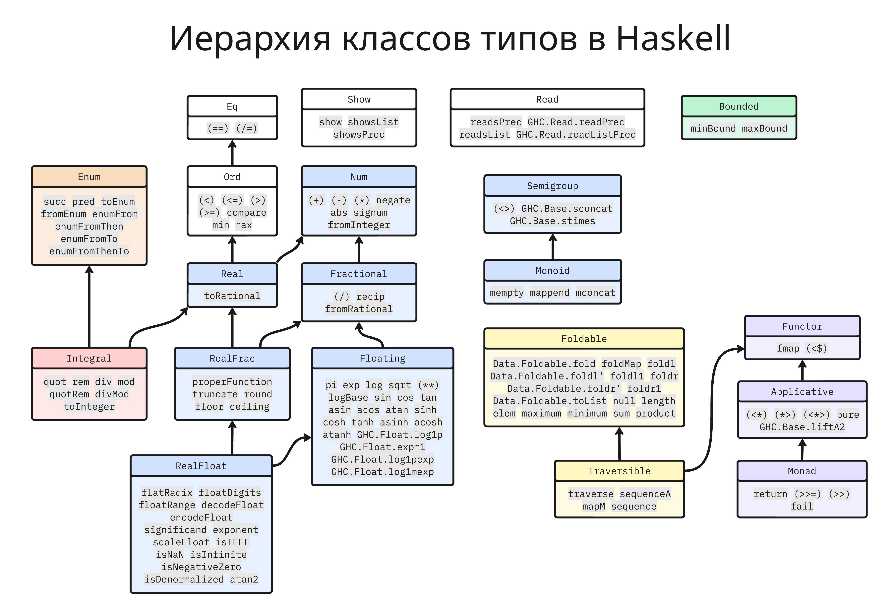
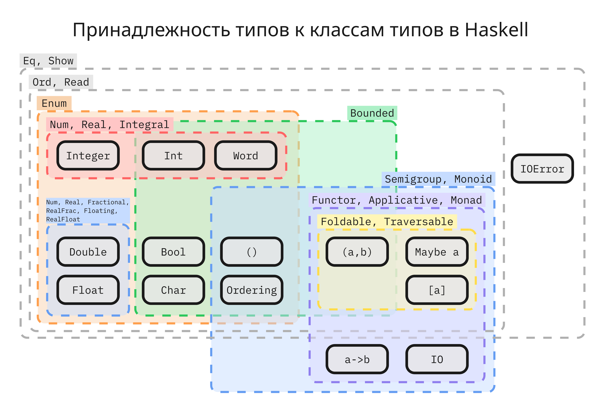

<!-- This file is generated by assets.build.markdown.superconspect_builder. All changes to it will be lost -->


# <a name="%D1%84%D1%83%D0%BD%D0%BA%D1%86%D0%B8%D0%BE%D0%BD%D0%B0%D0%BB%D1%8C%D0%BD%D0%BE%D0%B5-%D0%BF%D1%80%D0%BE%D0%B3%D1%80%D0%B0%D0%BC%D0%BC%D0%B8%D1%80%D0%BE%D0%B2%D0%B0%D0%BD%D0%B8%D0%B5.-%D1%82%D1%80%D0%B5%D0%BA-%D1%85%D0%BE%D0%BB%D0%BE%D0%BF%D0%BE%D0%B2%D0%B0-%D0%B4.-%D1%81."></a> Функциональное программирование. Трек Холопова Д. С.

* [Функциональное программирование. Трек Холопова Д. С.](#%D1%84%D1%83%D0%BD%D0%BA%D1%86%D0%B8%D0%BE%D0%BD%D0%B0%D0%BB%D1%8C%D0%BD%D0%BE%D0%B5-%D0%BF%D1%80%D0%BE%D0%B3%D1%80%D0%B0%D0%BC%D0%BC%D0%B8%D1%80%D0%BE%D0%B2%D0%B0%D0%BD%D0%B8%D0%B5.-%D1%82%D1%80%D0%B5%D0%BA-%D1%85%D0%BE%D0%BB%D0%BE%D0%BF%D0%BE%D0%B2%D0%B0-%D0%B4.-%D1%81.)
  * [Лекция 1. Введение](#%D0%BB%D0%B5%D0%BA%D1%86%D0%B8%D1%8F-1.-%D0%B2%D0%B2%D0%B5%D0%B4%D0%B5%D0%BD%D0%B8%D0%B5)
  * [Лекция 2. Синтаксис языка Haskell](#%D0%BB%D0%B5%D0%BA%D1%86%D0%B8%D1%8F-2.-%D1%81%D0%B8%D0%BD%D1%82%D0%B0%D0%BA%D1%81%D0%B8%D1%81-%D1%8F%D0%B7%D1%8B%D0%BA%D0%B0-haskell)
  * [Лекция 3. Кортежи и списки в Haskell](#%D0%BB%D0%B5%D0%BA%D1%86%D0%B8%D1%8F-3.-%D0%BA%D0%BE%D1%80%D1%82%D0%B5%D0%B6%D0%B8-%D0%B8-%D1%81%D0%BF%D0%B8%D1%81%D0%BA%D0%B8-%D0%B2-haskell)
    * [Кортеж](#%D0%BA%D0%BE%D1%80%D1%82%D0%B5%D0%B6)
    * [Списки](#%D1%81%D0%BF%D0%B8%D1%81%D0%BA%D0%B8)
    * [Свертки](#%D1%81%D0%B2%D0%B5%D1%80%D1%82%D0%BA%D0%B8)
    * [Генераторы](#%D0%B3%D0%B5%D0%BD%D0%B5%D1%80%D0%B0%D1%82%D0%BE%D1%80%D1%8B)
  * [Лекция 4. Типы и классы типов](#%D0%BB%D0%B5%D0%BA%D1%86%D0%B8%D1%8F-4.-%D1%82%D0%B8%D0%BF%D1%8B-%D0%B8-%D0%BA%D0%BB%D0%B0%D1%81%D1%81%D1%8B-%D1%82%D0%B8%D0%BF%D0%BE%D0%B2)
    * [Создание новых типов](#%D1%81%D0%BE%D0%B7%D0%B4%D0%B0%D0%BD%D0%B8%D0%B5-%D0%BD%D0%BE%D0%B2%D1%8B%D1%85-%D1%82%D0%B8%D0%BF%D0%BE%D0%B2)
    * [`Maybe` и `Either`](#%60maybe%60-%D0%B8-%60either%60)
    * [Псевдонимы и обертки](#%D0%BF%D1%81%D0%B5%D0%B2%D0%B4%D0%BE%D0%BD%D0%B8%D0%BC%D1%8B-%D0%B8-%D0%BE%D0%B1%D0%B5%D1%80%D1%82%D0%BA%D0%B8)
    * [Классы типов](#%D0%BA%D0%BB%D0%B0%D1%81%D1%81%D1%8B-%D1%82%D0%B8%D0%BF%D0%BE%D0%B2)

<!-- begin funcprog-holopov_2026_09_03.md -->
## <a name="%D0%BB%D0%B5%D0%BA%D1%86%D0%B8%D1%8F-1.-%D0%B2%D0%B2%D0%B5%D0%B4%D0%B5%D0%BD%D0%B8%D0%B5"></a> Лекция 1. Введение

Сейчас самой распространенной парадигмой программирования в бизнес-разработке является объектно-ориентированное программирование (ООП), которое строится вокруг 4 ключевых принципов:

1. Абстрагирование сущностей для выделения существенных характеристик
2. Инкапсуляция, то есть отделение друг от друга элементов объекта, которые определяют его устройство и поведение
3. Наследование, что позволяет объекту одного класса иметь общие свойства с объектом другого класса, но при этом расширять или изменять структуру или поведение
4. Модульность системы

Парадигма ООП имеет множество преимуществ, но иногда не подходит под некоторые задачи

Так, например, в ООП у объекта есть внутреннее изменяемое состояние, от которого неявно зависит поведение функции. Например, в этом примере, функция изменяет переданный объект (а именно удаляет запись в нем):

```java
class Validator {
    static void validate(Map<String, User> users) {
        if (users.containsKey("admin") && !users.get("admin").isActive()) {
            users.remove("admin"); // валидация мутирует входные данные
        }
    }
}

Map<String, User> users = new HashMap<>();
users.put("admin", new User("Alice", false));
Validator.validate(users);
User admin = users.get("admin"); // admin == null
```

В функциональной парадигме у объектов иммутабельность по умолчанию, то есть данные объекта не изменяется, а вместо этого создается новый объект с другими данными

```hs
users = [("admin", User ("Alice", False))]
users' = validate users

result1 = lookup "admin" users' -- "admin" не найдется
result2 = lookup "admin" users -- найдется объект "Alice"
```

Также функции в ООП зачастую имеют побочные эффекты. Это значит, что результат их выполнения зависит не только от аргументов, но и от внутреннего состояния других объектов, например, базы данных:

```java
double withdraw(BankAccount account, double amount) {
    if (amount > account.getBalance()) {
        logger.error("Not enough money for account {}", account.getId());
        throw new IllegalStateException("Insufficient funds");
    }

    account.setBalance(account. getBalance() - amount);
    logger.info("Withdraw {} from {}", amount, account.getId());
    auditService. save(account);
    return account.getBalance();
}
```

В функциональных языках все функции считаются чистыми, то есть их результат зависит только от входных параметров. Из этого следует 4 важных свойства:

* Прозрачность по ссылке (referential transparency) - любое выражение можно заменить его результатом так, что поведение программы не изменится
* Встраивание (inlining) результата функции вместо ее вызова для увеличения оптимизации
* Порядок вызовов функций, аргументы которых не зависят от результатов этих функций, можно изменять
* Мемоизация - результат вызова функции для конкретных значений можно запоминать

Также чистые функции позволяют выполнять ленивые вычисления. Например, такой код на Java:

```java
public int firstArgument(int a, int b) {
    return a;
}

firstArgument(1, 1/0); // ArithmeticException
```

запустится в ошибкой `ArithmeticException`, так как сначала нужно вычислить значения параметров `1` и `1/0`, а затем вызвать функцию, несмотря на то, что второй аргумент не применяется. В функциональном языке с ленивыми вычислениями второй аргумент не вычисляется, из-за чего программа выполняется:

```hs
firstArgument a b = a
result = firstArgument (1) (1/0) -- ok
```

Подытожим ключевые идеи функциональной парадигмы:

1. Иммутабельность
2. Чистые функции
3. Ленивые вычисления (поддерживаются не всеми языками, например, в Haskell ленивые вычисления применяются по умолчанию, а в Clojure, по умолчанию, нет)
4. Функции высших порядков - функции, которые принимают другие функции как аргументы или возвращают их
5. Алгебраические типы данных - способ моделирования данных (есть не во всех языках)

---

Сейчас самым распространенным функциональным языком программирования является Haskell, появившийся в конце 1980-ых

Язык Haskell имеет компилятор GHC (от Glasgow Haskell Compiler) `ghc` и интерактивный интерпретатор GHCi `ghci`. Интерпретатор (он же REPL, от Read-Eval-Print Loop) имеет свои команды:

* `:quit` - выход из интерпретатора
* `:load File.hs` или `:l File.hs` - загрузка модуля в сессию
* `:reload` или `:r` - рекомпиляция модулей с измененным кодом

В качестве системы сборки и пакетных менеджеров применяются два варианта:

* Cabal, появившийся в 2005. Основные команды:

    * Создание проекта: `cabal init`
    * Интерактивная версия: `cabal repl`
    * Сборка проекта: `cabal build`
    * Запуск: `cabal run`

* Stack, который является оберткой над Cabal

    * Создание проекта: `stack new <название-проекта>`
    * Интерактивная версия: `stack ghci`
    * Сборка проекта: `stack build`
    * Запуск: `stack run`

Раньше Cabal имел проблему с зависимостями, из-за чего на диске сохранялась только одна версия конкретного пакета, в ответ на что был создан Stack. Но с приходом Cabal версии 2 проблема исчезла. Сейчас Cabal используется по умолчанию

Функциональные языки программирования хорошо подходят для создания компиляторов, парсинга и форматирования строк, CLI-утилит и бэкенда, но плохо подходят для машинного обучения, создания графического интерфейса и игровой разработки
<!-- end funcprog-holopov_2026_09_03.md -->

<!-- begin funcprog-holopov_2026_09_17.md -->
## <a name="%D0%BB%D0%B5%D0%BA%D1%86%D0%B8%D1%8F-2.-%D1%81%D0%B8%D0%BD%D1%82%D0%B0%D0%BA%D1%81%D0%B8%D1%81-%D1%8F%D0%B7%D1%8B%D0%BA%D0%B0-haskell"></a> Лекция 2. Синтаксис языка Haskell

Haskell обладает статической строгой типизацией, то есть компилятор проверяет операции над типами переменных, а также не позволяет не явных преобразований типов

Одними из базовых типов в Haskell являются:

* целочисленные значения `Int` (диапазон `Int` определяется реализацией, но строго включает `[-2^29, 2^29-1]`)
* большие целочисленные значения `Integer`
* булевые значения `Bool` (истина представляется как `True`, а ложь как `False`)
* числа с плавающей точкой (32-битные `Float` и 64-битные `Double`)
* а также символ `Char` в кодировке Unicode

Особое место занимает значение `undefined` - оно принимает любой тип, но при обработке выбрасывается исключение

Haskell для работы с числами и булевыми значениями имеет такой же набор операторов, как и большинство других языков:

| Операция | Обозначение в языке | Пример | Результат |
|----------|---------------------|--------|-----------|
| Сложение | `+` | `2 + 3` | `5` |
| Вычитание | `-` | `5 - 2` | `3` |
| Умножение | `*` | `4 * 3` | `12` |
| Деление | `/` | `7 / 2` | `3.5` |
| Целочисленное деление (применимо только к целым числам) | `` `div` `` | `` 7 `div` 2 `` | `3` |
| Деление по модулю (применимо только к целым числам) | `` `mod` `` | `` 7 `mod` 2 `` | `1` |
| Возведение в степень (показатель степени должен быть неотрицательным) | `^` | `2 ^ 3` | `8` |
| Меньше | `<` | `2 < 3` | `True` |
| Больше | `>` | `2 > 3` | `False` |
| Меньше или равно | `<=` | `2 <= 2` | `True` |
| Больше или равно | `>=` | `3 >= 2` | `True` |
| Равно | `==` | `2 == 2` | `True` |
| Не равно | `/=` | `2 /= 3` | `True` |
| Логическое И | `&&` | `True && False` | `False` |
| Логическое ИЛИ | `||` | `True || False` | `True` |
| Логическое НЕ | `not` | `not True` | `False` |
| Отрицание числа | `negate` | `negate 5` | `-5` |

Единственным отличием является использование `/=` в качестве оператора "не равно" вместо привычного `!=`

Комментарии в коде обозначаются так:

```hs
-- однострочный комментарий

{-
    многострочный
    комментарий
-}
```

> В дальнейших примерах будет представлен код и вывод интерпретатора `ghci`  
> Строка с `ghci>` обозначает вводимый код, а код без `ghci>` обозначает результирующее значение

Вызов функции осуществляется так:

```hs
ghci> min 5 8
5
```

Здесь `min` - это название функции, а `5` и `8` - аргументы, перечисленные через пробел

Если аргумент содержит в себе пробелы, то аргумент нужно обернуть в скобки. Например:

```hs
ghci> min (3) (8)
3
ghci> min 3 (max 8 1)
3
ghci> max 3 max 8 1
-- ошибка GHC-39999, нельзя вызвать `max` как функцию 4 аргументов
ghci> (min 3 max) 8 1
-- ошибка GHC-39999, второй аргумент в функции `min` не может иметь тип функции
```

Такой способ вызова функции называется префиксный. Другим способом является инфиксный вызов:

```hs
ghci> (+) 2 3
5
ghci> 2 + 3
5
ghci> div 2 3
0
ghci> 2 `div` 3
0
ghci> mod 2 3
2
ghci> 2 `mod` 3
2
```

Здесь `(+) 2 3` является префиксной формой, а `2 + 3` - инфиксной. Как можно заметить, операторы в Haskell - это тоже функции. Если функция состоит из специальных символом, то в префиксной форме он должен быть обернутым в скобки (`(+) 2 3`), а если из букв, то в инфиксной форме в обратные кавычки (```2 `mod` 3```)

Помимо этого у операторов есть две характеристики: тип ассоциативности и приоритет выполнения

* Тип ассоциативности определяет порядок выполнения выражения, содержащего одинаковый оператор, примененного в инфиксной форме. Если в префиксной форме порядок определен слева направо, то в инфиксной форме есть 3 типа операторов:

    * Левоассоциативные (`infixl`), такие как `+`, `-`, `/`. Выполнение такой цепочки будет исполняться _слева направо_, то есть записи `3 / 4 / 5` и `(3 / 4) / 5` будут гарантированно иметь один результат
    * Правоассоциативные (`infixr`), такие как `^`. Выполнение такой цепочки будет исполняться _справа налево_, записи `3 ^ (4 ^ 5)` и `3 ^ (4 ^ 5)` имеют один результат
    * Неассоциативные (`infix`), такие как `==`, `>=`. Их нельзя применять в цепочке (например, запись `3 == 4 == 5` вызовет ошибку)

* Приоритет определяет последовательность выполнения операции в цепочке. Приоритет является число от 0 до 9, чем больше приоритет, тем раньше выполниться операция. Приоритет 10 зарезервирован для применений функций

    Оператор `^` имеет приоритет 8, операторы `*`, `/`, ``` `div` ```, ``` `mod` ``` имеют приоритет 7, операторы `+`, `-` имеют приоритет 6, операторы `==`, `/=`, `<=`, `>=`, `<`, `>` имеют приоритет 4

Такую информацию об операторе можно узнать в интерпретаторе с помощью инструкции `:info` или `:i`:

```hs
ghci> :i +
type Num :: * -> Constraint
class Num a where
  (+) :: a -> a -> a
  ...
        -- Defined in `GHC.Internal.Num'
infixl 6 +
```

---

В Haskell можно сделать свой оператор, например:

```hs
(|-|) :: Int -> Int -> Int
(|-|) a b = abs (a - b)
```

В первой строчке определен тип оператора, а именно `Int -> Int -> Int`. Последний тип в этой цепочке определяет тип возврата, а предыдущие - типы аргументов. Вторая строка определяет реализацию оператора

Важно заметить, что объявление оператор нельзя указать в интерпретаторе

Далее оператор можно будет применить:

```hs
ghci> (|-|) 4 5
1
ghci> 4 |-| 5  
1
```

По умолчанию, такой оператор будет левоассоциативным и иметь приоритет 9

Чтобы изменить тип ассоциативности и приоритет, нужно применить соответствующее ключевое слово (`infix`, `infixl` или `infixr`):

```hs
(|-|) :: Int -> Int -> Int
(|-|) a b = abs (a - b)
infixl 6 |-|
```

Обозначение оператора может состоять из таких символов: `!`, `#`, `$`, `%`, `&`, `*`, `+`, `.`, `/`, `<`, `=`, `>`, `?`, `@`, `\`, `^`, `|`, `-`, `~`, `:`. Если оператор начинается с `:`, то он является конструктором

---

Функции объявляются таким же образом:

```hs
mod :: Int -> Int -> Int
mod a b = a - b * a `div` b
```

Компилятор может попытаться вывести тип из реализации, поэтому сигнатуру необязательно указывать, но крайне рекомендуется

Такое определение функции называется явным или точечным (pointful). Однако есть еще бесточечный (pointfree) стиль:

```hs
-- Явный
plus5 :: Int -> Int
plus5 a = a + 5

-- Бесточечный
plus5 = (+) 5
-- или так
plus5 = (+5)
```

Можно также применять в функциях с несколькими аргументами (но такое ухудшает читаемость):

```hs
-- Pointful
pentaSum a b c d e = a + b + c + d + e
-- Pointfree
pentaSum = ((((((+) .). (+)) .). (+)) .). (+)
```

Сервис <pointfree.io> позволяет переводить функции из точечного стиля в бесточечный

---

Рассмотрим конструкции языка:

*   Условная конструкция `if expression` применяется для возврата выражения при нужном условии. Синтаксис:

    ```hs
    if <предикат>
    then <выражение-для-верного-предиката>
    else <выражение-для-ложного-предиката>
    ```

    Например:

    ```hs
    factorial :: Integer -> Integer
    factorial n = if n <= 1 then 1 else n * factorial (n - 1)
    ```

*   Охранная конструкция (guard) возвращает выражение, если соблюдено условие:

    ```hs
    grade :: Integer -> String
    grade n
      | n >= 90 = "A"
      | n >= 75 = "B"
      | n >= 60 = "C"
      | otherwise = "F"
    ```

    В отличие от `if` охранная конструкция допускает несколько условных веток. Здесь `otherwise` - это не ключевое слово, а синоним значения `True`

*   Выражение `let <binding> in <expression>` позволяет сократить выражение, определяя промежуточные переменные:

    ```hs
    dist :: Double -> Double -> Double -> Double -> Double

    dist x1 y1 x2 y2 = let
        dx = x2 - x1
        dy = y2 - y1
        in sqrt (dx * dx + dy * dy)
    ```

    Такие переменные существуют только в пределах подвыражения

*   Аналогичное выражение `<expression> where <binding>` позволяет сделать то же самое:

    ```hs
    dist :: Double -> Double -> Double -> Double -> Double

    dist x1 y1 x2 y2 = sqrt (dx * dx + dy * dy)
      where
        dx = x2 - x1
        dy = y2 - y1
    ```

    Ключевое отличие - это то, что `let ... in ...` - это выражение, а `... where ...` - синтаксическая конструкция, поэтому она возможна только в конце определения функции или ветки

---

В Haskell можно определить функцию используя соответствие шаблону:

```hs
isZero :: Integer -> Bool
isZero 0 = True
isZero _ = False
```

Такая функция возвращает истину, если аргумент соответствует нулю. Однако порядок важен, такая функция возвращает всегда ложь:

```hs
isZero :: Integer -> Bool
isZero _ = False
isZero 0 = True
```

Другой пример - вычисление значений последовательности `a_1 = 1`, `a_2 = 2`, `a_k = a_{k - 1} + 3 * a_{k - 2}`:

```hs
someSequence :: Integer -> Integer
someSequence n = calcHelper n 1 2 where
    calcHelper 1 a1 _ = a1
    calcHelper 2 _ a2 = a2
    calcHelper k x y = calcHelper (k - 1) y (y + 3 * x)
```

Здесь в блоке `where` объявляется вспомогательная функция `calcHelper`

---

Тип функции можно узнать с помощью инструкции `:t` или `:type`:

```hs
ghci> :type not
not :: Bool -> Bool
```

При этом есть особые функции:

* `id :: a -> a` возвращает аргумент
* `fst :: (a, b) -> a` возвращает первый элемент кортежа
* `snd :: (a, b) -> b` возвращает второй элемент кортежа

Такие функции не определяют явно типы, поэтому они соблюдают параметрический полиморфизм

Помимо этого в Haskell есть перегрузка функций (или Ad-hoc полиморфизм):

```hs
ghci> :t (+)
(+) :: Num a => a -> a -> a
ghci> :t (==)
(==) :: Eq a => a -> a -> Bool
```

Здесь для операторов на тип `a` наложены ограничения: для оператора `+` это то, что `a` должен быть числом, а для `==` - что `a` должен быть сравниваемым

---

Haskell поддерживает композицию функций. В математике композиция функций `g ○ f` определена так, что `(g ○ f)(x) = g(f(x))`

В Haskell композиция функций осуществляется через оператор `.`:

```hs
f :: Integer -> Integer
f x = x ^ 2
g :: Integer -> Integer
g x = x + 1

-- (f ○ g)(x) = f(g(x))
example -: Integer -> Integer
example x = (f . g) x

-- или так
example = (f . g)
```

Так как `.` - это оператор, значит это функция, и у нее такой тип:

```hs
ghci> :t (.)
(.) :: (b -> c) -> (a -> b) -> a -> c
```

Как можно заметить `.` - это функция от 3 аргументов: функции `b -> c`, функции `a -> b` и значения `a`

Реализовать `.` можно так:

```hs
(.) f g x = f (g (x))
```

---

Другой оператор `$` выглядит таким образом:

```hs
($) :: (a -> b) -> a -> b
f $ x = f x
```

Как можно заметить, оператор `$` применяет функцию `f` с аргументом `x`. В отличие от обычного применения оператор `$` имеет приоритет 0 и правоассоциативен

Например, так можно представить оператор `.`:

```hs
(.) f g x = f $ g x
```

Или так можно возвести в квадрат несколько раз:

```hs
f :: Integer -> Integer
f = (^2)
```

```hs
ghci> f . f $ 2
16
ghci> f . f . f $ 2
256
```

Или упростить еще сильнее:

```hs
ghci> (^2) . (^2) $ 2
16
ghci> (^2) . (^2) . (^2) $ 2
256
```

Такая форма не засоряет пространство имен, но ухудшает читаемость
<!-- end funcprog-holopov_2026_09_17.md -->

<!-- begin funcprog-holopov_2026_10_01.md -->
## <a name="%D0%BB%D0%B5%D0%BA%D1%86%D0%B8%D1%8F-3.-%D0%BA%D0%BE%D1%80%D1%82%D0%B5%D0%B6%D0%B8-%D0%B8-%D1%81%D0%BF%D0%B8%D1%81%D0%BA%D0%B8-%D0%B2-haskell"></a> Лекция 3. Кортежи и списки в Haskell

### <a name="%D0%BA%D0%BE%D1%80%D1%82%D0%B5%D0%B6"></a> Кортеж

Кортеж - это структура данных, которая представляет упорядоченный набор фиксированной длины, состоящий из элементов, как правило, разных типов

В Haskell кортеж представляется с помощью круглых скобок, например, `("Haskell", 2010)` или `(1, True, "Third", 4.0, '5')`. При этом такие кортежи имеют тип, который описывает типы находящихся в них элементах

```hs
ghci> :t ("Haskell", 2010)
("Haskell", 2010) :: Num b => (String, b)
ghci> :t (1, True, "Third", 4.0, '5')
(1, True, "Third", 4.0, '5')
  :: (Fractional d, Num a) => (a, Bool, String, d, Char)
```

В кортеже символ запятой `,` - это оператор `a -> b -> (a, b)`, который берет два типа и возвращает кортеж, поэтому кортежи можно создавать так:

```hs
(,) "Haskell" 2010
(,,,,) 1 True "Third" 4.0 '5'
```

Если кортеж состоит из двух элементов, то к нему можно применить функции `fst` и `snd` для возврата первого и второго элементов соответственно:

```hs
ghci> fst ("Haskell", 2010)
"Haskell"
ghci> snd ("Haskell", 2010)
2010
```

---

Кортежи используются в функции каррирования - преобразования функции от многих аргументов в набор вложенных функций, каждая из которых является функцией от одного аргумента (процесс назван в честь математика Хаскелла Брукса Карри)

В Haskell функция `curry` позволяет превратить функцию от двух аргументов в функцию от одного, которая принимает еще один аргумент

```hs
ghci> :t curry
curry :: ((a, b) -> c) -> a -> b -> c
```

С помощью `curry` можно вызвать функцию без скобок:

```hs
ghci> curry fst "Haskell" 2010
"Haskell"
```

А с помощью обратной функции `uncurry`, которая выполняется декаррирование, можно выполнить обратное преобразование, чтобы передать аргументы как кортеж:

```hs
ghci> :t uncurry
uncurry :: (a -> b -> c) -> (a, b) -> c
ghci> uncurry div (3, 2)
1
```

Пример использования каррирования - пусть есть функции `hasAccess` и `checkRequest` с разными сигнатурами:

```hs
hasAccess :: String > String -> Bool
hasAccess role page
    | role = "admin" = True
    | role = "user" && page = "moin" = True
    | otherwise - Falsa

request = ("admin", "dashboard")

checkRequest :: (String, String) -> Bool
```

`checkRequest` принимает кортеж, а `hasAccess` - 2 аргумента. Здесь есть 3 способа, чтобы вызвать `hasAccess` в `checkRequest`:

```hs
-- 1: через функции `fst` и `snd`
checkRequest request = hasAccess (fst request) (snd request)

-- 2: через декаррирование
checkRequest request = uncurry hasAccess request
-- или в бесточечном стиле
checkRequest = uncurry hasAccess

-- 3: сопоставление с образцом
checkRequest :: (String, String) -> Bool
checkRequest (role, page) = hasAccess role page
```

### <a name="%D1%81%D0%BF%D0%B8%D1%81%D0%BA%D0%B8"></a> Списки

Список - это односвязная структура данных, которая представляет упорядоченный набор элементов одного типа

В Haskell список создается с помощью квадратных скобок:

```hs
myList = [1, 2, 3, 4]
```

`myList` здесь имеет тип `[Int]`. Также в Haskell тип строки `String` - это список символов `[Char]`

Для работы со списками есть два правоассоциативных оператора:

*   `:` - добавление элемента в голову списка, например:

    ```hs
    ghci> 1 : 2 : 3 : 4 : []
    [1,2,3,4]
    ```

*   `++` - конкатенация двух списков:

    ```hs
    ghci> [1] ++ [2] ++ [3, 4]
    [1,2,3,4]
    ```

Списки в Haskell хранятся как односвязный список - узлы помимо значения хранят ссылку на следующий узел. Поэтому, если есть список `[2, 3, 4]`, то добавление в начало `1` не клонирует весь список, а возвращает ссылку на список `[1, 2, 3, 4]`:

```hs
ghci> a = [2, 3, 4]
ghci> b = 1 : a
ghci> a
[2,3,4]
ghci> b
[1,2,3,4]
```

С другой стороны, оператор `++` изменяет ссылки в существующих узлах, что нарушило бы иммутабельность объектов, поэтому при конкатенации первый список копируется, из-за чего временная сложность операции `++` получается `O(n)`, где `n` - длина первого списка:

```hs
ghci> a = [3, 4]
ghci> b = [1, 2]
ghci> c = b ++ a
ghci> a
[3,4]
ghci> b
[1,2]
ghci> c
[1,2,3,4]
```

Также есть другие функции для работы со списками:

*   `head` возвращает голову списка:

    ```hs
    ghci> head [10, 20, 30]
    10
    ```

*   `tail` возвращает список, который расположен после головы:

    ```hs
    ghci> tail [10, 20, 30]
    [20,30]
    ```

*   `!!` позволяет вернуть элемент из списка по индексу:

    ```hs
    ghci> [10, 20, 30] !! 1
    20
    ```

*   `null` возвращает истину, если список пуст:

    ```hs
    ghci> null []
    True
    ```

*   `length` возвращает длину списка (эта функция работает за `O(n)`):

    ```hs
    ghci> length [10, 20, 30]
    3
    ```

Функции `head`, `tail` и `!!` являются частичными, что означает, что они не определены для некоторых аргументов. Так, `head` и `tail` бросают исключение, если список пуст, а `!!` не работает, если индекс больше длины списка или отрицательный

Со списками также можно использовать сопоставление образцов:

```hs
sum' :: [Int] -> Int
sum' [] = 0
sum' (x:xs) = x + sum' xs
```

Здесь в функции `sum'` список разделяется на две части: на один элемент `x` и хвост `xs`, что позволяет рекурсивно вычислять сумму. Аналогично, можно выделять больше элементов:

```hs
sum' :: [Int] -> Int
sum' [] = 0
sum' (x1:x2:xs) = x1 + x2 + sum' xs
```

Однако здесь при исполнении выброситься ошибка, так как список из одного элемента не сможет обработаться

---

Рассмотрим другие основные функции:

*   Функция `map`, которая преобразует элементы списка:

    ```hs
    map :: (a -> b) -> [a] -> [b]
    -- если список пуст, то возвращаем его
    map _ [] = []
    -- если не пуст, то рекурсивно применяет функцию `f` к элементу
    map f (x:xs) = f x : map f xs
    ```

*   Функция `filter`, которая возвращает элементы, удовлетворяющие предикату:

    ```hs
    filter :: (a -> Bool) -> [a] -> [a]
    -- если список пуст, то возвращаем его
    filter _ [] = []
    -- если не пуст, то от результата предиката решаем, что вернуть
    filter p (x:xs)
        | p x = x : filter p xs
        | otherwise = filter p xs
    ```

    Функцию `filter` можно также использовать с лямбда-функциями:

    ```hs
    ghci> filter (\x -> x `mod` 2 == 0) [1, 2, 3, 10, 11]
    [2,10]
    ```

    В лямбда-функциях аргументы обозначаются с помощью обратного слеша `\`

*   Функция `take`, возвращающая префикс списка:

    ```hs
    ghci> let arr = [42, 1, 4, 3, 42]
    ghci> take 2 arr
    [42,1]
    ```

*   Функция `drop`, возвращающая суффикс списка:

    ```hs
    ghci> let arr = [42, 1, 4, 3, 42]
    ghci> drop 2 arr
    [4,3,42]
    ```

*   Функция `all`, возвращающая истину, если все элементы удовлетворяют предикату:

    ```hs
    ghci> let arr = [42, 1, 4, 3, 42]
    ghci> all (> 5) arr
    False
    ```

*   Функция `any`, возвращающая истину, если один из элементов удовлетворяют предикату:

    ```hs
    ghci> any (> 5) arr
    True
    ghci> any (> 5) [6, undefined]
    -- функция any прекратит выполнение на 6,
    -- таким образом не перебирая все значение
    -- из-за чего не выкидывается ошибка на обработке undefined
    True
    ```

### <a name="%D1%81%D0%B2%D0%B5%D1%80%D1%82%D0%BA%D0%B8"></a> Свертки

Рассмотрим еще раз функцию `sum'`:

```hs
sum' :: [Int] -> Int
sum' [] = 0
sum' (x:xs) = x + sum' xs
```

Здесь мы можем выделить начальное значение `0` (так называемый аккумулятор, к которому мы прибавляем элементы списка) и операцию `+`. Если мы параметризуем эти значения, то мы получим функцию правой свертки:

```hs
foldr :: (a -> b -> b) -> b -> [a] -> b
foldr op accumulator [] = accumulator
foldr op accumulator (x:xs) = x `op` (foldr op accumulator xs)
```

Функция `foldr` сворачивает список, начиная справа, в один элемент. Пример применения:

```hs
ghci> foldr (+) 0 [1, 2, 3]  -- сумма элементов
6                            -- 1 + (2 + (3 + 0))
ghci> foldr (+) 10 [1, 2, 3]
16
ghci> foldr (*) 1 [4, 5, 7]  -- произведение
140                          -- 4 * (5 * (7 * 0))
ghci> foldr (:) [0] [1, 2, 3, 4] -- конкатенация (добавление в конец списка)
[1,2,3,4,0]                      -- 1 : (2 : (3 : (4 : [0])))
```

Аналогично, есть левая свертка:

```hs
foldl :: (b -> a -> b) -> b -> [a] -> b
foldl op accumulator [] = accumulator
foldl op accumulator (x:xs) = foldl op (accumulator `op` x) xs
```

С помощью нее можно инвертировать список:

```hs
ghci> foldl (\acc x -> x : acc) [] [1, 2, 3]
[3,2,1]   -- ((([] : 1) : 2) : 3) = [3, 2, 1]
```

---

Рассмотрим производительность операций сверток. С помощью инструкции `:set +s` в интерпретаторе можно узнать, сколько времени и памяти заняло исполнение строки код:

```hs
ghci> a = [1 .. 200000]
(0.04 secs, 15,016 bytes)

ghci> foldr (+) 0 a    
20000100000
(0.03 secs, 32,347,024 bytes)

ghci> foldl (+) 0 a
20000100000
(0.14 secs, 32,275,808 bytes)

ghci> foldl' (+) 0 a
20000100000
(0.01 secs, 17,656,664 bytes)
```

Как видно, в среднем `foldl` работает медленнее, чем `foldr`. Связано это с выполнением ленивых вычислений в Haskell, из-за чего сначала строится дерево вычислений, которое в конце вычисляется. Альтернативная функция левой свертки `foldl'` позволяет принудительно совершать вычисления (из-за чего работает быстрее и использует меньше памяти), но работает не со всеми операциями

Также существенно понимать различия в порядке обхода. `foldr` обрабатывает элементы слева направо, из-за чего может прекратить обработку, не доходя до конца списка:

```hs
ghci> foldr (&&) True (False : undefined)
-- = False && foldr (&&) True undefined
False

ghci> foldr (\x acc -> x = 5 || acc) False [1 ..] -- бесконечный список😈
True
```

`foldl` же нужно добрать до конца списка, из-за чего могут возникнуть ошибки:

```hs
ghci> foldl (&&) True (False : undefined)
-- = foldl (&&) (True && False) undefined
*** Exception: Prelude.undefined

ghci> foldl (\acc x -> acc || x = 5) False [1 ..]
-- выполнение не останавливается
```

Подробнее об различиях левой и правой сверток: <https://blog.haskell.org/foldl-and-foldr/>

### <a name="%D0%B3%D0%B5%D0%BD%D0%B5%D1%80%D0%B0%D1%82%D0%BE%D1%80%D1%8B"></a> Генераторы

Haskell позволяет задавать списки с помощью генераторов. Генератор не создает все элементы списка, а хранит только правилам, по которым можно создать следующий элементы

Генератор задается через `..`, например:

```hs
ghci> [1 .. 5]
[1,2,3,4,5]
ghci> [1, 3 .. 10]
[1,3,5,7,9]
ghci> [10, 9 .. 7] 
[10,9,8,7]
```

Также можно создать бесконечные списки, не указывая верхней границы:

```hs
ghci> [10, 9 .. ] 
[10,9,8,7,6,5,4,3,2,1,0,-1,-2,-3,-4,-5,-6,-7,-8,-9,-10,-11,-12,-13,-14,-15,-16,-17,-18,-19,-20,-21 -- ну и еще триллион чисел
```

Бесконечные списки могут иметь смысл с функцией `take`

```hs
ghci> take 6 [10, 9 .. ]
[10,9,8,7,6,5]
```

Также можно задавать другие правила:

```hs
ghci> [n * n | n <- [1..10]]
    -- ^ результат  ^ исходный список
-- квадраты чисел от 1 до 10
[1,4,9,16,25,36,49,64,81,100]

ghci> take 6 [n | n <- [1 ..], even n]
                            -- ^ фильтр
-- первые 6 четных чисел
[2,4,6,8,10,12]

ghci> take 6 [(n, n * n) | n <- [1 ..], even n]
-- кортежи первые 6 четных чисел и их квадратов
[(2,4),(4,16),(6,36),(8,64),(10,100),(12,144)]

ghci> [(a, b) | a <- [1 .. 3], b <- [4 .. 5]]
-- декартово произведение
[(1,4),(1,5),(2,4),(2,5),(3,4),(3,5)]
```
<!-- end funcprog-holopov_2026_10_01.md -->

<!-- begin funcprog-holopov_2026_10_15.md -->
## <a name="%D0%BB%D0%B5%D0%BA%D1%86%D0%B8%D1%8F-4.-%D1%82%D0%B8%D0%BF%D1%8B-%D0%B8-%D0%BA%D0%BB%D0%B0%D1%81%D1%81%D1%8B-%D1%82%D0%B8%D0%BF%D0%BE%D0%B2"></a> Лекция 4. Типы и классы типов

### <a name="%D1%81%D0%BE%D0%B7%D0%B4%D0%B0%D0%BD%D0%B8%D0%B5-%D0%BD%D0%BE%D0%B2%D1%8B%D1%85-%D1%82%D0%B8%D0%BF%D0%BE%D0%B2"></a> Создание новых типов

В языке Haskell можно создавать свои типы с помощью слова `data`. Например, с помощью `data` можно объявить перечисление значений:

```hs
data Color = Red | Green | Blue | White | Black
```

Далее с помощью сопоставления с образцом можно использовать логику для разных значений:

```hs
whatIsTheColor :: Color -> String
whatIsTheColor Red = "Color is Red"
whatIsTheColor Green = "Color is Green"
whatIsTheColor Blue = "Color is Blue"
whatIsTheColor White = "Color is White"
whatIsTheColor Black = "Color is Black"
whatIsTheColor _ = "😼" -- такое сопоставление избыточно, так как
                        -- перечислены все возможные значения Color
```

Если нет общего сопоставления с `_` и какое-либо значение не указано, то при вызове такой функции выбросится исключение: `"*** Exception: 1.hs:(4,1)-(7,39): Non-exhaustive patterns in function whatIsTheColor`

Также с помощью слова `data` можно объявлять структуру - набор других типов, например, точку с двумя координатами:

```hs
data Point2D = CreatePoint Double Double
--   ^         ^                ^   ^
--   имя типа  имя              |   |
--             конструктора   типы полей
```

Здесь конструктор - это функция с сигнатурой `CreatePoint :: Double -> Double -> Point2D`

Далее написать функции, которые работают с ним, например, возвращение координаты `x` или `y`:

```hs
getX :: Point2D -> Double
getX (CreatePoint x _) = x

getY :: Point2D -> Double
getY (CreatePoint _ y) = y
```

Вместо числа с плавающей точкой `Double` может быть другой тип, тогда объявление будет выглядеть так:

```hs
data Point2D a = Point2D a a
-- здесь для удобства конструктор назван так же, как и тип
```

Здесь `a` может представлять любой тип, но так как не у любого типа есть нужные арифметические операторы, использующие их функции не будут принимать `Point2D a`. Поэтому, например, в определении функции расстояния между точками необходимо уточнять тип:

```hs
distance :: Point2D Double -> Point2D Double -> Double
distance (Point2D x1 y1) (Point2D x2 y2) =
    sqrt $ (x2 - x1) ^ 2 + (y2 - y1) ^ 2
```

---

Такие структуры можно объединять в перечисления:

```hs
data Point a = Point2D a a | Point3D a a a
```

Значение такого перечисления хранит в памяти значение лишь одного типа - либо `Point2D`, либо `Point3D` (аналог `union` в C++ или `enum` в Rust). Для работы с ним в функции можно воспользоваться сопоставление с образцом:

```hs
toList :: Point a -> [a]
toList (Point2D x y) = [x, y]
toList (Point3D x y z) = [x, y, z]
```

Для такого общего типа точки `Point` можно написать такую функцию расстояния:

```hs
distance :: Point Double -> Point Double -> Double
distance p1 p2 = sqrt . sum . map (^2) $ zipWith (-) (toList p2) (toList p1)
```

В этом примере такая функция отлично работает с `Point2D` и `Point3D`:

```hs
ghci> distance (Point2D 0 0) (Point2D 4 3) 
5.0
ghci> distance (Point3D 0 0 0) (Point3D 4 3 8)
9.433981132056603
```

Однако при вычислении расстояния между двухмерной и трехмерной точками получается число (потому что функция `zipWith` умеет работать со списками разной длины), хотя результат подобной операции в математике не определен:

```hs
ghci> distance (Point2D 0 0) (Point3D 4 3 8)  
5.0
```

Как правило, это говорит о плохом проектировании типов, но в этом случае можно применить сопоставление с образцом, чтобы предотвратить такое:

```hs
distance :: Point Double -> Point Double -> Double

distance p1@(Point2D _ _) p2@(Point2D _ _) =
    sqrt . sum . map (^2) $ zipWith (-) (toList p2) (toList p1)
distance p1@(Point3D _ _ _) p2@(Point3D _ _ _) =
    sqrt . sum . map (^2) $ zipWith (-) (toList p2) (toList p1)
distance _ _ = error("Результат не определен")
```

---

В Haskell конструкторы также могут иметь именованные аргументы, например:

```hs
data Student = Student
    { studentId   :: Int
    , studentName :: String
    , studentYear :: Int
    }
```

Далее к полям объекта такого типа можно обращаться по имени:

```hs
ghci> studentName (Student 1 "John Doe" 4)
"John Doe"
```

Компилятор Haskell сам генерирует функции с такими же именами, как имена полей, которые возвращают значение поля объекта

С помощью такого конструктора можно копировать объект с обновлением только одного (или нескольких) поля:

```hs
moveNextYear :: Student -> Student
moveNextYear s = s { studentYear = studentYear s + 1 }
```

Или осуществлять сопоставление с образцом по одному или нескольким полям:

```hs
isFirstYear :: Student -> Bool
isFirstYear Student { studentYear = 1 } = True
isFirstYear _ = False
```

### <a name="%60maybe%60-%D0%B8-%60either%60"></a> `Maybe` и `Either`

Также Haskell имеет встроенные перечисления:

*   `Maybe a` используется для типов, которые могут не иметь значения (аналог `Option<T>` в Rust или `std::optional<T>` в C++):

    ```hs
    data Maybe a = Nothing | Just a
    ```

    `Maybe` может использоваться как результат поиска значения в структуре:

    ```hs
    ghci> lookup 2 [(1, "One"), (2, "Two")]
    Just "Two"
    ghci> lookup 0 [(1, "One"), (2, "Two")]
    Nothing
    ```

*   `Either a b` используется для значений, которые могут иметь один из двух типов (аналог `Result<T, E>` в Rust или `std::variant<L, R>` в C++):

    ```hs
    data Either a b = Left a | Right b
    ```

    Обычно `Either a b` используется для ошибок, где `Left a` - это ошибка, а `Right b` - успешный результат, например:

    ```hs
    data MonthError = MonthTooSmall | MonthTooBig

    month :: Int -> Either MonthError Int
    month n
        | n < 1     = Left MonthTooSmall
        | n > 12    = Left MonthTooBig
        | otherwise = Right n
    ```

    Далее функция `month` вернет ошибку, если номер месяца не лежит в диапазоне `[1, 12]`:
    
    ```hs
    ghci> month 0
    Left MonthTooSmall

    ghci> month 13
    Left MonthTooBig

    ghci> month 8
    Right 8
    ```

### <a name="%D0%BF%D1%81%D0%B5%D0%B2%D0%B4%D0%BE%D0%BD%D0%B8%D0%BC%D1%8B-%D0%B8-%D0%BE%D0%B1%D0%B5%D1%80%D1%82%D0%BA%D0%B8"></a> Псевдонимы и обертки

Также Haskell имеет еще два слова для работы с типами:

*   `type` позволяет создать псевдоним для существующего типа (аналог `using` в C++ и `type` в Rust), например:

    ```hs
    type Phone = String
    type Name = String
    type Password = String
    type Mass = Double
    type Id = Integer

    register :: Phone -> Name -> Password -> String
    register phone name pass = "Registered with phone [" ++ phone ++ "], name [" ++ name ++ "], pass [" ++ pass ++ "]"
    ```

    Такой псевдоним является только семантической подсказкой для программиста, какое значение ожидает функция. Для компилятора такие типы равнозначны, поэтому нет проверки типов и можно вместо объекта типа `Phone` положить в функцию `String`

*   `newtype` позволяет создать обертку над существующим типом, например:

    ```hs
    newtype Phone = Phone String
    newtype Name = Name String
    newtype Password = Password String
    newtype Mass = Mass Double
    newtype Id = Id Integer

    register :: Phone -> Name -> Password -> String
    register (Phone ph) (Name n) (Password ps) = "Registered with phone [" ++ ph ++ "], name [" ++ n ++ "], pass [" ++ ps ++ "]"
    ```

    `newtype` создает тип с только одним конструктором, который принимает только один аргумент

    В отличие от `type` для компилятора типы `Phone` и `String` разные, поэтому проверка типов объектов происходит (то есть перепутать `Name` и `Password` нельзя), однако в отличие от `data` на этапе выполнения типы `Phone` и `String` равнозначны, поэтому производительность не ухудшается

### <a name="%D0%BA%D0%BB%D0%B0%D1%81%D1%81%D1%8B-%D1%82%D0%B8%D0%BF%D0%BE%D0%B2"></a> Классы типов

Помимо этого Haskell имеет механизм классов типов. Класс типов задает интерфейс (то есть набор сигнатур функций), чтобы затем представитель класса, конкретный тип, реализовывал этот интерфейс (наподобие трейтов в Rust)

Например, при сравнении новосозданных типов в Haskell выведется ошибка:

```hs
ghci> Red == Red
<interactive>:2:5: error: [GHC-39999]
    * No instance for `Eq Color' arising from a use of `=='
```

Здесь интерпретатор говорит, что при использовании `(==)` не был найден представитель `Eq Color`. С помощью `:i` можно спросить интерпретатор, что такое `Eq`:

```hs
ghci> :i Eq
type Eq :: * -> Constraint
class Eq a where
  (==) :: a -> a -> Bool
  (/=) :: a -> a -> Bool
  {-# MINIMAL (==) | (/=) #-}
        -- Defined in `GHC.Classes'
instance Eq Bool -- Defined in `GHC.Classes'
instance Eq Char -- Defined in `GHC.Classes'
-- ...
```

Здесь `Eq` - это класс типов, который объявляет функции `(==)` и `(/=)`. Далее идут типы, которые реализуют `Eq`

Разберем несколько базовых классов типов:

*   `Eq` задает операторы `(==)` и `(/=)` (то есть проверка на равенство/неравенство)

    При этом, так как `(==)` и `(/=)` операции противоположные, то компилятор способен вывести одно из другого, поэтому можно написать реализацию только для одного (что указано в `{-# MINIMAL (==) | (/=) #-}` в информации о классе типов)

    Для типа `Color` реализация выглядит так:

    ```hs
    instance Eq Color where
        Red   == Red   = True
        Green == Green = True
        Blue  == Blue  = True
        White == White = True
        Black == Black = True
        _     == _     = False
    ```

    Для типа `Point2D` реализация выглядит так:

    ```hs
    instance (Eq a) => Eq (Point2D a) where
        (Point2D x1 y1) == (Point2D x2 y2) = x1 == x2 && y1 == y2
    ```

    Если подразумевается, что сравнение на равенство объектов типа состоит из сравнения всех его полей (которые реализуют `Eq`), то можно воспользоваться словом `deriving`:

    ```hs
    data Color = Red | Green | Blue | White | Black
        deriving (Eq)
    -- или так
    data Color = Red | Green | Blue | White | Black
    deriving instance Eq Color


    data Point2D a = Point2D a a
        deriving (Eq)
    -- или так
    data Point2D a = Point2D a a
    deriving instance Eq a => Eq (Point2D a)
    ```

    В таком подходе компилятор сам напишет реализацию операторов

*   Класс `Show` отвечает за отображение типа в выводе

    Без `Show` при попытке вывести объект в консоли с помощью функции `print` выведется ошибка

    ```hs
    ghci> print Black
    <interactive>:8:1: error: [GHC-39999]
        * No instance for `Show Color' arising from a use of `print'
    ```

    Чтобы такого не было, надо реализовать метод `show`, например:

    ```hs
    instance Show Color where
        show Red = "Red"
        show Green = "Green"
        show Blue = "Blue"
        show White = "White"
        show Black = "Black"
    ```

    Здесь также можно предложить компилятору самим сгенерировать реализацию с помощью слова `deriving`:

    ```hs
    data Color = Red | Green | Blue | White | Black
        deriving (Eq, Show)

    data Point2D = CreatePoint Double Double
        deriving (Eq, Show)
    ```

    В результате чего для перечислений `show` будет возвращать само имя значения, а для структур строку вызова конструктора, например, для `Point2D`:

    ```hs
    ghci> CreatePoint 4 7
    CreatePoint 4.0 7.0
    ```

* Класс `Ord` отвечает за порядок значений типа

    Класс `Ord` определяет функции `(<)`, `(<=)`, `(>)`, `(>=)`, `compare`, `min` и `max`. Здесь примечательна функция `compare x y`, которая возвращает объект перечисления `Ordering`, который задает, как два числа относятся друг к другу: 
        
    * `EQ`, если `x` и `y` равны
    * `LT`, если `x` не больше `y` (`<=` вместо `<`, чтобы `compare` можно было вывести из оператора `(<=)`)
    * и `GT` в других случаях

    Класс `Ord` наследуется от класса `Eq`, поэтому `Ord` требует реализации либо оператора `(<=)`, либо функции `compare` - остальные функции компилятор сможет вывести

    Для структур генерация реализации с помощью `deriving` приводит к тому, что сравнение происходит в лексикографическом порядке (то есть сравниваются элементы с первого по последний до тех пор, пока они не равны)

Свой класс типов может определить с помощью слова `class`, например:

```hs
class HasArea a where
    area :: a -> Double
```

Далее можно определять реализацию этого класса у типов:

```hs
data Shape = Circle Double | Rectangle Double Double
    deriving (Eq, Show)

instance HasArea Shape where
    area (Circle r) = pi * r ^ 2
    area (Rectangle w h) = w * h
```

И функцию, которая требует, чтобы тип принадлежал классу:

```hs
printArea :: HasArea a => a -> String
printArea x = "Calculated area = " ++ (show $ area x)
```

Классы типов могут наследовать сигнатуры у других классов типов, тем самым образуя иерархию:



А сами типы могут реализовывать несколько классов типов:


<!-- end funcprog-holopov_2026_10_15.md -->

