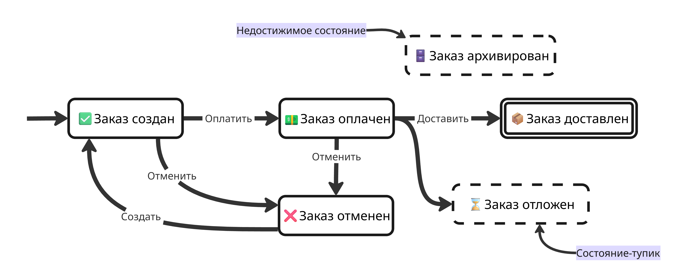

## Лекция 6. Тестирование переходов состояний

Если система имеет несколько состояний, между которыми она может переходить, то она требует отдельного подхода

Одно и то же событие может приводить к разным результатам в зависимости от исходного состояния объекта и другого контекста. Например, нажатие на кнопку "Отмена" в состоянии "Отправлено" в системе отправки опросов может давать мгновенный переход, а в состоянии "Принято" - запускать дополнительные проверки

Таблица решений без указания зависимостей недостаточна для такой системы, так как она показывает комбинации условий и действий, но не последовательность состояний

Поэтому важно понимать связи между состояниями, события, которые создают переходы, и условия переходов

---

Такую систему можно смоделировать с помощью конечного автомата. Детерминированный конечный автомат (Finite State Machine, FSM) $A = (S, E, T, s_0, F)$ - это структура, состоящая из:

* Множества состояний $S$
* Множества входных символов $E$ (в нашем случае это события, то есть действия пользователя)
* Функции $T \ : \ S \times E \to S$, которая задает правила переходов
* Начального состояния $s_0$
* И множества конечных состояний $F$

Автомат можно описать с помощью ориентированного графа или матрицы состояний и переходов

Если появляется новое состояние, то его добавление в модель определяется его влиянием на логику переходов, событий или на изменение инварианта

Сам переход состоит из нескольких элементов:

* Исходное состояние перехода
* Событие (или триггер), которое вызвало переход, то есть действие пользователя или внешних систем
* Защитные условия (guard conditions)
* Целевое состояние перехода
* Эффект, который производит переход

Система помимо перехода в новое состояние может реагировать на событие по-разному, например, отказать, проигнорировать действие или вернуть ошибку, если переход по такому событию недопустим

---

В реальных системах автомат состояний может быть сложнее, например, из-за дополнительных условий или глобального состояния. Поэтому определение автомата расширяется до расширенного автомата (Extended Finite State Machine, EFSM) - в нем переход зависит не только от состояния и триггера, но и от дополнительных данных, например флагов. Например, событие "Отменить" в состоянии "Оплачен" допустимо, только если не установлен флаг "Передан в доставку". Важно помнить, что слишком подробная модель может привести к избыточной детализации и повышению числа комбинаций, а слишком грубая может пропустить важные проверки

Состояния при построении модели выделяются в местах, где меняется логика работы системы. Такие места называются критическими точками, и они разделяют состояния с разным поведением друг от друга. Также состояния могут иметь скрытый от пользователя контекст, из-за которого может меняться поведение, поэтому состояния описывают не только видимую пользователю часть системы

Полнота модели проверяется через матрицу состояний и событий, которая указывает следующее состояние по переходу из данного, например:

| Состояние \ Событие | Оплатить | Отменить | Доставить | Создать |
|-|-|-|-|-|
| ✅ **Заказ создан** | 💵 Заказ оплачен | ❌ Заказ отменен | _Не определено_ | _Не определено_ |
| 💵 Заказ оплачен | _Состояние не меняется_ | _Не определено_ | 📦 Заказ доставлен | _Отказ_ |
| 📦 Заказ доставлен | _Отказ_ | _Не определено_ | _Состояние не меняется_ | _Отказ_ |
| ❌ Заказ отменен | _Отказ_ | _Состояние не меняется_ | _Отказ_ | ✅ Заказ создан |

В такой матрице видно, какие переходы определены, а какие нет, поэтому легко выявляются возможные проблемы:

* Неопределенность поведения в требованиях (здесь это, например, переход по событию "Отменить" из состояния "Заказ оплачен")
* Забытые переходы
* Тупиковые состояния - такие неконечные, переходы из которых не ведут к конечному состоянию

Для сохранения детерминизма результат должен быть уникальным для заданной комбинации состояния, события и данных

Если есть несколько возможных переходов, удовлетворяющих условию, то возникает конфликт. Такие конфликты решаются через взаимоисключающие защитные условия или через приоритеты условий

Графическое представление модели в виде графа помогает выявить недостижимые узлы, состояния-тупики и циклы без выхода к финальному состоянию. Например, состояние без входящих стрелок указывает на то, что до него нельзя добраться из начального состояния

Также важно учитывать инварианты - свойства, которые не должны меняться после определенного события. Например, при оплате идентификатор платежа не должен меняться, поэтому в ходе проверки важно проверять, что он остается постоянным

---

Обычный конечный автомат плохо масштабируется из-за того, что при росте числа состояний и событий матрица переходов становится громоздкой, а одинаковые переходы приходится повторять для многих состояний. Для решения этой проблемы используют расширение модели:

* Вложенное состояние - такое состояние, внутри которого находится свой набор состояний. Внешнее состояние называют составным (суперсостоянием), а внутренние - подсостояниями

    Например, у заказа есть составное состояние "Активный", внутри которого находятся подсостояния "Ожидание оплаты", "Оплачен" и "Упаковка". Переход на составном состоянии срабатывает из любого подсостояния, поэтому такой переход нужно проверять из каждого подсостояния

* Некоторые части системы изменяются независимо друг от друга. Тогда вместо одного большого автомата строят несколько, которые работают одновременно - параллельные автоматы. Тогда состояние всей системы - это набор текущих состояний каждого автомата

    Например, жизненный цикл заказа можно разделить на два автомата:

    * Оплата: "Не оплачен", "Оплачен", "Возвращён"
    * Обработка: "Не собран", "Собран", "Отправлен"

    Такие два автомата имеют меньше состояний, чем один большой, поэтому их проще тестировать отдельно друг от друга

    Риск детализации состоит в том, что при попытке охватить все независимо изменяющиеся атрибуты возникает увеличение числа комбинаций. Поэтому модель должна отвечать на конкретные вопросы тестирования, а не описывать систему целиком

Преобразование модели в тесты делается так:

* Предусловия, то есть начальное состояние и данные
* Действия, то есть события
* Ожидаемый результат, то есть смена на нужное состояние, эффекты перехода и несменяемость инварианта

Например, для модели выше можем получить тест-кейс с предусловием "Начальное состояние - 'Заказ создан'", действием - "Совершить событие 'Оплатить'" и ожидаемым результатом "Новое состояние - 'Заказ оплачен'"

Негативные сценарии берутся из матрицы переходов, где есть запрещенные комбинации состояний и переходов, и из граничных случаев. В негативных тестах важно проверять не только код ошибки, но и отсутствие побочных эффектов: изменения в базе данных, лишних запросов и других нежелательных действий

Покрытие тестов можно проверять по критериям:

* Проверка всех состояний (но такой тест может не проверить все переходы)
* Проверка каждого перехода (0-switch)
* Проверка каждой пары связных переходов (1-switch)
* В общем случае проверка каждой цепочки из $N + 1$ переходов ($N$-switch)

Чем больше $N$, тем строже критерий покрытия и больше тестов. Число $N$ выбирается исходя из рисков

---

В итоге, этапы работы выглядят так:

1. Сбор информации из требований или других источников
2. Построение модели
3. Анализ модели (поиск тупиков и избыточности)
4. Обновление модели
5. Генерация тест-кейсов
6. Оценка покрытия
7. Выполнение тестов
