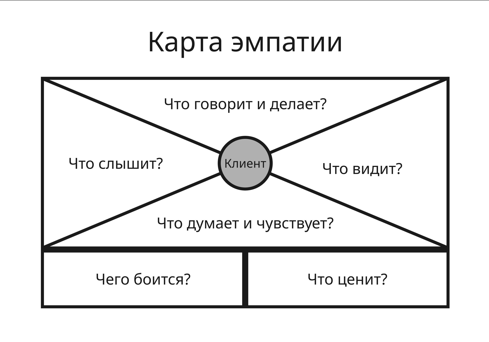
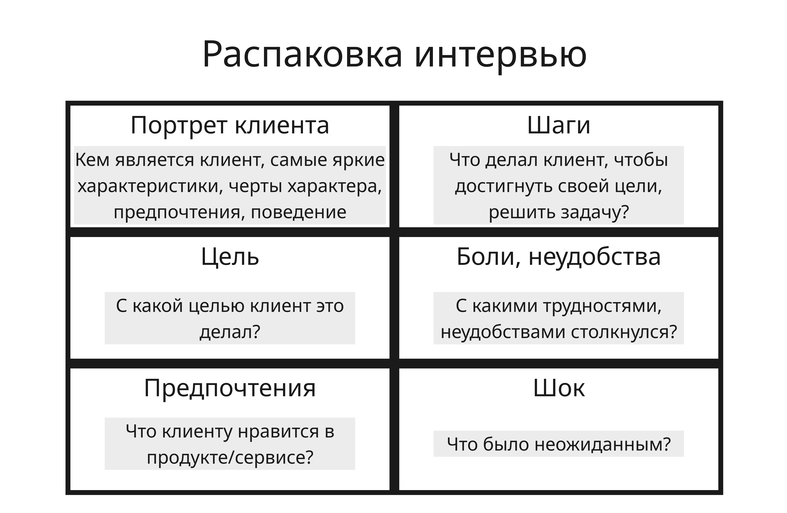

## Лекция 4. Дизайн-мышление

Дизайн-мышление (Design Thinking) - подход к разработке нового продукта или к улучшению существующего

В дизайн-мышлении конечный пользователь должен быть в центре всех решений

Дизайн-мышление состоит из 5 шагов:

1. Эмпатия

    На этом этапе собирается глубокое понимание потребителя-клиента

    Для этого наблюдают за действиями клиентов и формируют исследовательскую гипотезу. Гипотеза может строиться на основе проблемы, ценности, сегмента, монетизации, ценообразования или масштабирования

    При этом важно определить целевую аудиторию. Выбор целевой аудитории рассматривается с трех точек зрения: компаний, пользователей и науки/консалтинга. Например:
    
    * С точки зрения компаний можно анализировать внутренние отчеты и конкурентов
    * С точки зрения пользователей - существующие соцопросы или статистика
    * С точки зрения науки/консалтинга - статьи про поведение потребителей, поиск лучших технологий, прогноз потенциальных ограничений или новых перспектив

    Далее проводится глубинное интервью с потенциальными пользователями, которое проверит, верна ли поставленная ранее исследовательская гипотеза. Респондент должен быть заинтересован, вопросы должны быть открытыми и ориентированы на личный опыт респондента (но не должны быть слишком личными). Цель подобного интервью - это понять мотивацию и причины поведения людей, поэтому важно при этом спрашивать, не "чего хотят пользователи", а "какую задачу пользователь хочет решить" (подход Jobs To Be Done)

    Далее составляют карту эмпатии:

    

    Или "распаковку интервью":

    

    Или карту пути клиента (Customer Journey Map, CJM). Дополнительно можно составить карту экстремального пользователя - такого, который пользуется продуктом нестандартно, либо очень интенсивно, либо вообще не пользуются (например, пожилые люди или путешественники)

    На их основе составляется ценностное предложение и уникальное торговое предложение - ключевое конкурентное преимущество товара или услуги, четко формулирующее выгоду для покупателя, которую не предлагают конкуренты

2. Определение проблемы

    Далее на основе интервью и его результатов четко определяют формулировку существующей проблемы клиента

    Проблема строится так:

    * В чем именно возникает проблема?
    * У кого возникает проблема?
    * Где возникает проблема?
    * Почему решение этой проблемы важно?

    Например, по такому шаблону: когда _персона_ в ситуации делает _определенный шаг из карты пути клиента_, потому что хочет _решить задачу или реализовать потребность_, сталкивается с _проблемой, барьером или ограничением_ и не может получить _результат_

    При таком подходе формулировка "_Люди не бронируют жилье на нашем сайте_" плохая, а формулировка "_Путешественники не доверяют объявлениям, потому что фотографии жилья плохого качества и не передают реальную атмосферу_" хорошая

3. Генерация идей

    После этого начинается этап генерации идей, которые помогут решить проблему клиента (например, с помощью мозгового штурма). Для этого создаются продуктовые гипотезы

    Проверять формулировку продуктовой гипотезы можно по методу SMART:

    * Является ли гипотеза конкретной (Specific)?
    * Является ли гипотеза измеримой (Measurable)?
    * Является ли гипотеза достижимой (Achievable)?
    * Является ли гипотеза значимой (Relevant)?
    * Является ли гипотеза ограниченной во времени (Time-bound)?

    Например, "Если на сайте появится иконка чат-бота, то конверсия покупателей с сайта повысится на 20% за неделю"

4. Прототипирование

    Прототип создается, чтобы проверить работоспособность решения проблемы. Цель прототипирования - не сделать идеальное решение, а сделать минимально возможное решение, которое покажет, что оно работает

    Для этого можно использовать цикл HADI:

    * Гипотеза (Hypotheses)

        Формулируем гипотезу в формате "Если сделать X для Y, то метрика Z изменится на N"

    * Действие (Action)

        Записываем способ, которым будем проверять свою гипотезу и/или действия, которые нужно предпринять, чтобы проверить гипотезу

    * Данные (Data)

        Определяем желаемую метрику или показатель успешности гипотезы. Собираем измерения показателей после проведения эксперимента

    * Выводы (Insights)

        Анализируем полученные данные, проверяем гипотезу и принимаем решение

    Примером прототипирования может послужить Dropbox. Основатель Дрю Хьюстон хотел проверить, нужен ли людям облачный файлообменник, но не хотел тратить месяцы на разработку. Для этого он записал 3 минуты того, как работает будущий сервис без работающей реализации. В итоге видео обрело популярность и список ожидания вырос

5. Тестирование

    На этапе тестирования проверяется прототип, и собирается обратную связь пользователей

    Различают 2 подхода:
    
    * Наблюдательное тестирование - исследователь наблюдает за тем, как реальный пользователь взаимодействует с продуктом, и фиксирует свои наблюдения, не вмешиваясь в процесс
    * Итеративное тестирование - продукт проходит повторяющиеся циклы тестирования и доработки на протяжении всего процесса разработки

---

Одной из моделей проверки идеи является бережливый стартап (Lean Startup), который заключается:

1. В создании минимально жизнеспособного продукта (Minimum Viable Product, MVP)
2. В измерении результата (например, с помощью интервью, пробных продаж и так далее)
3. В анализе результата и внесении улучшений
4. В повторе пунктов 1-3

Продвижение подобного продукта осуществляется через каналы продвижения - инструменты и платформы, через которые компания привлекает внимание аудитории, формирует интерес, стимулирует действие и удерживает клиента. В 2026 году значимыми остаются поисковая оптимизация, контекстная реклама, соцсети, партнерства и контент-маркетинг

Эффективность продвижения можно узнать с помощью модели AARRR:

* Привлечение (Acquisition) - откуда приходят пользователи?

    Метрики - число новых пользователей, цена получения пользователя (Customer acquisition cost, CAC)

* Активация (Activation) - получили ли пользователи первую ценность?

    Метрики - доля достигших 1-ого целевого действия, конверсия

* Удержание (Retention) - возвращаются ли к продукту?

    Метрики - число ежедневных пользователей (Daily Active Users, DAU), еженедельных (Weekly Active Users, WAU), ежемесячных (Monthly Active Users, MAU)

* Рекомендации (Referral) - приводят ли пользователей других?
    
    Метрика - индекс потребительской лояльности (Net Promoter Score, NPS), число приглашенных пользователей

* Выручка (Revenue) - приносит ли продукт доход?

    Метрики - средний доход с пользователя (Average Revenue Per User, ARPU), пожизненная ценность клиента (Lifetime Value, LTV)

Каналы продвижения делятся на:

* Платные каналы: контекстная реклама, таргетированная реклама, медийные размещения и другие инструменты, где компания напрямую покупает внимание аудитории
* Собственные каналы: сайт, блог, рассылки по почте, сообщество и другие активы, которые бренд контролирует сам
* Заработанные каналы: отзывы, рекомендации, репутационные упоминания, PR-эффекты

Канал выбирается по типу продукта, характеристике потребителей, длине цикла сделки, среднему чеку и степени сформированности спроса
