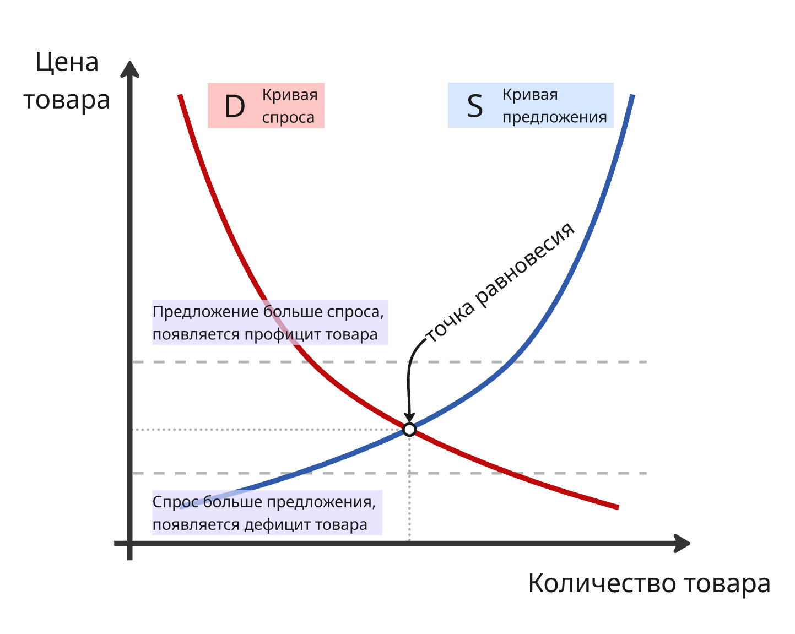
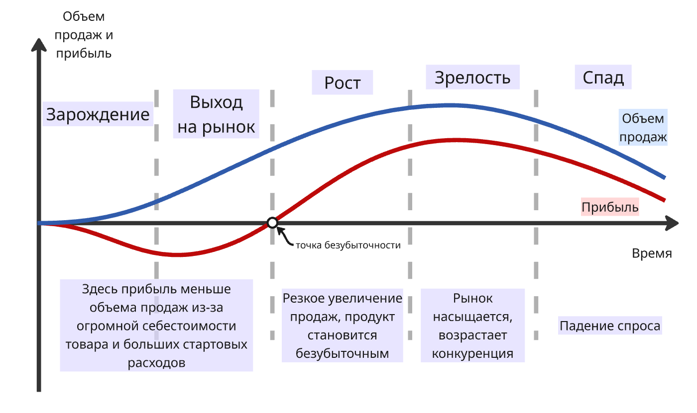
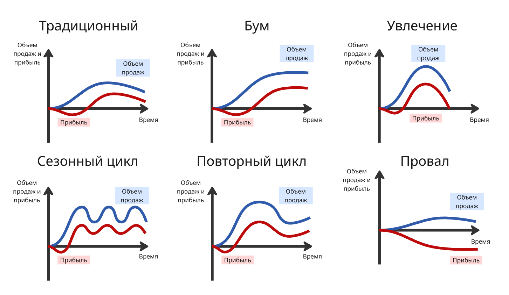
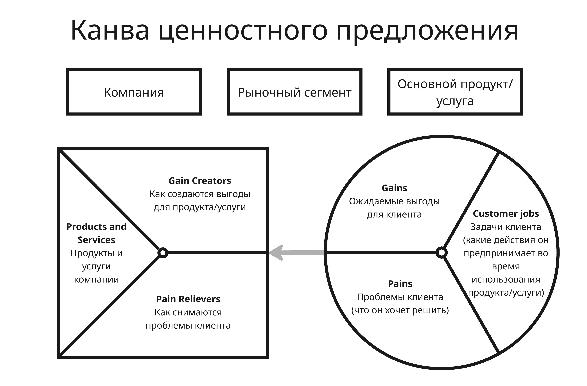
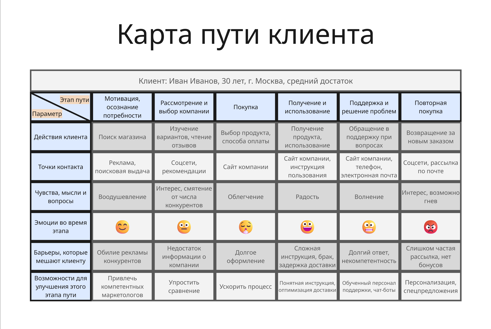
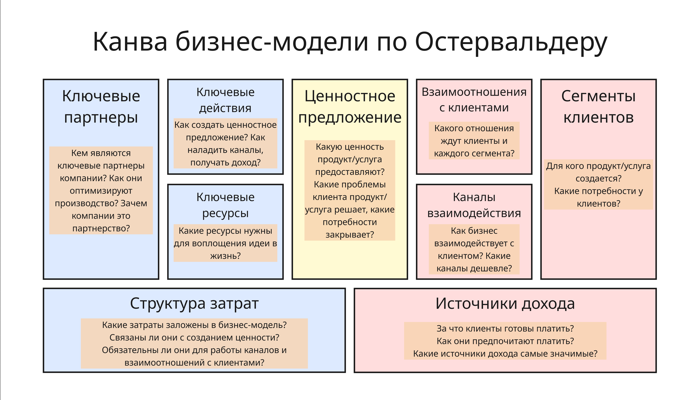

<!-- This file is generated by assets.build.markdown.superconspect_builder. All changes to it will be lost -->

#  Введение в технологическое предпринимательство

* [Введение в технологическое предпринимательство](#%D0%B2%D0%B2%D0%B5%D0%B4%D0%B5%D0%BD%D0%B8%D0%B5-%D0%B2-%D1%82%D0%B5%D1%85%D0%BD%D0%BE%D0%BB%D0%BE%D0%B3%D0%B8%D1%87%D0%B5%D1%81%D0%BA%D0%BE%D0%B5-%D0%BF%D1%80%D0%B5%D0%B4%D0%BF%D1%80%D0%B8%D0%BD%D0%B8%D0%BC%D0%B0%D1%82%D0%B5%D0%BB%D1%8C%D1%81%D1%82%D0%B2%D0%BE)
  * [Лекция 1. Основы рыночной экономики](#%D0%BB%D0%B5%D0%BA%D1%86%D0%B8%D1%8F-1.-%D0%BE%D1%81%D0%BD%D0%BE%D0%B2%D1%8B-%D1%80%D1%8B%D0%BD%D0%BE%D1%87%D0%BD%D0%BE%D0%B9-%D1%8D%D0%BA%D0%BE%D0%BD%D0%BE%D0%BC%D0%B8%D0%BA%D0%B8)
  * [Лекция 2. Рыночная среда и вывод продукта на рынок](#%D0%BB%D0%B5%D0%BA%D1%86%D0%B8%D1%8F-2.-%D1%80%D1%8B%D0%BD%D0%BE%D1%87%D0%BD%D0%B0%D1%8F-%D1%81%D1%80%D0%B5%D0%B4%D0%B0-%D0%B8-%D0%B2%D1%8B%D0%B2%D0%BE%D0%B4-%D0%BF%D1%80%D0%BE%D0%B4%D1%83%D0%BA%D1%82%D0%B0-%D0%BD%D0%B0-%D1%80%D1%8B%D0%BD%D0%BE%D0%BA)
  * [Лекция 3. Трансформация подходов к управлению и выбор рынка](#%D0%BB%D0%B5%D0%BA%D1%86%D0%B8%D1%8F-3.-%D1%82%D1%80%D0%B0%D0%BD%D1%81%D1%84%D0%BE%D1%80%D0%BC%D0%B0%D1%86%D0%B8%D1%8F-%D0%BF%D0%BE%D0%B4%D1%85%D0%BE%D0%B4%D0%BE%D0%B2-%D0%BA-%D1%83%D0%BF%D1%80%D0%B0%D0%B2%D0%BB%D0%B5%D0%BD%D0%B8%D1%8E-%D0%B8-%D0%B2%D1%8B%D0%B1%D0%BE%D1%80-%D1%80%D1%8B%D0%BD%D0%BA%D0%B0)

<!-- begin techentrep_2026_09_05.md -->
##  Лекция 1. Основы рыночной экономики

**Экономика** - это:

1. хозяйственная система, обеспечивающая производство, распределение, обмен и потребление благ в условиях ограниченных ресурсов
2. наука, изучающая, как люди, фирмы и государство принимают решения по использованию ограниченных ресурсов

**Экономическая система** - это способ организации хозяйственной жизни общества, представляющий собой установленную и действующую совокупность принципов, правил, законов, определяющих форму и содержание основных экономических отношений, которые возникают в процессе производства, обмена и потребления экономического продукта

Всего выделяют 4 типа экономических систем:

* **Традиционная экономика** - способ организации экономической жизни, базирующийся на отсталой технологии, широком распространении ручного труда и общинной собственности

    Примеры стран с традиционной экономикой: Бурунди, Афганистан, Бангладеш, Непал, а также некоторые общины и племена в Африке (например, масаи), Азии (некоторые регионы Индии), Южной Америки и племена коренных народов Северной Америки (инуиты)

* **Командная** (она же плановая, командно-административная или директивная) **экономика** - способ организации экономической жизни, при котором капитал и земля, практически все экономические ресурсы находятся в государственной собственности. Примеры:

    * Северная Корея - единственная страна, где сохранилась почти чистая командная экономика с полным государственным контролем над всеми процессами, что приводит к дефициту товаров

    * Индия, Китай, Вьетнам - используют пятилетние планы для индикативного планирования, где государство устанавливает целевые показатели, а не жестко регламентирует все решения. Из-за этого считают, что в этих странах экономика переходит от командной к смешанной

    * Куба - страна предприняла реформы, но элементы централизованного планирования все еще используются

* **Рыночная экономика** - способ организации экономической жизни, при котором капитал и земля находятся в частной собственности отдельных лиц

    Примеры: США, Швейцария, Великобритания и другие промышленно развитые страны, такие как Канада, Австралия

* **Смешанная экономика** - экономическая система, где и государство, и частный сектор играют важную роль в производстве, распределении, обмене и потреблении всех ресурсов и материальных благ в стране

    Примеры: Россия, Германия, Франция, Япония и страны Северной Европы (Швеция, Норвегия, Дания)

    Особое место занимают особые экономические зоны (например, наукограды Дубна, Иннополис и туристическая зона "Эльбрус") которые представляют собой территории с особым юридическим и экономическим статусом, где государство создает льготные условия для предпринимательства, сочетая рыночные механизмы с государственной поддержкой

Рынок - это система взаимодействия, обеспечивающая обмен экономическими благами и услугами покупателей и продавцов

Функции рынка: регулирование общественного производства, определение затрат общества, связь производителей и потребителей, установление цен, дифференциация производителей

Субъектами рынка являются физические лица, домашнее хозяйство (то есть семья), фирма, государство. Объектами рынка являются товары и услуги, факторы производства, деньги, ценные бумаги и так далее

Инфраструктура рынка - это совокупность учреждений, государственных и коммерческих фирм, обеспечивающих функционирование рыночных отношений

---

Рассмотрим рыночную экономику. В рамках рыночной экономики более всего присуще два явления:

* Экономические циклы - периодически повторяющиеся колебания уровня экономической активности, при которых периоды роста сменяются периодами спада. Такие колебания определяются изменениями таких показателей, как реальный ВВП, уровень занятости, объемы производства и уровень инфляции

    Цикл делят на 4 фазы:

    1. Подъем (или экспансия, рост) - появляется рост производства, снижается уровень безработицы, растут доходы населения и потребительский спрос, что постепенно начинает подталкивать цены (то есть инфляцию) вверх
    2. Пик (высшая точка) - экономика работает на пределе своих производственных возможностей, безработица находится на минимальном уровне, а инфляция может достигать пиковых значений. В этот период центральные банки часто начинают повышать процентные ставки
    3. Спад (или рецессия, кризис) - начинается сокращение объемов производства и деловой активности, падает спрос на товары и услуги, снижаются инвестиции, компании сокращают штаты, из-за чего растет безработица
    4. Дно (низшая точка) - производство и занятость достигают своего минимального уровня, цены стабилизируются, а процентные ставки снижаются

    В экономике выделяют несколько типов циклов в зависимости от их причины возникновения:

    * Циклы Китчина (2–4 года) связаны с колебаниями мировых запасов золота и коммерческих запасов предприятий
    * Циклы Жюгляра (7–11 лет) вызваны периодичностью обновления основного капитала (оборудования и производственных мощностей)
    * Циклы Кузнеца (15–25 лет) обусловлены демографическими изменениями и обновлением инфраструктуры
    * Циклы Кондратьева (45–60 лет), вызванные радикальными изменениями в технологическом укладе (например, появление парового двигателя, электричества, компьютеров)

* А также закон спроса и предложения

Закон спроса и предложения - это принцип, определяющий формирование цен и объем товаров на рынке через взаимодействие покупателей и продавцов

Спрос - это количество товаров и услуг, которое покупатели готовы приобретать по определенной цене (в данном месте, в данное время и при прочих равных условиях)

Неценовые факторы, влияющие на спрос:

* Уровень доходов в обществе
* Размеры рынка (то есть число покупателей)
* Мода, сезонность
* Наличие товаров-заменителей
* Инфляционные ожидания

Предложение - это количество данного товара, которое продавцы готовы продать по данной цене (в данном месте, в данное время при прочих равных условиях)

Неценовые факторы, влияющие на предложение:

* Наличие товаров-заменителей
* Наличие товаров-комплементов (дополняющих)
* Уровень технологий
* Объём и доступность ресурсов
* Налоги и дотации
* и другие

Если спрос превышает предложение (то есть люди хотят купить больше товара, чем его существует, именно по этой цене), то цена начинает расти

Если предложение превышает спрос (меньше людей хотят покупать товар по этой цене), то продавцы начинают снижать цену, чтобы привлечь больше покупателей

Рыночное равновесие достигается, когда величина спроса равна величине предложения

Спрос и предложение обозначают в виде кривых на координатной плоскости цена-количество

При этом есть два эффекта, которые являются исключениями закон спроса:

* Эффект Веблена - спрос растет по мере увеличения цены на предметы роскоши, которые покупаются, чтобы подчеркнуть высокий социальный статус
* Эффект Гиффена - спрос растет по мере увеличения цены на малоценные товары, у которых нет заменителей, так как их потребление повышается за счет экономии на других товарах

Эластичность спроса - показатель того, как сильно меняется объем покупок товара, когда меняются цены, доходы людей или стоимость других продуктов. Спрос считается неэластичным, если покупатели слабо реагируют на изменение цены

---

Для изучения прогнозирования спроса есть несколько методов:

* Количественные методы:
    * Анализ временных рядов - изучение динамики спроса с помощью скользящих средних, экспоненциального сглаживания
    * Регрессионный анализ - изучение статистической зависимости между спросом и независимыми переменными (такими как цена, реклама и так далее)

* Качественные методы:
    * Метод Дельфи - структурированный сбор и агрегация анонимных мнений независимых экспертов
    * Опросы потребителей - прямое взаимодействие с целевой аудиторией (анкетирование, интервью, фокус-группы) для выяснения намерений, предпочтений и ожиданий
    * Метод экспертных оценок - привлечение специалистов с глубокими знаниями рынка и продукта для формирования прогнозов на основе опыта и интуиции

Ценовая дискриминация - это рыночная стратегия, когда один и тот же продавец продает одинаковые товары или услуги разным покупателям по разным ценам, причем эта разница не обоснована затратами на производство

Разделяют на 3 степени:

* Первая степень (совершенная) - продажа каждой единицы товара по максимальной цене, которую готов заплатить конкретный покупатель
* Вторая степень - цена меняется в зависимости от объема покупки или условий тарифа (например, оптовые скидки)
* Третья степень - деление рынка на группы по доходам, возрасту или статусу (например, скидки для студентов и пенсионеров)

Также для того, чтобы оценить ресурсы и способности компании, чтобы определить источник устойчивого конкурентного преимущества, применяют VRIO-анализ:

* Value (Ценность) - помогает ли ресурс использовать рыночные возможности или защищаться от угроз? Если ресурс не приносит пользы, он не имеет стратегической ценности
* Rarity (Редкость) - является ли этот ресурс уникальным или он есть у большинства конкурентов? Редкие ресурсы дают временное преимущество
* Inimitability (Неподражаемость / Воспроизводимость) - насколько тяжело и дорого конкурентам скопировать или воспроизвести данный ресурс (например, технологии, патенты)
* Organization (Организованность) - настроены ли внутренние процессы, управление и структура компании так, чтобы эффективно использовать этот ресурс и извлекать из него выгоду

При анализе также изучают факторы среды, которые делятся на три типа:

* Факторы внутренней среды: культура организации, маркетинг, кадры, имидж, технологии, менеджмент и другое
* Факторы внешней среды:
    * Факторы микросреды: посредники, конкуренты, партнеры, инвесторы, поставщики, клиенты, СМИ и другое
    * Факторы макросреды (на них, как правило, влияние со стороны компании мало): экономико-правовая среда, социально-демографическая среда, научно-техническая среда, политическая среда, культурно-образовательная среда, среда государственного регулирования, природно-экологическая среда, маркетинговая информационная среда
<!-- end techentrep_2026_09_05.md -->

<!-- begin techentrep_2026_09_19.md -->
##  Лекция 2. Рыночная среда и вывод продукта на рынок

Рынки делятся на типы:

* По географическому положению:
    * Местный - рынок в пределах одного населенного пункта или района
    * Региональный - рынок,  охватывающий часть страны
    * Национальный - рынок в пределах одной страны
    * Мировой - рынок, связывающий страны

* По объектам рыночных отношений:
    * Рынок товаров и услуг - где торгуют потребительскими и промышленными товарами
    * Финансовый рынок - включает рынки ценных бумаг, валюты, кредитов и другие
    * Рынок труда - где происходит найм и поиск сотрудников
    * Рынок информации - где торгуют данными и интеллектуальными продуктами (например, консалтинг)

* По характеру организации:
    * Оптовый рынок - крупные сделки, продажа партий товара
    * Розничный рынок - продажа товаров конечным потребителям
    * Биржевой рынок - торгуют стандартизированными товарами, ценными бумагами, валютой на бирже

У любого продукта в классической модели есть этапы жизненного цикла на рынке, которые состоят из 5 фаз:

* Зарождение нового продукта, например, при создании новой технологии и полного цикла производства
* Выход на рынок
* Рост числа новых применений и участников рынка
* Зрелость - рост ценовой конкуренции
* Спад - сокращение прибыли

После спада товар либо трансформируется в нечто другое, либо закрывается разработку

Обычно такая модель не идеально описывает цикл товара: после роста может образоваться плато объема продаж, а прибыль может упасть из-за разработки нового дорогого станка

Для наукоемких продуктов также выделяют дорыночный этап - когда продукт продают ограниченному числу покупателей, чтобы оценить прибыль и расходы

Жизненный цикл у каждого товара может быть разным, обычно выделяют 6 типов:

1. Традиционный (классический) - динамика большинства стандартных товаров на рынке
2. Бум (продолжительное увлечение) - характерен для популярных товаров, которые быстро завоевали рынок и стали частью повседневной жизни
3. Увлечение - спрос обусловлен временным трендом или вирусным эффектом, но после продукт быстро надоедает потребителям (например, спиннеры)
4. Повторный цикл (или ностальгия) - всплеск вызывают за счет модернизации продукта или моды на ретро (например, виниловые пластинки или ретро-консоли)
5. Сезонный цикл - спрос жестко привязан к времени года, погоде или праздникам (например, солнцезащитные кремы или новогодние елки)
6. Провал - товар оказывается неактуальным, слишком сложным, дорогим или не находит свою целевую аудиторию

---

Конкуренция - это борьба между товаропроизводителями за более выгодные условия хозяйствования, за получение максимальной прибыли

Конкуренция бывает нескольких типов:

* Совершенная конкуренция, например, рынок сельскохозяйственной продукции, где фермеры продают одинаковую пшеницу, кукурузу или молоко по схожим ценам
* Олигополия - несколько крупных игроков и много покупателей, например, рынок финансовых расчетов, где есть Visa, MasterCard и UnionPay
* Монополистическая конкуренция - конкуренция большего числа компаний за доминирование у разных целевых аудиторий, например, рынок автомобилей
* Монополия - один продавец и много покупателей, например, РЖД на рынке железнодорожных перевозок

Конкурентный анализ помогает разработать новые продукты и услуги, более эффективно проводить маркетинговые кампании и определить тенденции рынка

Выделяют типы конкурентов:

* Прямые конкуренты, производящие аналогичную продукцию или предоставляющие аналогичные услуги
* Косвенные конкуренты:
    * Производящие продукты-заменители
    * Вытеснители (например, музыкальная школа конкурирует с курсами английского за кошелек родителей и время ребенка)
    * Канальные конкуренты, которые вытесняют компании из каналов связей к клиентам

Поиск конкурентов можно осуществлять через опрос клиентов или поисковые системы. Информацию о конкурентах можно находить с помощью их сайтов, маркетплейсов и каталогов, профессиональных сообществ и патентных баз

Одним из классических анализов является метод пяти сил Портера:

* Угроза появления новых игроков - "Насколько легко войти на рынок?"
* Рыночная власть поставщиков - "Могут ли поставщики диктовать цены?"
* Рыночная власть покупателей - "Могут ли клиенты легко уйти к другому? Могут ли они диктовать цены и условия?"
* Угроза товаров-заменителей - "Есть ли альтернативные способы решения проблемы?"
* Интенсивность конкуренции - "Насколько жесткая борьба между  существующими игроками?"

Затем создается таблица сравнения компании и конкурентов исходя из ответов на эти вопросы

---

Одной из методик для оптимизации моделей разработки продуктов является методология Jobs to Be Done (JTBD). Зачастую, клиенты не просто покупают продукт, а "нанимают" его для выполнения определенной "работы". Для развития задача компании состоит в том, чтобы выяснить, какую конкретную задачу клиенты хотят решить с помощью их продукта

Знаменитый пример применения JTBD - это молочные коктейли в McDonald's

Менеджмент McDonald's хотел увеличить продажи милкшейков, поэтому маркетологи опросили целевую аудиторию, изучили демографию (кто пьет коктейли) и свойства продукта (густота, сладость, шоколадный или ванильный вкус, цена). По итогам опросов фокус-групп рецепты были улучшены, но продажи не увеличивались

Позднее команда исследователей провела в ресторане целый день, фиксируя каждую покупку милкшейка. Получилось, что милкшейки покупали в разное время суток:

1. Утром, в основном водители перед работой, чтобы занять время в поездке, заглушить голод и не испачкаться в машине. Конкурентами в таком случае являются не другие коктейли, а банан, пончик, шоколадный батончик и другие закуски. Милкшейк выбирается, потому что он калорийный, всасывается через узкую трубочку долго и помещается в подстаканнике
2. После обеда, когда родитель идет с ребенком из школы или магазина. В этом случае "работа" - это угостить ребенка приятным десертом. Однако ребенку тяжело тянуть слишком густую массу через трубочку

В итоге изменили стратегию: коктейль сделали еще более густым, добавили мелкие кусочки фруктов и сделали быстрее выдачу для автовладельцев, а для детей предложили более жидкую версию в уменьшенном объеме

---

Сегментация - разделение рынка на сегменты, то есть на группы покупателей, обладающих схожими характеристиками, с целью изучения их реакции на тот или иной товар/услугу и выбора целевых сегментов рынка

Разделяют:

* Макросегменты - верхнеуровневые группы пользователей, из них выделяют корпоративные рынки (B2B, Business-to-Business), потребительские рынки (B2C, Business-to-Consumer), рынки взаимоотношений между бизнесом и государством (B2G, Business-to-Government) и рынки взаимоотношений между потребителями (P2P, Peer-to-Peer или C2C, Consumer-to-Consumer)
* Географическую сегментацию: локальный или глобальный рынок, климат, плотность населения (которая влияет на методы продвижения и доставки) и уровень урбанизации
* Сегментацию клиентов:
    * Демографическая - по возрасту, полу, доходу, образованию, профессии, семейному положению и так далее
    * Психографическая - социальный класс, личностные черты, ценности, хобби и интересы
    * Поведенческая - частота покупок, лояльность к бренду, повод для покупки, что помогает анализировать стадии покупательского пути

---

Инновация - это внедренное новшество, которое существенно улучшает продукт, процесс или услугу и повышает эффективность или качество

Выделяют:

* Продуктовые инновации - внедрение новых или усовершенствованных продуктов
* Процессные инновации -  разработка и внедрение технологически новых или значительно усовершенствованных производственных процессов
* Организационные инновации - реализация нового метода в ведении бизнеса, организации рабочих мест или организации внешних связей
* Маркетинговые инновации - внедрение новых методов и стратегий управления, направленных на создание, позиционирование и продвижение на рынок принципиально новых товаров

Также инновации делятся на 4 типа:

* Инкрементальные инновации - небольшие изменения в технологиях на существующем рынке
* Радикальные инновации - новые технологии, создающие новый рынок
* Подрывные инновации - внедрение новых технологий на существующем рынке
* Архитектурные инновации - технология совсем не изменилась, но способ связи уже известных компонентов продукта изменился, из-за чего появилось новое применение

На основе целей фирмы формируются стратегии по привнесению инноваций. Так, например, если одна из целей компании - не отставать от лидеров рынка, то инновации будут в основном инкрементальные
<!-- end techentrep_2026_09_19.md -->

<!-- begin techentrep_2026_10_03.md -->
##  Лекция 3. Трансформация подходов к управлению и выбор рынка

В 1910-ых с появлением конвейера и массового производства:

* Упор на управление людьми превращается в управление производственной линией
* Ценностью товара становится доступная цена
* Основные затраты уходят на масштабирование

Процесс производства становится важнее мастерства отдельного исполнителя, из-за чего ниже трудоемкость и себестоимость единицы - получается доступный стандартный продукт для массового рынка

Ценностью с тех пор является то, что стандарт превращает способ работы в повторяемый результат, что достигается благодаря:

* Развитию инструментов и документации для принятия управленческих решений в зависимости от частоты ошибок, погрешностей и так далее
* Фиксации всех ключевых процессов (из-за чего легко сменить персонал)
* Постоянного контроля качества

В этот момент число стандартов кратно возросло

Позже в конце 1940-ых после Второй мировой войны японская компания Toyota адаптировала конвейер Форда на производстве автомобилей. В 1950-1960-ых инженеры Тайити Оно, Эйдзи Тоёда, Киитиро Тоёда и Сигэо Синго разработали производственную систему Тойоты (Toyota Production System), которая строилась, чтобы уменьшить:

* Потери (Muda, 無駄 на японском) - любая деятельность, которая потребляет ресурсы, но не добавляет ценности для конечного потребителя. В системе выделяют 8 видов таких потерь:

    * Потери из-за перепроизводства (объём нереализованной продукции, оборачиваемость готовой продукции, точность прогноза спроса, уровень загрузки складов)
    * Потери времени из-за ожидания (время простоя, время ожидания в очереди, время переналадки)
    * Потери из-за излишней обработки (количество лишних этапов обработки, не влияющих на качество или цену для клиента)
    * Потери из-за лишних движений при выполнении операций (время на поиск инструмента, количество шагов, пройденное расстояние, количество наклонов и подъёмов)
    * Потери из-за лишних запасов (оборачиваемость запасов, дни запаса, стоимость хранения, площадь складов)
    * Потери при транспортировке (расстояние перемещений, время в пути, стоимость логистики, количество погрузо-разгрузочных операций)
    * Потери из-за выпуска дефектной продукции (уровень брака, стоимость переделок, потери от возвратов)
    * Потери из-за неиспользованного потенциала персонала (вовлеченность, текучесть кадров, использование квалификации, автономность)

* Неравномерность (Mura, 斑 на японском) - непостоянство, колебания или несогласованность в процессе работы. Устранение неравномерности позволяет стабилизировать поток
* И перегрузку (Muri, 無理 на японском) - чрезмерное напряжение людей или оборудования, когда работа выполняется на пределе, что ведет к браку, поломкам и выгоранию

Позднее система Тойоты превратилась в концепцию бережливого производства (Lean production), которая строится на 5 принципах:

1. **Ценность** - эффективная доставка того результата, который был нужен клиенту. Нужно выпускать ту продукцию, которая будет пользоваться спросом у клиента
2. **Цепочка создания ценности** - визуализация процесса от начала до конца. Все сотрудники компании должны быть заинтересованы в оптимизации
производства и принимать активное участие в решении проблем
3. **Поток** - непрерывное и плавное движение процесса
4. **Вытягивание** - производство только той продукции, которую уже заказали. Все ресурсы следует использовать рационально и своевременно.
Необходимо постоянно работать над снижением потерь на всех этапах
производства
5. **Совершенство** - постоянное стремление к улучшениям процесса. Увеличивать затраты при производстве товара можно, только повышая его ценность для потребителя. Желательно непрерывно совершенствовать качество продукции

---

В наше время же получили распространение:

* Массовая кастомизация: доступны как стандартные модули, так и индивидуальные сборки
* Платформы и экосистемы, где ценность создаётся сетью партнёров
* Четвертая индустриальная революция (Industry 4.0): цифровые двойники, Интернет вещей (Internet of Things, IoT), предиктивная аналитика
* Бережливые стартапы (Lean Startup), которые начинаются с минимально жизнеспособного продукта (Minimum Viable Product, MVP), используют цикл "Создать-Измерить-Обучиться" (Build-Measure-Learn) и валидированное обучение.
* Гибкая методология разработки (Agile) и практики DevOps, которые вносят гибкость, короткие циклы, непрерывные улучшения в разработку
* Сервитизация и подписка: доход от предоставления доступа или сервиса, а не от передачи владения
* Циркулярная экономика: устойчивость, переработка, снижение отходов

Поэтому появилось понятие **бизнес-модели** - того, как организация, используя все свои механизмы, планирует зарабатывать деньги на своих идеях, технологиях и ресурсах, преобразуя знания в экономические ценности для рынка

До понятия бизнес-модели использовали матрицу Boston Consulting Group (BCG). В ней все направления деятельности компании разделяют на 4 группы:

| Темп роста рынка | Доля рынка, которую занимает направление | |
|-|-|-|
| | Низкая | Высокая |
| Высокий | "Проблемные дети" | "Звезды" |
| Низкий | "Собаки" | "Дойные коровы" |

* "Дойные коровы" - модель, которая не требует больших инвестиций и "кормит" компанию. Из-за этого высокий уровень продаж, но рынок стабильный или спадающий
* "Звезды" - модель, в которой высокий потенциал прибыли, такая компания активно растет и приносит деньги, но требует больших затрат
* "Проблемные дети" - модель в быстрорастущей отрасли, но которая требует больших инвестиций и приносит мало прибыли
* "Собаки" - модель, которая не требует больших затрат и приносит мало прибыли

План действий развития по такой модели получается таким:

1) развивать сильные стороны "проблемных детей", чтобы они скорее превратились в "звёзд"
2) инвестировать в "звёзд" до их трансформации в "дойных коров"
3) как можно дольше сохранять за "дойными коровами" лидирующие позиции, пока они не превратятся в "собак"
4) как можно быстрее избавляться от "собак"

---

Потом появился SWOT-анализ (от Strengths, Weaknesses, Opportunities, Threats):

| | Положительное влияние | Отрицательное влияние |
|-|-|-|
| Внутренняя среда | Сильные стороны (Strengths) | Слабые стороны (Weaknesses) |
| Внешняя среда | Возможности (Opportunities) | Угрозы (Threats) |

SWOT-анализ приводит к TOWS-матрице, которая формирует стратегию развития:

| | Возможности | Угрозы |
|-|-|-|
| Сильные стороны | SO - использовать сильные стороны для роста | ST - использовать сильные стороны против угроз |
| Слабые стороны | WO - преодолеть слабости через возможности | WT - минимизировать слабости и избегать угроз |

SWOT помогает оценить внутренние и внешние факторы для выбора стратегических направлений

---

Бизнес-модель по О. Гассману представляет собой сумму ответов на 4 вопроса:

1. Кто является целевой аудиторией?
2. Какие продукты/услуги будут ценностным предложением и каково его конкурентное преимущество?
3. Как можно сделать это эффективно?
4. Почему это прибыльно?

Целевой клиент бизнеса - это элемент бизнес-модели. Три инструмента помогают проанализировать клиента и спроектировать бизнес-модель:

* Канва ценностного предложения (Value Proposition Canvas, VPC) - что мы обещаем и чем отличаемся

    Ценностное предложение - это четкое описание того, какую проблему клиента мы решаем и какую выгоду он получает

    Например: клиент хочет быстро и недорого доехать до работы. Такси-сервис А предлагает дешевую поездку, но придется долго ждать. Такси-сервис Б предлагает чуть дороже, но машина приезжает за 3 минуты. Если для клиента скорость важнее цены, он выберет сервис Б

    Важно, что ценностное предложение должно быть проверяемым: "эта компания решает конкретную боль конкретного сегмента лучше, чем
    альтернативы"

    

* Карта пути клиента (Customer Journey Map, CJM) - как клиент проживает путь к нам и после покупки

    Карта пути клиента - визуализация пути клиента с момента поиска товара или услуги вплоть до совершения покупки и во время использования, а также поддержку, повторную покупку и так далее

    CJM показывает, где и как клиент сталкивается с ценностным предложением компании. Если на этапе сравнения он не видит преимуществ, то он уходит, а если на этапе использования возникает боль, то скорее всего он не вернётся

    

    Число этапов зависит от рассматриваемого продукта/услуги и бизнес-модели

* Бизнес-модель Остервальдера - как всё это связано в единую систему

    Бизнес-моделирование - это не разовая задача, а циклический и итеративный процесс, состоящий из этапов:

    1. Исследование рынка, клиентов, конкурентов, трендов
    2. Генерация гипотез о ценности, каналах, отношениях, доходах,
    ресурсах и так далее
    3. Визуализация, использование шаблонов
    4. Тестирование и валидация с помощью интервью, минимально жизнеспособных продуктов, экспериментов
    5. Анализ и корректировка на основе обратной связи и данных
    6. Внедрение и масштабирование
    7. Постоянная адаптация

    Канва бизнес-модели (Business Model Canvas, BMC) - одностраничная схема, разработанная А. Остервальдером и И. Пинье

    Один из самых распространённых инструментов стратегического управления для описания бизнес-модели новых и действующих предприятий

    Канва позволяет визуализировать все ключевые элементы бизнеса и их взаимосвязи, что делает её незаменимой для командной работы и стратегических сессий

    

---

Монетизация - это способ, которым бизнес захватывает созданную ценность и получает доход. Важно не путать бизнес-модель (как компания создаёт, доставляет и извлекает ценность) с моделью монетизации (за что, с кого, когда и как компания получает доход)

Модель монетизации получается как ответ на 5 вопросов:

* Кто платит?
* За что платит?
* Когда платит?
* Как определяется цена?
* Как модель масштабируется?

Основные модели монетизации:

* Продажа товара или услуги - клиент платит за конкретный продукт или разовую услугу
* Подписка - регулярный платёж (например, раз в месяц) за доступ к продукту или сервису (например, Netflix)
* Freemium - базовая версия бесплатна, а платная - расширенная (например, Spotify)
* Комиссия или маркетплейс - платформа берёт процент со сделки (например, Amazon, Wildberries)
* Реклама - доход от рекламодателей за доступ к аудитории (например, YouTube, Google Ads)
* Лизинг вместо владения - клиент платит за фактическое использование, не покупает продукт целиком (например, каршеринг или SaaS - Software as a Service, ПО как услуга)
* Открытая модель - компания делится данными для ускорения развития (например, Red Hat)
* Бритва и лезвие (Razor and Blades) - продавать дешёвый носитель и дорогие расходники (например, принтеры, бритвы, игровые консоли)
* Франшиза - партнёр платит за бренд и модель (например, McDonald's)
* Длинный хвост (Long Tail) - продажа множества разнообразных нишевых товаров вместо модных (или совместно)

Также модели делятся по типами:

* По плательщику:
    * В2С - платит конечный пользователь
    * В2В - платит компания
    * В2В2С - платит партнёр, пользуется клиент партнёра
    * B2G - платит государство
    * С2С - платят пользователи друг другу, платформа берёт комиссию
* По способу получения дохода:
    * Подписочная
    * Комиссионная
    * Рекламная
    * Лицензионная
* По частоте:
    * Разовая
    * Повторяющаяся
    * Смешанная

На выбор модели монетизации влияют: готовность клиента платить, ценность продукта, частота использования, маржинальность, масштабируемость, конкуренты, альтернативы и другие критерии
<!-- end techentrep_2026_10_03.md -->

